# ISV Simulator: the game

An Overcooked-style couch co-op game about shipping software. 2 to 4 players share one screen, each controlling a developer in a small office. Orders come in, players carry tickets through the stations (code, review, test, pipeline) and ship them before the customer gives up. A round lasts 3 minutes and ends with a score and 1 to 3 stars. Shouting at each other is part of the game.

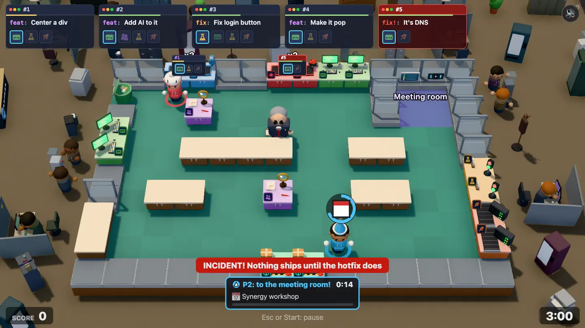

## In these docs

| Page                               | What's in it                                                                                                |
| ---------------------------------- | ----------------------------------------------------------------------------------------------------------- |
| [Stations](stations.md)            | Every tile you can walk up to: inbox, bug queue, keyboard, review, test bench, pipeline, ship, bin, counter |
| [Tickets and events](mechanics.md) | Features, reviews, bugs, hotfixes, the pipeline breaking, throwing, the manager, meetings, scoring          |
| [Levels](levels.md)                | All 16 levels in 5 chapters: layout, map, what's new, star targets                                          |
| This page                          | How a round works, controls, and every screen from title to results                                         |

## How a round works

1. **Orders** appear along the top. Each order card shows its kind and the stations its ticket must visit, in order, as tiles with each station's icon in its color, ticking off as the ticket gets worked. The line under its title bar is the time left; it flashes in the last 10 seconds.
2. A **ticket** for every order waits in a queue: features in the blue **inbox**, bugs and hotfixes in the red **bug queue**. Pick one up.
3. Carry it to each **station** in order and work it there. Keyboards and test benches need someone holding work; the pipeline builds by itself; a review needs two players at once.
4. When every step is done, put it on a **ship** hatch. Points pop up next to the score.
5. When the clock hits 0:00 the round ends. Your score decides the stars.

On top of that each chapter adds a new kind of trouble: production incidents, a manager who walks into people, and calendar invites. See [Tickets and events](mechanics.md).

## Controls

Two players can share a keyboard; up to four can play with gamepads. Directions are screen-relative: up is up on screen.

| Action                    | Left keyboard | Right keyboard     | Gamepad |
| ------------------------- | ------------- | ------------------ | ------- |
| Move                      | WASD          | Arrow keys         | Stick   |
| Pick up / put down / ship | E             | Right Shift        | A       |
| Throw (hold pick-up)      | Hold E        | Hold Right Shift   | Hold A  |
| Work (hold)               | Q             | /                  | X       |
| Dash                      | Left Shift    | Right Alt (Option) | B       |
| Pause                     | Esc           | Esc                | Start   |

Anywhere: **M** or the speaker button in the top right turns all sound off and on.

## Screens

### Title

The title screen says **OverEngineered** (the game's new name; only the title screen uses it so far) over the world map, which drifts slowly behind it with every chapter in view: the garage on the left, the city on the right, the journey ahead. It waits for any button. After that it shows the main menu: Play (couch play on this machine), Host online, Join online, Settings and Credits. The menus look like a code editor in dark mode: the logo reads `<OverEngineered/>` with a blinking cursor, every menu is a window with a file name in its title bar (`main.ts`, `settings.json`) and numbered lines, screen names are tags like `<Settings/>`, the selected line gets a `>` prompt, and the button hint runs along the bottom like an editor's status bar; going on to the lobby, the camera swoops down and the clouds roll back in over the chapters you haven't opened yet.

|                                            |                                               |
| ------------------------------------------ | --------------------------------------------- |
| 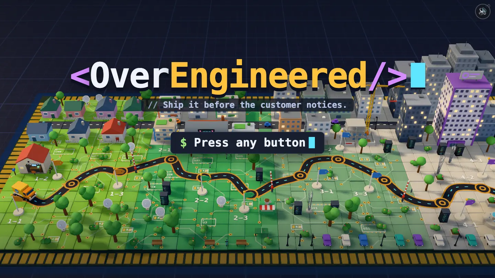 | 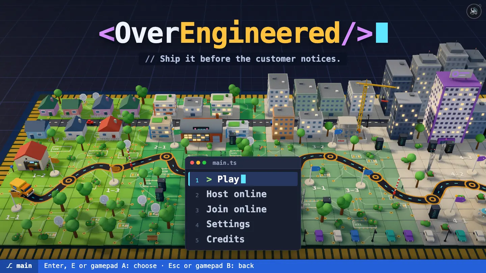 |

Settings has sound volume, music volume, screen shake, graphics and the online profile. Graphics is Auto by default: the game starts on High and steps down to Medium or Low by itself when frames stay slow; High, Medium or Low fixes it. `?quality=low` (or `medium`, `high`) on the URL overrides it. Credits lists the asset packs.

|                                           |                                         |
| ----------------------------------------- | --------------------------------------- |
| 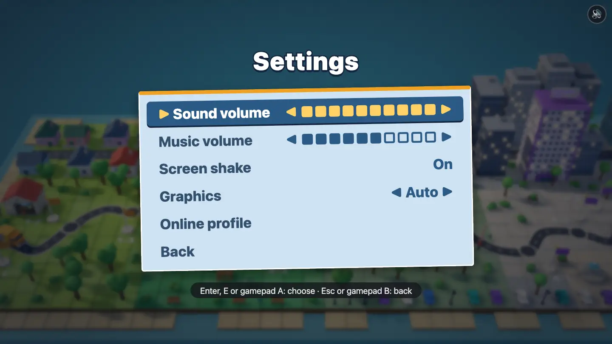 | 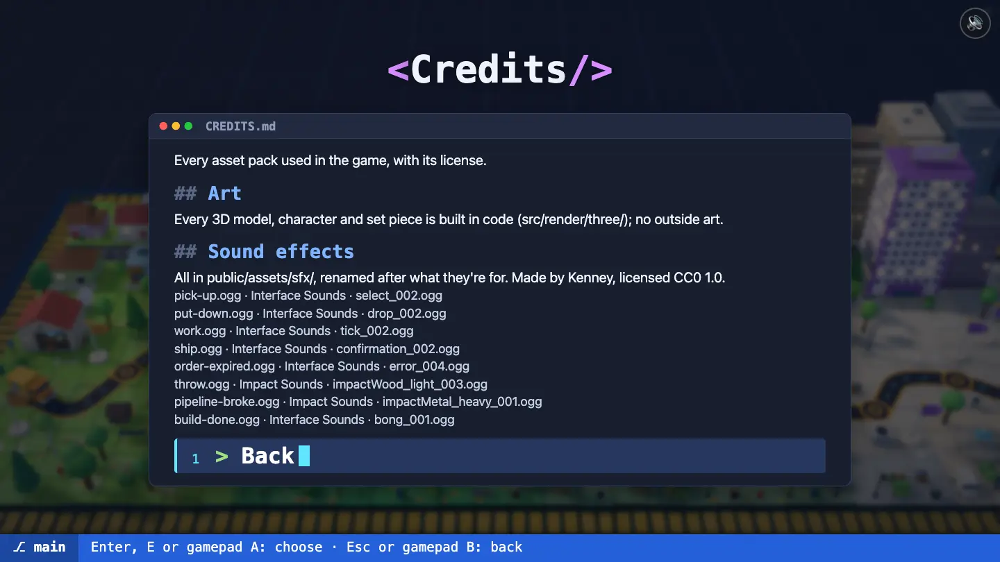 |

Settings → Online profile shows this browser's user ID and display name. Copy ID puts the ID on the clipboard; Use another ID takes an ID pasted from another browser (and asks again before switching), so your progress comes along. When the game server is running, progress is synced with your online profile at start-up; without it everything stays on this device. Typing a name or an ID needs a keyboard.

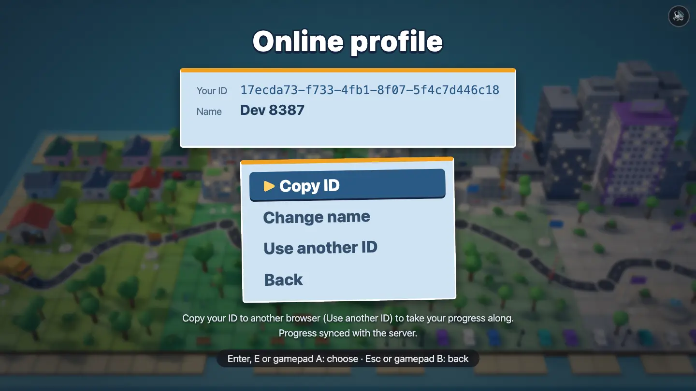

### Lobby

Press Enter or gamepad A to join. The first Enter joins the left keyboard, the second the right keyboard; every gamepad joins with A. Each player gets a color, number and owner shape (circle, triangle, square, diamond), independent of their role and hairstyle. Joining does not also confirm or start. Player 1 continues to level selection with their pick-up button.

Everyone starts as a **generalist**. Left/right on your own controls chooses a role; each compact card shows the live character, its strength/tradeoff and skill bars for all five coding domains, testing, design and repair. All bars share one scale and mark the 1.00x baseline, with exact multipliers alongside. Four players fit on one screen without scrolling; narrow screens use a two-by-two layout. Generalist is dependable everywhere; frontend/backend specialists prefer their coding domain, QA prefers testing, and platform prefers infrastructure coding with a smaller repair bonus. Every role can do every task, duplicate roles are allowed, and roles do not change movement, scoring or unattended build speed. The numbers are work-speed multipliers: 2.00x means twice the work speed (half the task time).

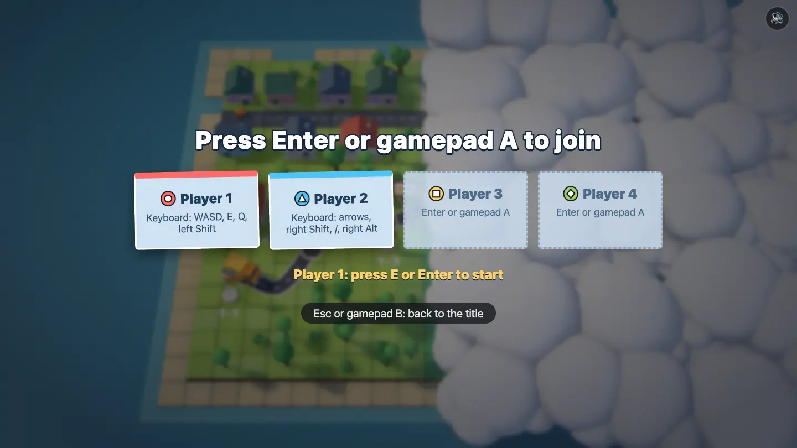

### Playing online

Online play needs the game server (`npm run dev:online` runs it with the game). **Host online** creates a room and shows the online lobby with its 4-letter code. **Join online** asks for that code: type it (or paste it), Enter joins. A gamepad turns the letters with up/down and moves with left/right. A wrong code, a full room, another game version or a server that can't be reached each get their own message.

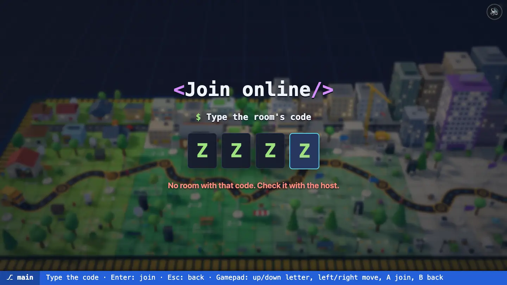

The online lobby shows the code (with Copy), everyone in the room, the host's badge and each machine's couch players in their owner colors/shapes and selected role outfits. Couch players on every machine join with Enter or gamepad A, as on the couch (4 players per room in total). Each machine can change only its own players' roles. The host continues with their pick-up button and picks the level; everyone else sees "Host is choosing a level" (and the level select's hint says the host picks). Only the host's devices drive level select, pause (which pauses the whole room) and results; **everyone confirms their own players on the intro**. Settings and the online profile aren't reachable from an online room. Leave room leaves; so does Esc or gamepad B twice.

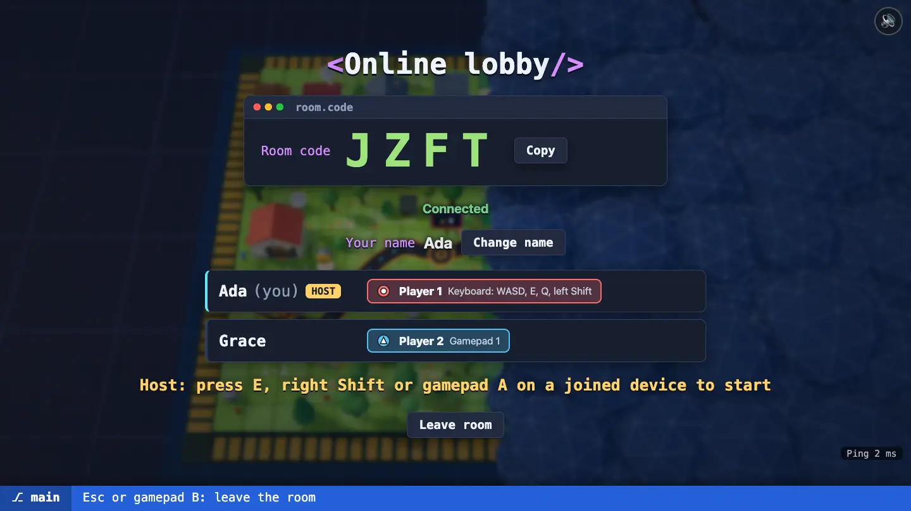

The round itself plays like on the couch: every machine draws the whole office, with everyone's players, the same orders, score and clock. The server runs the round; each machine sends its own players' buttons and draws what the server sends about a tenth of a second behind it, so movement glides smoothly even on a slow connection (your own player answers your keys a little later than on the couch). During a round a small room bar sits over the score with Leave room. When the round ends everyone gets the results, and the round counts for every player's progress, online and in their own browser. The first-level hints only show on the couch.

Things go wrong on real networks, and the room copes:

- **Dropped connection** (wifi blip, laptop lid): your screen shows "Connection lost. Reconnecting…" and the game keeps trying for 20 seconds; the others see "<name> reconnecting…" and your players stand still meanwhile. Back in, you're in the same round with the same players. If it doesn't work in time you get a message and Back to the title.
- **Reloading the page** in a room takes you straight back in (same tab, within 20 seconds).
- Roles survive reconnect and controller takeover. A drop during team confirmation clears that machine's ready states; connected players can continue without it. Rejoining before countdown means confirming again.
- **The host leaves or drops:** the next person who joined takes over the menus (level select, pause, results), even without a player of their own.
- **Joining while a round runs:** you watch it ("you're watching, you'll join after it"), then press Enter or gamepad A on the results or the level select to play the next round.
- Leaving mid-round still counts the round for you; the round counts for everyone who was there when it started.
- Esc in the online lobby asks first: press it again to leave. If the server restarts, everyone is told.

For trying it out: `ROUND_SECONDS=30 npm run dev:online` makes every online round 30 seconds; `?lag=100&jitter=20` on the game's URL pretends the network is slow (100 ms each way plus up to 20 ms); the ping corner (bottom right, on in dev builds or with `?nethud`) shows the round trip, and `N` turns it on and off.

### Level select

The level select is a 3D map of the campaign: startup to enterprise, left to right. The island is a circuit board (traces, vias, silkscreen chips and gold contact fingers round its edge) on a dark editor grid, and the road is a data bus with cyan packets and a via at every stop. It runs from a garage in a small town, past the startup offices and a growing downtown, to the enterprise towers and the Big Tech campus. Every level is a numbered tag-shaped flag beside the road (1-1, 1-2, …) and a moving van drives to the selected one; the camera follows it. Arrows, WASD or the stick drive the van along the road to the next or previous flag; Enter, E or gamepad A plays that level, Esc or B goes back to the lobby.

The card in a top corner (a window on the level's file, `level-1-1.ts`) shows the selected level's name, blurb and your best stars and score; the banner top left names the chapter as a folder (`~/campaign/Garage/`) with its new trick as a comment, and the star badge top right adds up your best stars. Played flags carry their stars.

A level opens once the level before it has at least 1 star; a chapter opens once you have enough stars in total (4, 9, 13 and 18). Locked chapters lie under clouds that aren't rendered yet (faceted navy meshes with a faint wireframe), with a striped barrier and a little terminal sign with the stars it needs where the road enters them; a locked flag is grey with a padlock, and the card says what opens it. When something opens, the next time you see the map the clouds roll away or the padlock drops off.

|                                                                   |                                                                                                                       |
| ----------------------------------------------------------------- | --------------------------------------------------------------------------------------------------------------------- |
| 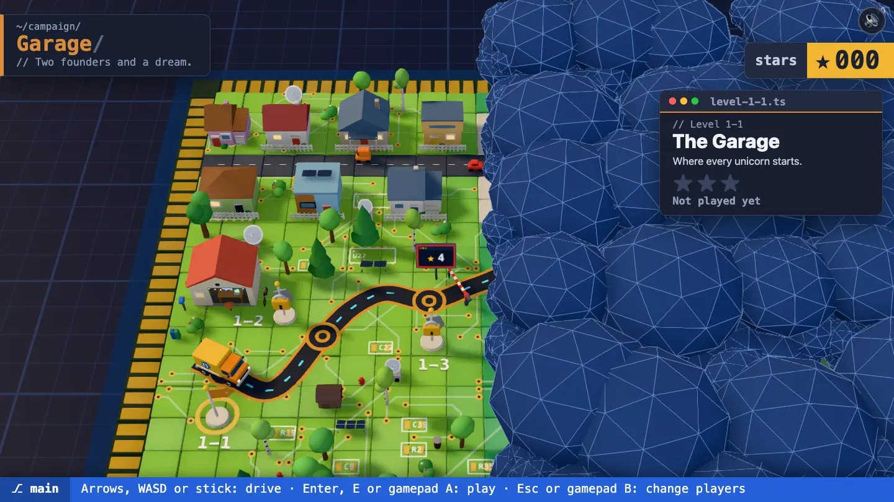 | 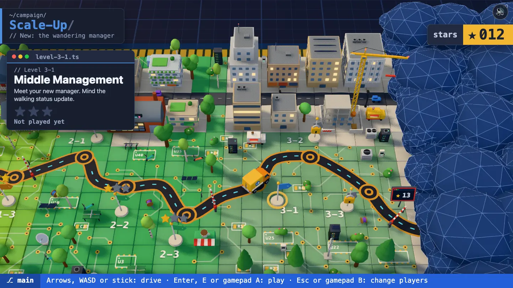 |

On a fresh save (left) only The Garage is open and everything past it is under clouds. Further in (right), the flags behind the van carry their stars, the Scale-Up is open, and the sign at the Enterprise's barrier asks for 13 stars.

### Level intro card

Before every round, including retries, team confirmation shows the level's name, a compact **Planned workload** band and everyone's role cards. **Level guide** swaps the team area for recipes, tutorial and detailed workload without scrolling or hiding the forecast; **Back to team** returns to readiness. Up/down on a keyboard or controller toggles the guide too. The forecast comes from the level, not your chosen roles: classic levels announce general-domain features; domain-enabled work also describes its authored feature mix and any full-stack parts or incidents. Coverage notes are advice, never permission checks.

Each player can revise their own role here, then press their pick-up button (E, Right Shift or gamepad A) to ready. Enter is join-only and cannot ready both keyboard players together. Changing a role clears that player's ready. **Every connected participating player must be ready** before countdown; roles then freeze until the next round's confirmation. Roles stay selected across retries and next levels but readiness resets.

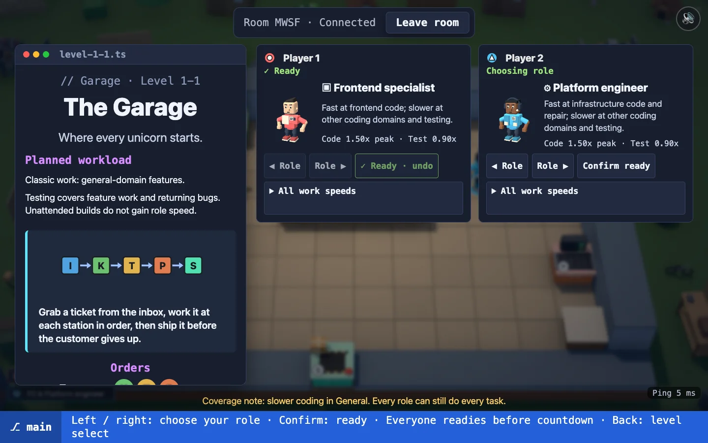

In a round, role labels beside player badges identify strengths without replacing owner colors/shapes. Tickets and orders show domain labels separately from workflow kind: a frontend-domain **feature** still needs code/test/build, unlike a code-only frontend **part** for merging. Contextual work labels show actual contributions, not just someone holding work nearby: a paired contribution includes design/pair modifiers and explicitly lists the pair total; review says when its quorum is met.

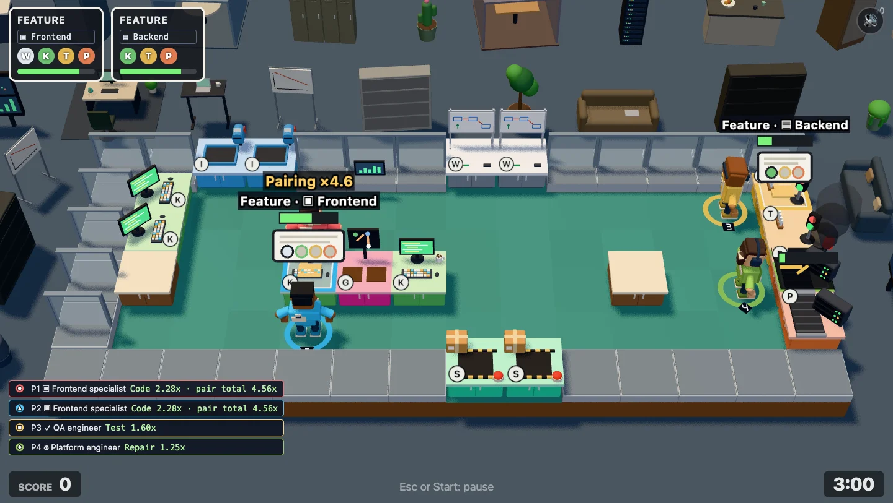

The cards that teach something:

| Level             | Tip                                   |                                                  |
| ----------------- | ------------------------------------- | ------------------------------------------------ |
| Open Plan Office  | Throwing over a counter               | 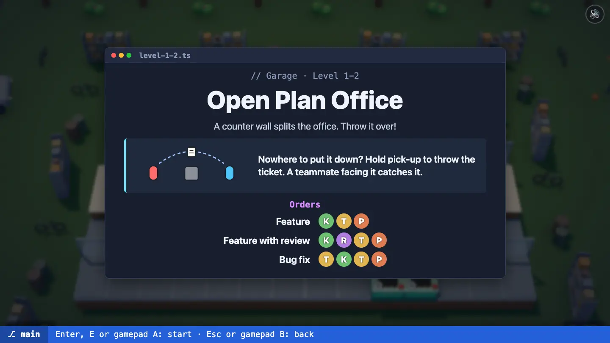         |
| Down the Hall     | Code reviews need two players         | 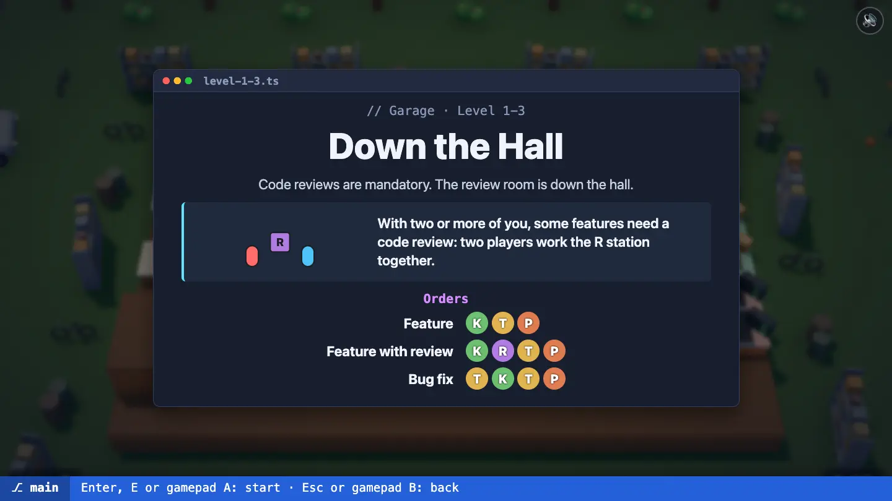          |
| Seed Round        | Production incidents and hotfixes     | 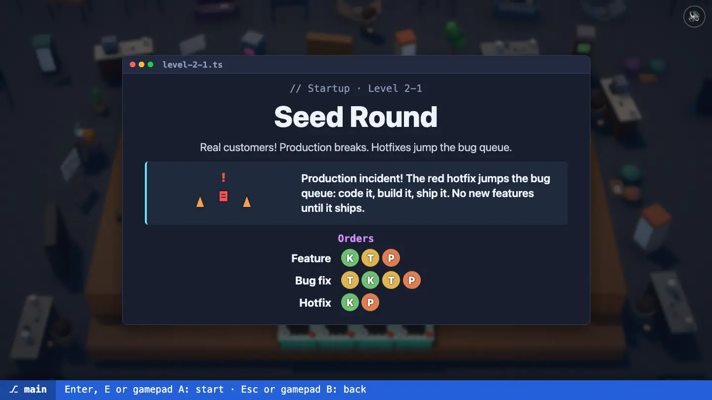        |
| Middle Management | The wandering manager                 | 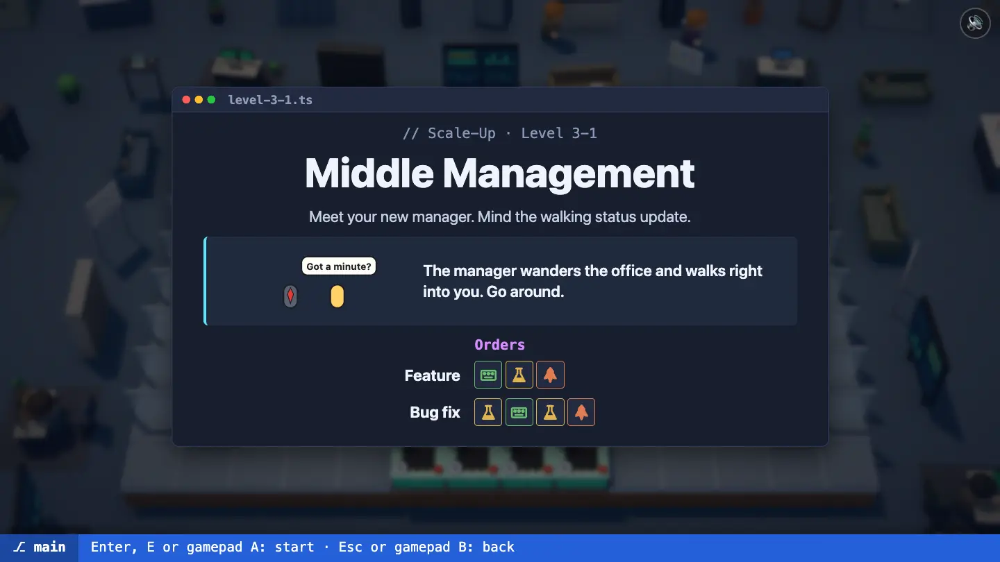 |
| Back to Back      | Calendar invites and the meeting room | 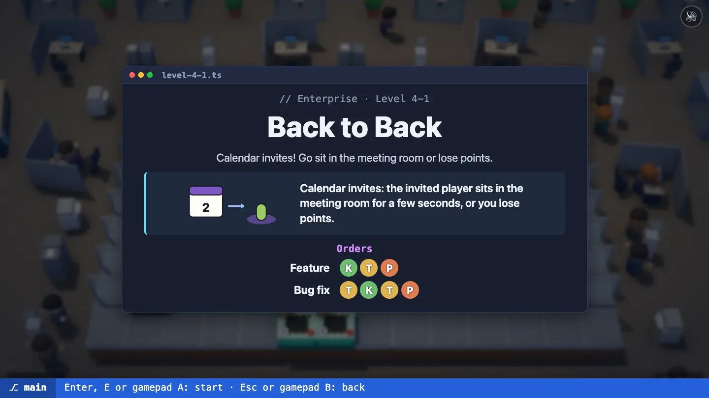      |

### Countdown and first-level hints

"3, 2, 1, Ship it!" and the round starts. The very first time you play The Garage, labels point at the inbox, the keyboard and the ship hatch until each one has been used once.

|                                             |                                                             |
| ------------------------------------------- | ----------------------------------------------------------- |
| 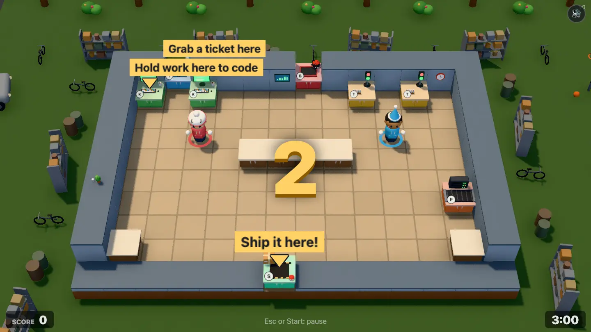 | 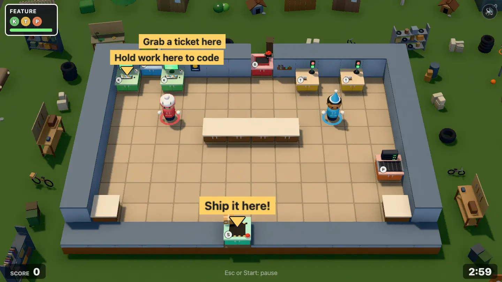 |

### Pause

Esc or Start pauses. From here you can resume, restart, change settings, go to the level select, change players (back to the lobby) or quit to the title.

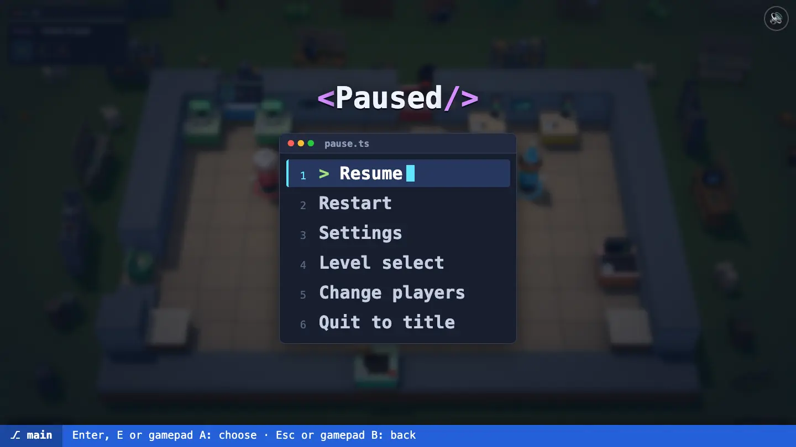

### Results

The stars fill in one by one. The results also say when you beat your best score, unlocked the next level or opened a new chapter.

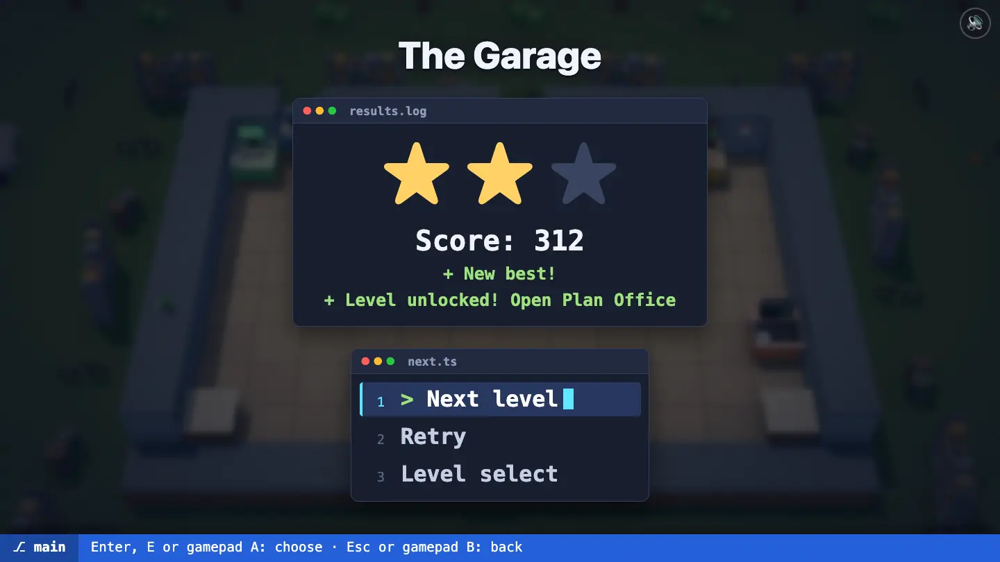

## Updating the screenshots

Every picture in these docs is taken by a script, so they can be retaken after art or UI changes:

```bash
npm run dev
```

```bash
npm run screenshots
```

The script (`scripts/screenshots.ts`) drives headless Chrome. Menus are reached with key presses. Every moment of a round is a **scene** in `src/sim/sceneCatalog.ts` (built with the blocks in `src/sim/scenes.ts`): it builds the game state for that moment directly (tickets on stations, a broken pipeline, a manager walking into someone), plays a few ticks with scripted buttons and freezes. Open one by hand with `/?scene=<id>`, e.g. `/?scene=throw`. `sceneCatalog.test.ts` checks every scene still reaches its moment, so a game change that breaks a screenshot fails the tests.

Pass `--only=<text>` to retake a subset, e.g. `--only=levels`. To add a picture: add a scene, run the script, link `images/mechanics/<scene id>.webp` (levels go to `images/levels/`).
