# Levels

16 levels in 5 chapters, one new mechanic per chapter (Big Tech brings a few). Every level is an ASCII map in [`maps/`](../../maps), from a 10 × 7 garage to 22 × 12 campus halls, and lasts 3 minutes; reorg levels have a map per floor plan (`.phase2.txt`, `.phase3.txt`). Settings (order pace, reviews, incidents, meetings, star targets) live in `src/sim/levels.ts`, names and blurbs in `src/sim/content.ts`.

## Campaign

A level opens when the level before it has at least 1 star. A chapter also needs enough stars in total over all levels.

| Chapter    | What's new                             | Opens at | Levels                                                                                                                 |
| ---------- | -------------------------------------- | -------- | ---------------------------------------------------------------------------------------------------------------------- |
| Garage     | Two founders and a dream.              | —        | [The Garage](#11-the-garage), [Open Plan Office](#12-open-plan-office), [Down the Hall](#13-down-the-hall)             |
| Startup    | New: production incidents and spills   | 4 ★      | [Seed Round](#21-seed-round), [Demo Day](#22-demo-day), [On Call](#23-on-call)                                         |
| Scale-Up   | New: the wandering manager and lifts   | 9 ★      | [Middle Management](#31-middle-management), [Hypergrowth](#32-hypergrowth), [Hot Desking](#33-hot-desking)             |
| Enterprise | New: meetings and reorgs               | 13 ★     | [Back to Back](#41-back-to-back), [Synergy](#42-synergy), [The Reorg](#43-the-reorg)                                   |
| Big Tech   | New: belts, design, merges, the campus | 18 ★     | [The Atrium](#51-the-atrium), [Design Sprint](#52-design-sprint), [Monorepo](#53-monorepo), [Hackathon](#54-hackathon) |

Unless a level says otherwise, feature orders come every 20 seconds (solo, a few seconds either way), at most 3 are open at once, features last 75 seconds and bugs 45. More players get orders faster and higher star targets: see [Tickets and events](mechanics.md#orders-and-tickets).

### Reading the maps

`#` wall · `.` floor · `C` counter · `I` inbox · `B` bug queue · `K` keyboard · `R` review · `T` test bench · `P` pipeline · `S` ship · `X` bin · `1`–`4` player spawns · `M` manager start · `m` meeting room · `W` whiteboard · `G` merge station · `>` `<` `^` `v` conveyor belt · `~` gap · blank: void (no floor) · `_` wet floor · `o` leaky tap · `%` spill zone · `r` mop robot loop · `L` lift cabin · `l` express lift cabin · `H` mail chute hatch · `=` partition · `D` rolling desk · `d` meeting door · `+` badge turnstile · `Q` travelator · `Y` shuttle stop · `*` revolving door. See [Mechanics](mechanics.md). See [Stations](stations.md).

The screenshots show four players on their spawns with a few orders open.

## Chapter: Garage

_Two founders and a dream._

### 1-1 The Garage

> Where every unicorn starts: one tiny garage.

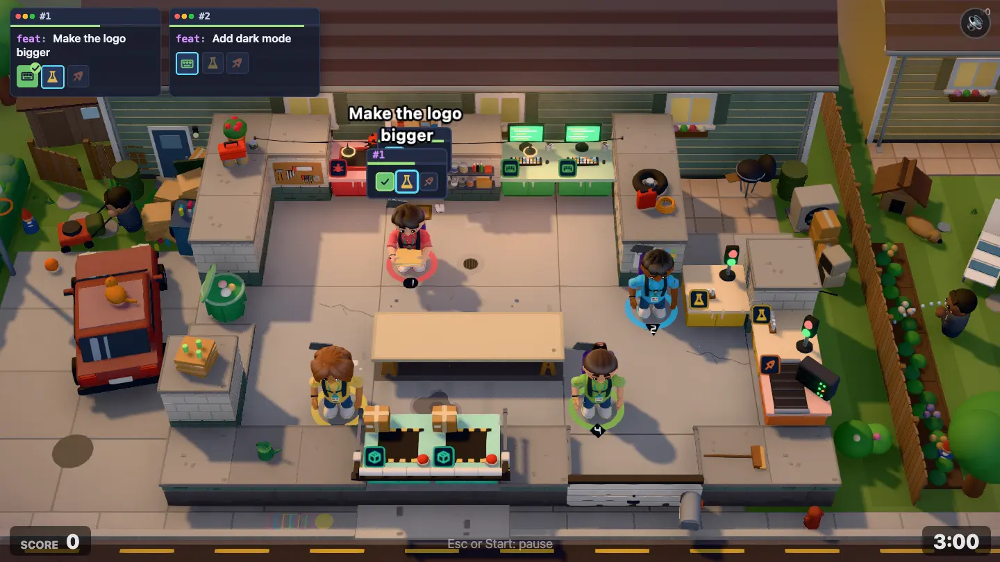

A single-car garage: the roll-up door is the ship hatch, the workbench is the counter in the middle. Tiny on purpose: four people in here is the joke. Orders come faster than in the other Garage levels (every 20 s, up to 4 open). The first time you play it, hints point at the inbox, a keyboard and the ship hatch.

- **New here:** The basics: pick up, code, test, build, ship.
- **Extras:** —
- **Map:** [`maps/level-01-garage.txt`](../../maps/level-01-garage.txt) (10 × 7)

```text
##BI#KK#
#......#
#..1...###
X......2T#
#..CCC...T
#.3...4..P
###SS#####
```

| Players      | 1          | 2           | 3           | 4           |
| ------------ | ---------- | ----------- | ----------- | ----------- |
| ★ / ★★ / ★★★ | 75/145/200 | 135/250/345 | 180/330/460 | 210/385/535 |

### 1-2 Open Plan Office

> Our first office, split by a desk row. Throw it over!

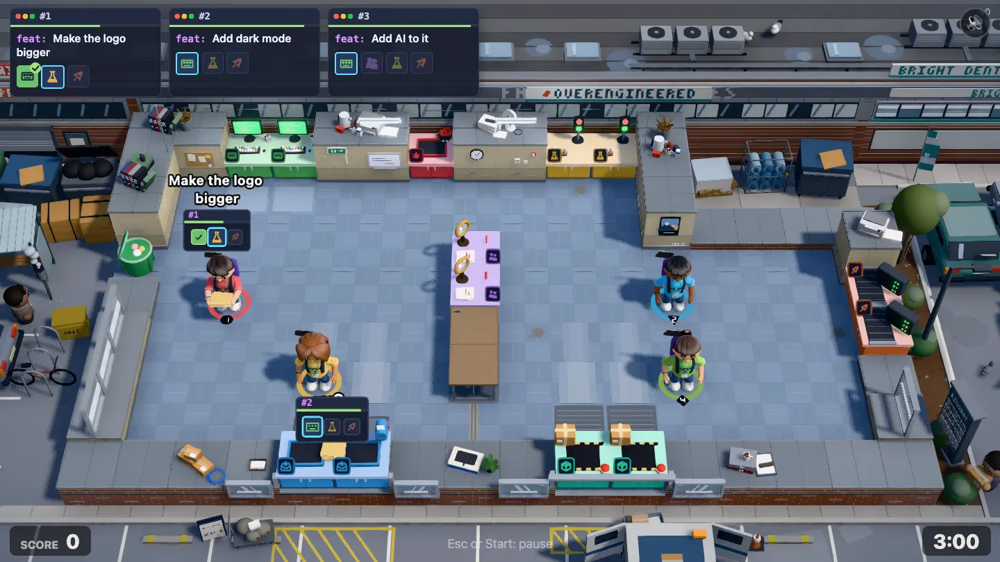

The first rented office: one open room split down the middle by a desk row with the review island in it and a single gap. Keyboards on the left, test benches and pipelines on the right. Walk round through the gap, or throw tickets over the desks.

- **New here:** Throwing. Code reviews (two or more players).
- **Extras:** Reviews 30%
- **Map:** [`maps/level-02-open-plan.txt`](../../maps/level-02-open-plan.txt) (16 × 9)

```text
##KK##B##TT#
#..........#
#..........#####
X......R.......#
#.1....R...2...P
#......C.......P
#...3..C...4...#
#..............#
####II###SS#####
```

| Players      | 1          | 2           | 3           | 4           |
| ------------ | ---------- | ----------- | ----------- | ----------- |
| ★ / ★★ / ★★★ | 60/115/160 | 100/180/250 | 130/245/340 | 155/290/400 |

### 1-3 Down the Hall

> Two rooms and a long hallway. Code reviews are down the hall.

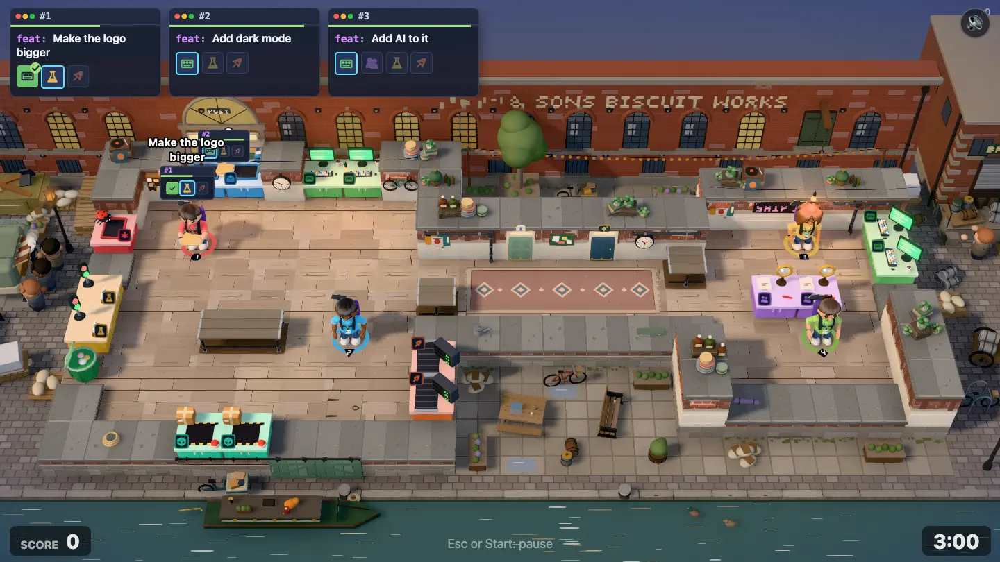

Two rooms joined by a long 2-wide hallway with 1-wide doors at both ends. The review station is in the far room, so reviews mean a walk down the hall, and the hallway is where people bump into each other.

- **New here:** Code reviews down the hall; hallway bumping.
- **Extras:** Reviews 50%
- **Map:** [`maps/level-03-scale-up.txt`](../../maps/level-03-scale-up.txt) (20 × 9)

```text
##II#KK##
#.......#     ######
B.1.....#######..3.K
#.............C....K
T.......C.......RR.#
T..CC.2.#######..4.#
X.......P     #....#
#.......P     ######
###SS####
```

| Players      | 1          | 2          | 3           | 4           |
| ------------ | ---------- | ---------- | ----------- | ----------- |
| ★ / ★★ / ★★★ | 65/115/160 | 85/155/215 | 125/235/325 | 130/240/335 |

## Chapter: Startup

_New: production incidents_

### 2-1 Seed Round

> Real customers! Production breaks. Hotfixes jump the bug queue.

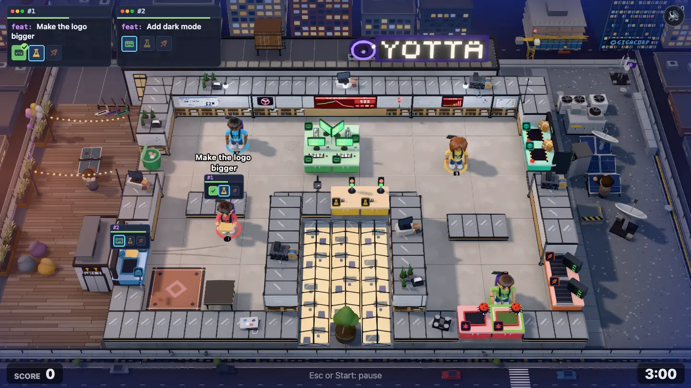

An L-shaped coworking loft with a desk island in the middle and two pipelines. Production breaks for the first time: the hotfix jumps the bug queue.

- **New here:** Production incidents.
- **Extras:** incidents
- **Map:** [`maps/level-04-seed-round.txt`](../../maps/level-04-seed-round.txt) (15 × 11)

```text
###############
#.............#
#..2..KK......S
X.....KK...3..S
#.............#
#.##.##TT#....#
#..1.#   #.##.#
I....#   #....#
I....#   #....P
#..C.#   #..4.P
######   ##BB##
```

| Players      | 1          | 2          | 3           | 4           |
| ------------ | ---------- | ---------- | ----------- | ----------- |
| ★ / ★★ / ★★★ | 60/110/155 | 95/180/250 | 115/210/295 | 120/225/310 |

### 2-2 Demo Day

> A leaky tap floods the floor. Fix it or slide.

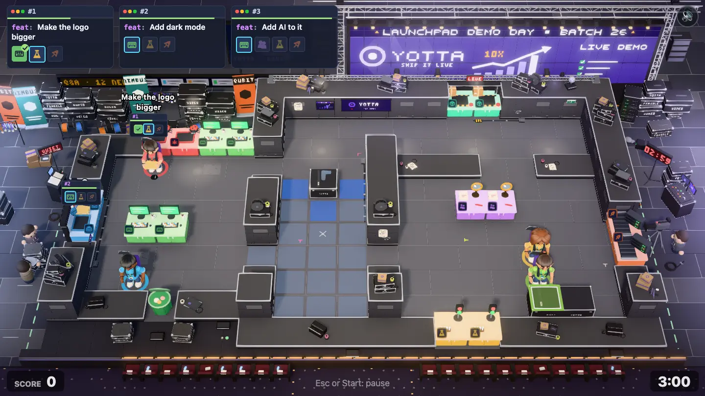

A coworking floor and a stage hall with a counter wall between them. In the middle sits a leaky tap: every so often it floods the floor round it, ring by ring, until someone holds work at it. There is always a dry way round.

- **New here:** Spills: wet floor and the leaky tap.
- **Extras:** Reviews 30%, incidents, leaky tap
- **Map:** [`maps/level-05-demo-day.txt`](../../maps/level-05-demo-day.txt) (19 × 11)

```text
      #######SS####
      #...........#
##BBKK#...#.......#
#.1.......####..###
#.....#_o_#.......#
I.....#%_%#..RR...#
I.KK..#%%%#.......P
#.....%%%%.....3..P
#.2...#%%%#....4..#
###X###%%%#....CC.#
      ######TT#####
```

| Players      | 1         | 2          | 3           | 4           |
| ------------ | --------- | ---------- | ----------- | ----------- |
| ★ / ★★ / ★★★ | 45/80/115 | 75/140/195 | 120/220/305 | 150/280/385 |

### 2-3 On Call

> Night shift. The mop robot never stops, and it leaves the floor wet.

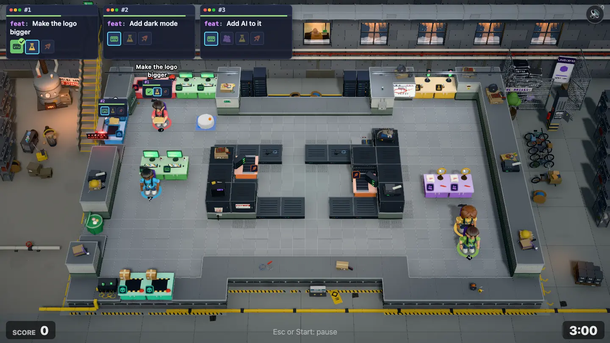

The night shift: two rooms round a locked server room, joined by corridors at the front and the back. The mop robot drives the ring all night and leaves it wet behind it, so which way round is dry keeps changing.

- **New here:** The mop robot.
- **Extras:** Reviews 40%, incidents, mop robot
- **Map:** [`maps/level-06-on-call.txt`](../../maps/level-06-on-call.txt) (18 × 12)

```text
#BBKK#      ##TT##
#....########....#
I.1.rrrrrrrrrr...#
I...r.......#r...#
#...r###.####r...#
#.KKr#P....##r...#
#.2.r##....P#rRR.#
#...r####.###r...#
X...r........r.3.#
#...rrrrrrrrrr.4.#
#....########....#
##SS##      ######
```

| Players      | 1        | 2         | 3           | 4           |
| ------------ | -------- | --------- | ----------- | ----------- |
| ★ / ★★ / ★★★ | 15/30/40 | 45/90/120 | 105/190/265 | 120/230/315 |

## Chapter: Scale-Up

_New: the wandering manager_

### 3-1 Middle Management

> Meet your new manager. Mind the walking status update.

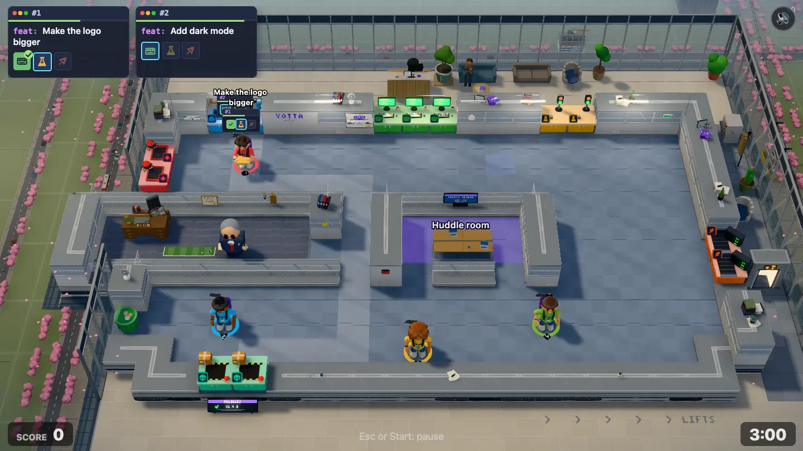

The biggest single open floor so far, with a corner office and a meeting room (quiet for now). One manager wanders the aisles and walks right into you.

- **New here:** The wandering manager.
- **Extras:** 1 manager
- **Map:** [`maps/level-07-middle-management.txt`](../../maps/level-07-middle-management.txt) (22 × 12)

```text
  ##II####KKK###TT####
  #..................#
  B..1...............#
  B..................#
#########.######.....#
#.C.....#.#mmmm#.....#
#....M....#mCCm#.....P
#########.#.##.#.....P
  #..................#
  X..2.........4.....#
  ##.......3........##
   ##SS##############
```

| Players      | 1          | 2          | 3           | 4           |
| ------------ | ---------- | ---------- | ----------- | ----------- |
| ★ / ★★ / ★★★ | 60/105/150 | 90/170/235 | 130/235/330 | 155/285/395 |

### 3-2 Hypergrowth

> Two floors, one lift and a mail chute. The stairs are a long way round.

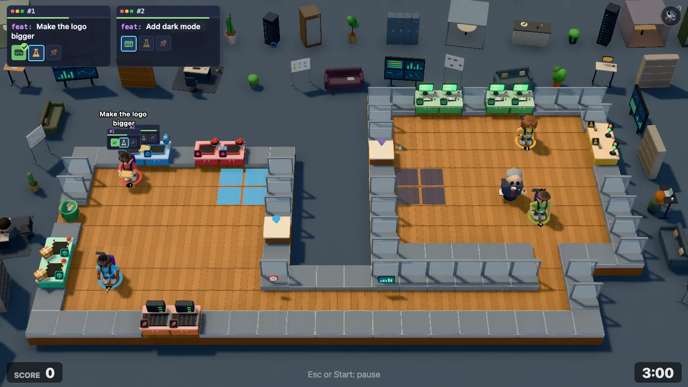

The company now has two floors, drawn side by side: the ground floor (inbox, bugs, pipelines, ship) and the first floor (keyboards, test benches). A lift joins them: walk into the car, the doors slide shut, and they open on the other floor. The stairs are a long way round, and a mail chute drops finished work from upstairs to the ground floor. The manager rides the lift too.

- **New here:** Lifts and the mail chute.
- **Extras:** incidents, 1 manager
- **Map:** [`maps/level-08-hypergrowth.txt`](../../maps/level-08-hypergrowth.txt) (22 × 12)

```text
            ##KK#KK###
            #........#
            #.....3..T
#IIBB####   ###......T
#.1..#LL#   #LL#.....#
#....#LL#   #LL#.M...#
X.......#   H.....4..#
#.......H   #........#
S.......#   ######.###
S.2.....##########.#
#..................#
####PP##############
```

| Players      | 1       | 2         | 3          | 4          |
| ------------ | ------- | --------- | ---------- | ---------- |
| ★ / ★★ / ★★★ | 5/10/10 | 40/80/110 | 60/105/150 | 80/155/210 |

### 3-3 Hot Desking

> Three floors, one lift, no stairs and two managers.

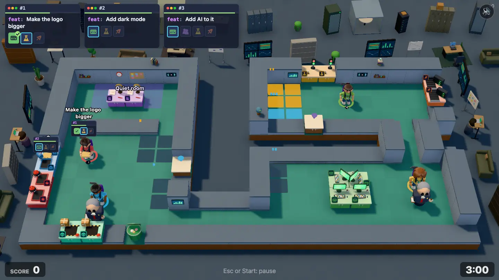

Three floors and one lift: the hot desks on the ground (inbox, keyboards, pipelines, ship), the test lab in the middle (bug queue, test benches) and the meeting room on top, where reviews happen. The stairwell is closed for the hot-desk refit. The lift holds three and stops at every floor in turn, so it is in the test lab twice a loop and at either end once: time it, and from the test lab check which way it goes before you get in. Two managers ride it too.

- **New here:** One lift with three stops and no stairs.
- **Extras:** Reviews 15%, 2 managers
- **Map:** [`maps/level-09-hot-desking.txt`](../../maps/level-09-hot-desking.txt) (22 × 12)

```text
####LLL#   #LLL##TT###
#mmmmmm#   #.........B
#mRRmmm#   #....M....B
#mmmmmm#   #.........#
########   ####CC#####

#II#####LLL#######PP##
#.1................3.#
#....KK......KK......#
X..2.............4...#
#.........M..........#
######CC########SS####
```

| Players      | 1        | 2        | 3        | 4        |
| ------------ | -------- | -------- | -------- | -------- |
| ★ / ★★ / ★★★ | 15/25/35 | 30/55/75 | 15/30/40 | 25/50/70 |

## Chapter: Enterprise

_New: meetings_

### 4-1 Back to Back

> Calendar invites, two meeting rooms, doors that shut while you meet.

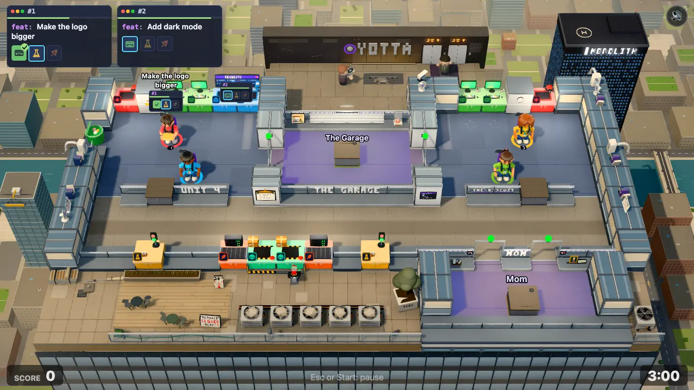

HQ: two offices off a corridor and two glass meeting rooms named after where YOTTA came from, The Garage between the offices and Mom off the corridor. Invites take turns between the rooms, and a room's doors shut on everyone but the invited player while the meeting runs, so the shortcut through The Garage comes and goes.

- **New here:** Calendar invites, named rooms, meeting doors.
- **Extras:** meetings
- **Map:** [`maps/level-10-back-to-back.txt`](../../maps/level-10-back-to-back.txt) (21 × 12)

```text
#B#KKII#     ##KK#B##
#......#######......#
X..1...#mmmmm#...3..#
#......dmmCmmd......#
#...2..#mmmmm#..4...#
#.#C##.#######.##C#.#
#...................#
#...................#
###T##PSSP#T###d#d###
             #mmmmm#
             #mmCmm#
             #######
```

| Players      | 1          | 2           | 3           | 4           |
| ------------ | ---------- | ----------- | ----------- | ----------- |
| ★ / ★★ / ★★★ | 60/110/155 | 105/190/265 | 135/255/350 | 160/295/410 |

### 4-2 Synergy

> The boardroom walls fold away on a schedule. Reorg!

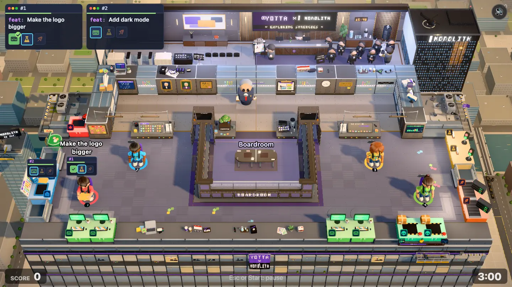

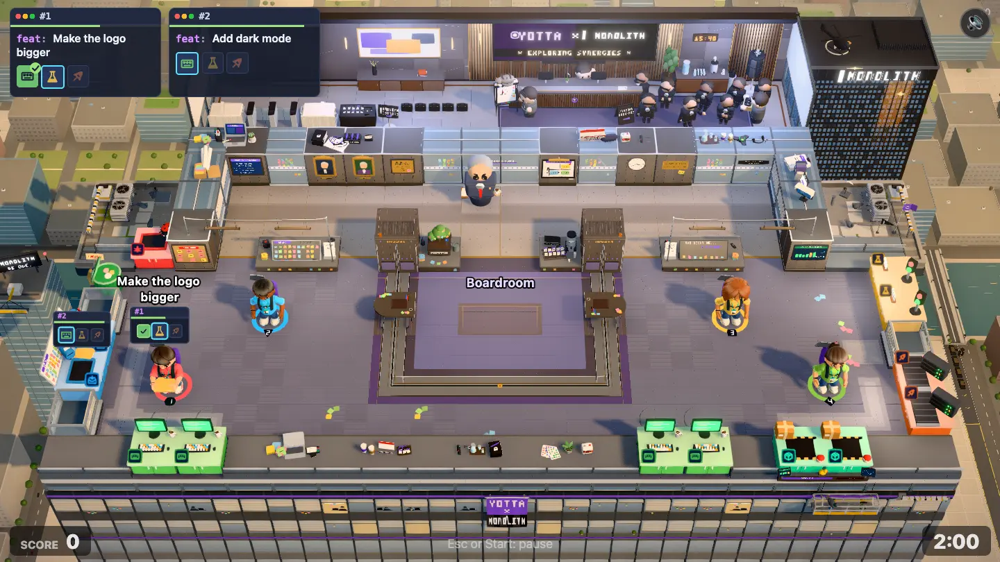

Dev and ops on either side of the boardroom, joined by a narrow front passage and a corridor round the back. On a schedule the boardroom walls fold away into one big hall, then close again; its table desks roll out to the edges and back with whatever is on them.

- **New here:** Reorgs: walls and desks that move.
- **Extras:** incidents, meetings, 1 manager, 3 reorgs
- **Map:** [`maps/level-11-synergy.txt`](../../maps/level-11-synergy.txt), [`level-11-synergy.phase2.txt`](../../maps/level-11-synergy.phase2.txt) (20 × 10)

```text
  ################
  #......M.......#
  #..............#
#B#.##.##..##.##.###
X......=mmmm=......T
#...2..=mDDm=..3...T
I......=mmmm=......#
I.1....======....4.P
#..................P
##KK#########KK#SS##
```

Phase 2:

```text
  ################
  #......M.......#
  #..............#
#B#.##.##..##.##.###
X.......mmmm.......T
#...2..Dm..mD..3...T
I.......mmmm.......#
I.1..............4.P
#..................P
##KK#########KK#SS##
```

| Players      | 1        | 2          | 3           | 4           |
| ------------ | -------- | ---------- | ----------- | ----------- |
| ★ / ★★ / ★★★ | 35/70/95 | 70/130/180 | 120/225/310 | 140/255/355 |

### 4-3 The Reorg

> Three floor plans in one round, and turnstiles that flip.

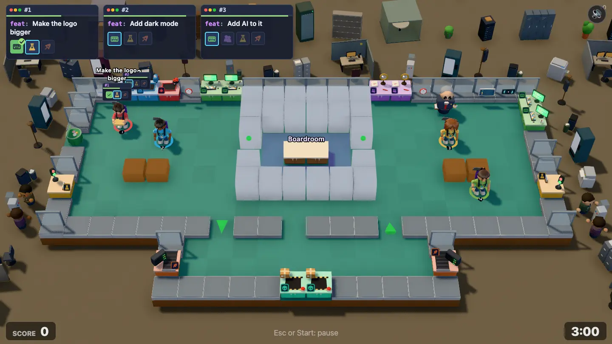

The finale of Enterprise: three floor plans round a fixed boardroom, Silos, Open Plan and Matrix, a minute each. Walls, doors and desks move; badge turnstiles into the shipping lobby only go one way and flip in Open Plan. The staff door is always two-way.

- **New here:** Three floor plans and badge turnstiles.
- **Extras:** Reviews 30%, incidents, meetings, 1 manager, 2 reorgs
- **Map:** [`maps/level-12-the-reorg.txt`](../../maps/level-12-the-reorg.txt), [`level-12-the-reorg.phase2.txt`](../../maps/level-12-the-reorg.phase2.txt), [`level-12-the-reorg.phase3.txt`](../../maps/level-12-the-reorg.phase3.txt) (22 × 12)

```text
##IIB#KK######RR######
#.......======...M...K
#.1.....======.......K
X...2...=mmmm=...3...#
#.......dmCCmd.......#
#..DD...=mmmm=...DD..#
T.......======....4..T
#....................#
#######+##.###+#######
     #..........#
     P..........P
     #####SS#####
```

Phase 2:

```text
##IIB#KK######RR######
#................M...K
#.1......DDDD........K
X...2....mmmm....3...#
#........mCCm........#
#........mmmm........#
T.................4..T
#....................#
#######+##.###+#######
     #..........#
     P..........P
     #####SS#####
```

Phase 3:

```text
##IIB#KK######RR######
#........=DD=....M...K
#.1.....======.......K
X...2...dmmmmd...3...#
#.==D====mCCm====D==.#
#.......=mmmm=.......#
T.......======....4..T
#....................#
#######+##.###+#######
     #..........#
     P..........P
     #####SS#####
```

| Players      | 1        | 2          | 3          | 4           |
| ------------ | -------- | ---------- | ---------- | ----------- |
| ★ / ★★ / ★★★ | 30/60/80 | 55/100/140 | 90/165/230 | 110/210/290 |

## Chapter: Big Tech

_New: belts, design, merges._

### 5-1 The Atrium

> Two buildings, an atrium, belts, a skybridge and a travelator.

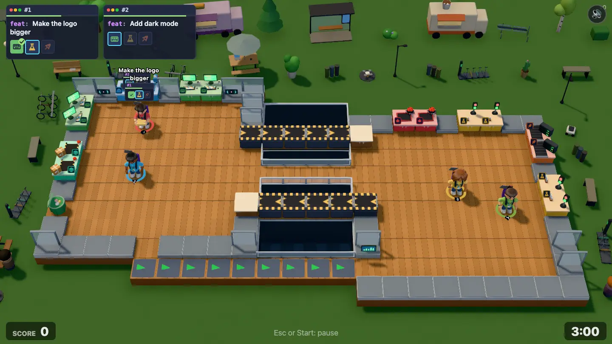

Two buildings face each other across an atrium. Ways across: a 1-wide skybridge, two belt bridges and a travelator along the front that runs east. Anything dropped into the atrium is gone.

- **New here:** Gaps, belts, the travelator.
- **Extras:** —
- **Map:** [`maps/level-13-the-atrium.txt`](../../maps/level-13-the-atrium.txt) (22 × 12)

```text
##II#KK##
K.......#~~~~
K..1....#~~~~##BB#TT##
#.......>>>>>C.......P
S........~~~~........P
S..2.................#
#........~~~~....3...T
X.......C<<<<<.....4.T
#.......#~~~~#.......#
####.####~~~~#.......#
    QQQQQQQQQ........#
             #########
```

| Players      | 1          | 2          | 3           | 4           |
| ------------ | ---------- | ---------- | ----------- | ----------- |
| ★ / ★★ / ★★★ | 55/100/140 | 95/180/250 | 120/220/305 | 150/285/390 |

### 5-2 Design Sprint

> Whiteboards behind a revolving door. Pair up to code faster.

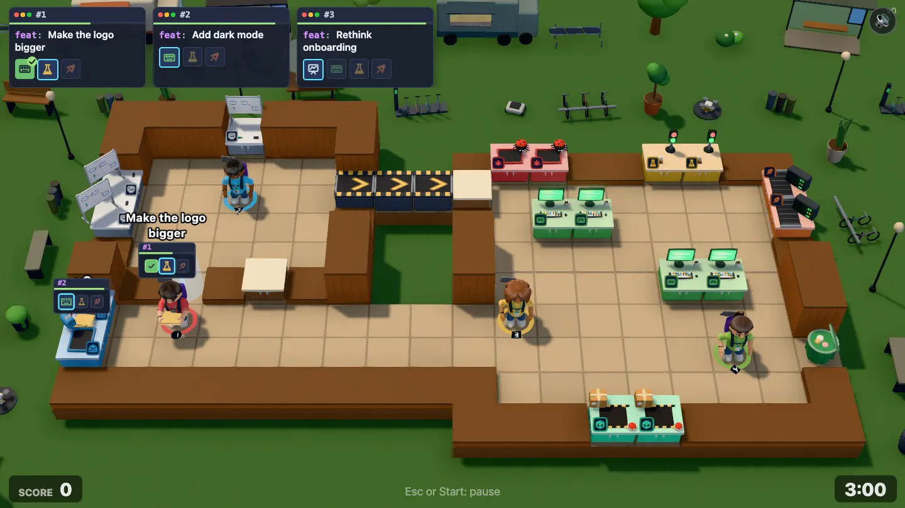

A cosy design studio behind a revolving door (one person at a time) and a hatch, a hallway, and a big engineering hall built for pairing. Designed tickets leave the studio over a belt.

- **New here:** Design at the whiteboard, pair programming, the revolving door.
- **Extras:** design 60%, pairing
- **Map:** [`maps/level-14-design-sprint.txt`](../../maps/level-14-design-sprint.txt) (18 × 10)

```text
###W###
#.....#  #BB##TT##
W..2..>>>C.......P
W.....#  #.KK....P
#.....#  #.......#
##*#C##  #....KK.#
I.1.......3......#
I..............4.X
##########.......#
         ###SS####
```

| Players      | 1          | 2           | 3           | 4           |
| ------------ | ---------- | ----------- | ----------- | ----------- |
| ★ / ★★ / ★★★ | 60/110/155 | 110/200/280 | 145/275/380 | 175/325/450 |

### 5-3 Monorepo

> Front end and back end in two towers. Merge in the middle, or take the shuttle.

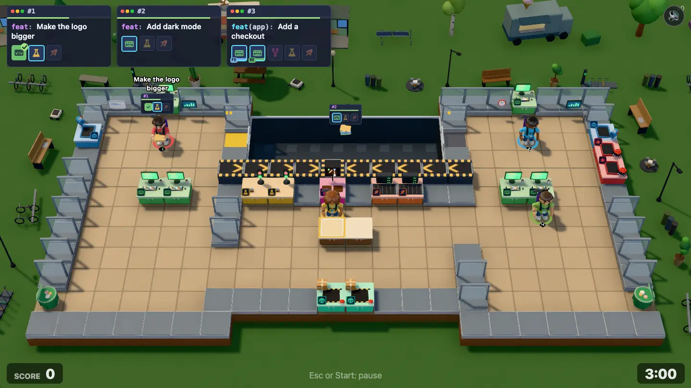

Two towers, front end and back end, with the integration room between them. Each team codes its half at home and puts it on its belt to the merge station; the campus shuttle crosses the courtyard at the back.

- **New here:** Full-stack merges and the shuttle.
- **Extras:** full-stack 60%, pairing
- **Map:** [`maps/level-15-monorepo.txt`](../../maps/level-15-monorepo.txt) (22 × 12)

```text
###K###        ###K###
#.....#~~~~~~~~#.....#
I..1..Y~~~~~~~~Y..2..I
#.....#~~~~~~~~#.....B
#.....>>>>v<<<<<.....B
#..KK.#TT#G#PP##.KK..#
#.....#...3.......4..#
#.....#...CC.........#
#..............#.....#
#..............#.....#
X.....####SS####.....X
#######        #######
```

| Players      | 1          | 2           | 3           | 4           |
| ------------ | ---------- | ----------- | ----------- | ----------- |
| ★ / ★★ / ★★★ | 55/105/145 | 105/195/270 | 140/265/365 | 170/310/430 |

### 5-4 Hackathon

> Everything at once: belts, spills, a lift, a partition and belt outages.

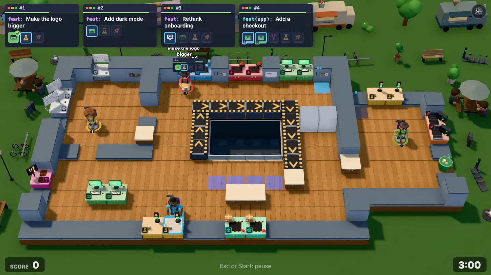

The finale: a big hall with a U belt round a pit, a design room and a server room, and a callback to every chapter: hatches, a spill in front of the snack table, a lift into the server room and a partition that closes one lane, then the other. Every other incident is a belt outage.

- **New here:** Everything at once, belt outages.
- **Extras:** design 30%, full-stack 40%, pairing, incidents (every other one a belt outage), 2 reorgs
- **Map:** [`maps/level-16-hackathon.txt`](../../maps/level-16-hackathon.txt), [`level-16-hackathon.phase2.txt`](../../maps/level-16-hackathon.phase2.txt) (22 × 12)

```text
##W####II#BB#KK##
#....#.1.......L#
W....#..........##TT##
W.......>>>>>v..#L...#
#.3..#..^~~~~v==#....P
#....C..^~~~~v..#..4.P
##.###..^~~~~v..#....#
#............v..C....X
G........____C.......#
#..KK.....CC....######
#......2........#
######TT##SS#####
```

Phase 2:

```text
##W####II#BB#KK##
#....#.1.......L#
W....#..........##TT##
W.......>>>>>v..#L...#
#.3..#==^~~~~v..#....P
#....C..^~~~~v..#..4.P
##.###..^~~~~v..#....#
#............v..C....X
G........____C.......#
#..KK.....CC....######
#......2........#
######TT##SS#####
```

| Players      | 1        | 2          | 3           | 4           |
| ------------ | -------- | ---------- | ----------- | ----------- |
| ★ / ★★ / ★★★ | 35/70/95 | 70/130/180 | 105/195/270 | 130/235/330 |
