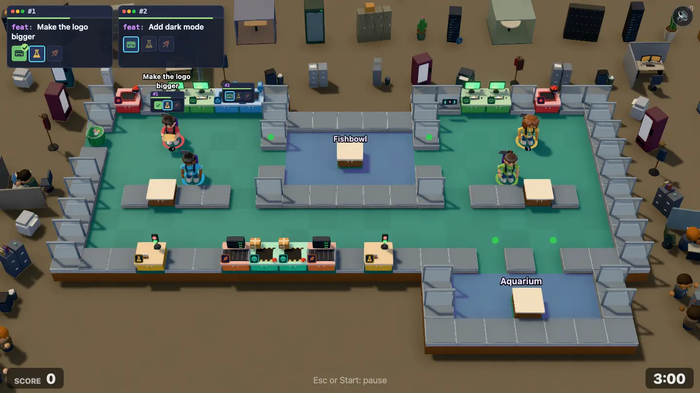
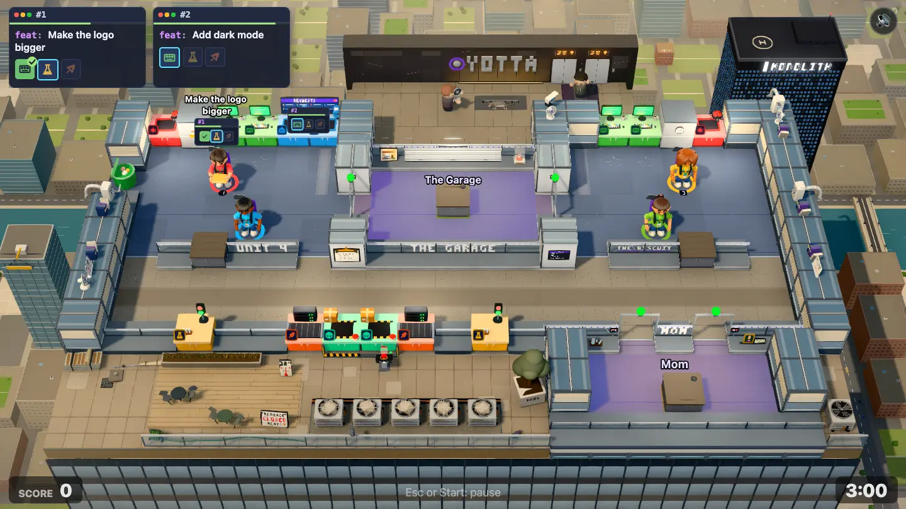

# Back to Back environment pass

**Status:** three rounds done (build, critic review, fixes, a second review, a short third round). Level 4-1 (`back-to-back`, "Back to Back"), the first level of the Enterprise chapter, gets a hand-built world after [Hot Desking](hot-desking-environment.md) (3-3). It opens a new chapter in a new building, so its props and atmosphere are the kit 4-2 Synergy and 4-3 The Reorg reuse. The bar: the best level so far.

| Before                                           | After                                           |
| ------------------------------------------------ | ----------------------------------------------- |
|  |  |

**Goal:** the world around the level tells one story, the way Overcooked 2 levels do. Render-only (`src/render/`); the sim, map and balance don't change. One text change in `src/sim/content.ts`: the two meeting rooms are renamed from "Fishbowl" and "Aquarium" to **"The Garage"** and **"Mom"**, so the storyline's joke (meeting rooms named after where they came from) reads in the HUD itself ("P2: to Mom!").

## The story in two sentences

> It's a summer heatwave morning and YOTTA has moved into YOTTA Tower, the glass tower that was a crane across the street from their first loft: a high floor of glass offices and glass meeting rooms, brushed-steel letters in the lift lobby, the city shimmering far below and MONOLITH's black tower level with them across the river. The building is a greenhouse, the air conditioning has given up, and the calendar is back to back: every meeting room is named after a place they've been ("The Garage", "Mom", "Unit 4", "The Biscuit"), and someone is always invited.

That is the level: stakeholder requests come in on the request portal by the lifts (the inbox), get built in the two glass offices, get tested and piped along the corridor's front wall and go out through the release hatch with the big red button (the ship). Calendar invites pull a player into The Garage or Mom, whose doors shut on everyone else while the meeting runs.

## Where this sits on the road

See [the storyline](../game/storyline.md#4-1-back-to-back-back-to-back). Chapter 3 was a rented mid-rise: plasterboard partitions, carpet tiles, a city seen from a few floors up, then three floors as a cutaway (3-3), whose ending was "YOTTA rents the whole glass tower across the street". 4-1 is **their own HQ, much higher up, and much more expensive**: the first level where YOTTA looks like a corporation. 4-2 Synergy is the boardroom floor of the same tower (MONOLITH's executives visit) and 4-3 The Reorg is that floor reorganised by consultants, so 4-1 must not show MONOLITH people, consultants, folding walls or the lowercase rebrand; it sets them up (MONOLITH's tower is right there, looking back).

- **Material:** a step up from chapter 3. **Floor-to-ceiling glass partitions with frosted manifestation bands** (a violet dot band at eye height, room names in vinyl), slim brushed-aluminium frames on a white plinth; **new corporate carpet** in the offices (deep slate with a faint violet fleck) and the meeting rooms (a quieter tone each), a **hard corridor** (pale terrazzo or light timber-look LVT with a walk line). The lift lobby is **stone and brushed steel**: dark stone wall, light stone floor, steel letters. The outer edge is a **unitised curtain wall** (deep mullions, spandrel bands), not chapter 3's thin glass.
- **Light:** a summer heatwave morning. A high, hard, bleached sun (about 55°), a pale hot sky that fades to white at the horizon, heat haze over the roofs far below, warm-white bounce inside, short crisp shadows, blinds half down on the sunny side. It must read **hot** without going brown or muddy: lift the whites, not the yellows. Mean luminance on the frame about **105+** (before: 96.1, saturation 0.376).
- **Outside:** the city from **very high up** for the first time: rooftops, a river with a bridge, the old loft's rooftop YOTTA sign tiny and far below, MONOLITH's black tower across the river at the same height as this floor with its logo glowing. Nothing at street level is near: the street is a long way down.

**Not food, not a kitchen.** No catering, pizza, kegs, fruit, ice-cream or bars. Water: a water cooler and a jug of water with glasses on a meeting-room credenza are fine (heatwave), coffee mugs are fine.

## Read it from the fixed front camera

The map (`maps/level-10-back-to-back.txt`, 21×12) is one floor with a notch at the top and a bay at the bottom right. Top of screen = back.

```text
#B#KKII#     ##KK#B##     row 0: back walls; office A: B (1,0) bug queue, K (3-4,0), I (5-6,0) inbox
#......#######......#            the notch (x 8-12, row 0) is void: the lift lobby
X..1...#mmmmm#...3..#     X (0,2): the bin, on the left wall; THE GARAGE (x 8-12, rows 2-4), table C (10,3)
#......dmmCmmd......#     meeting doors d (7,3) and (13,3): The Garage is the shortcut A <-> C
#...2..#mmmmm#..4...#     office A (x 1-6, rows 1-4), office C (x 14-19, rows 1-4)
#.#C##.#######.##C#.#     row 5: each office's far door, hatch counter, near door
#...................#     rows 6-7: the corridor, 2 wide
#...................#
###T##PSSP#T###d#d###     front wall: T (3,8), P (6,8), S (7-8,8) ship, P (9,8), T (11,8); doors (15,8), (17,8) to Mom
             #mmmmm#      MOM (x 14-18, rows 9-10), table C (16,10): a glass bay off the corridor
             #mmCmm#
             #######
```

Voids: the notch (x 8-12, row 0), the front-left (x 0-12, rows 9-11) and the front-right corner (x 20, rows 9-11). (Place everything from the map's outline, its meeting tiles, its door tiles, ship and inbox tiles: never these numbers.)

- **Back (above row 0): the tower's core in the middle, the curtain wall either side.** Behind the notch, the **lift lobby**: a dark stone feature wall with **brushed-steel YOTTA letters** (big, lit from below, the chapter's logo), two or three lift doors in steel frames with floor indicators showing a high number ("38"), a light stone floor, a low lobby bench. These lifts are decor, not a mechanic: keep them clearly part of the backdrop (behind the back wall line, no player-height car interiors). Behind office A and office C, the **curtain wall**: deep mullions, a spandrel band, half-lowered roller blinds on the sunny side, and past it the city far below in heat haze. The **inbox (5-6,0) is the stakeholder request portal**: a wall screen over the station ("REQUESTS" with a queue of tiles, a "+ NEW REQUEST" button), right by the lift lobby, as the storyline says. Order cards cover 0–690 × 0–140, so what stands behind office A stays low; tall things (the lobby letters, MONOLITH) go right of x≈700.
- **Left (x < 0): the curtain wall and the city.** Glass from floor to ceiling with mullions every tile, the city below. The **bin (0,2)** gets a locked confidential-waste console ("CONFIDENTIAL") against the glass. Outside, high up: a **building maintenance gondola** parked on its rails, or the next tower's top floors in haze; nothing at our floor level within a tile of the room.
- **Right (x > 20): the curtain wall, the river and MONOLITH.** Across the river, **MONOLITH's tower**: a black, slab-sided monolith whose top is level with this floor, its logo glowing (white on black), a helipad or plant screen on top, its windows a cold blue. This is the chapter's antagonist looking back: big, unmistakable, right of the room, clear of the mute button (1370–1440 × 0–60) and of the bug queue and test benches on the right.
- **Front (bottom of screen): the sky terrace.** The front-left void (x 0-12, rows 9-11) is a **setback terrace** at this floor, outside the corridor's glass front wall, baking in the heat: pale decking or stone pavers, a glass balustrade at its edge (low, under 0.6), **empty** outdoor seating (nobody sits out at 38°), a "TERRACE CLOSED – HEAT" A-board, a big outdoor thermometer reading 38°, and the reason the AC can't keep up: a row of **air-conditioning condensers** with fans spinning and heat shimmer over them. All under 0.6, no people. The **ship (7-8,8) is the release hatch**: a steel hatch in the front wall with a "RELEASE" panel and **the big red button** on a pedestal beside it (a mushroom button under a flip cover), a green "SHIPPED" lamp; its outside face onto the terrace stays low. **Mom (x 14-18, rows 9-10)** is a glass box stepping out onto the terrace, its outer glass reading as the curtain wall. The front-right corner (x 20, rows 9-11) is terrace or curtain wall, low.
- **Inside the rooms.**
  - **The offices (A: x 1-6, rows 1-4; C: x 14-19, rows 1-4).** Each is a named room, named on a vinyl plate by its near door: office A is **"Unit 4"**, office C is **"The Biscuit"**. New slate carpet with a faint fleck, placed wear (chair-castor marks behind the keyboards, a walk line from the near door). Wall tops: **heatwave kit** in clusters: desk fans (some turning), a portable AC unit with its exhaust hose stuck through a gap, a stack of blinds remotes, binders, a monitor turned away from the sun; a "WHO TURNED THE AC OFF?" note. Wall faces: a thermostat reading **29°C** with a "DO NOT TOUCH – FACILITIES" sticker, a room booking panel, a clock.
  - **The corridor (x 1-19, rows 6-7).** The hard floor: pale terrazzo or light timber-look LVT with a darker walk line along it, scuffs at the doors. **Prod in a big corridor planter** is the storyline's gag, but the corridor is play area: put Prod's planter **outside the room** against the corridor's end (the left wall around (0,6-7) or the right wall (20,6-7)), on the terrace by the glass, or in the lift lobby: big, a small tree now, "bigger than the founders".
  - **The meeting rooms (The Garage: x 8-12, rows 2-4; Mom: x 14-18, rows 9-10).** Glass rooms with the name in big vinyl letters on the glass and a **booking screen by each door** showing back-to-back bookings ("09:00 SYNC · 09:30 SYNC · 10:00 SYNC"). A calmer carpet that works under the game's meeting-tile overlay (`WorldFx.ts`). **The Garage** is decorated as a joke on itself: a framed photo of Mom's garage, a roll-up-door graphic printed on its back wall, maybe a single traffic cone or a lawnmower in a glass case as "heritage". **Mom** has Mom's framed portrait and **her first angel cheque**, framed, on the wall; a jug of water and glasses on a credenza.
  - **The plan** is framed on a wall like a piece of art: a gallery frame with a picture light, `1. Build it  2. ???  3. Profit` in fine type, on a corridor wall face or in the lobby.
  - **Lights:** slim linear pendants along the back of each room only, on a wire or from the head track; the meeting rooms get one pendant over the table each, from the room's back wall (never near the front wall).
- **The meeting doors (`d`)** keep their state light (`Mechanics.ts` draws it: green, amber, red). Room may build a glass door frame round each door tile (a slim aluminium portal, a pull handle on the glass), as long as the tile reads walkable when free and the light stays visible.
- **Light:** heatwave morning: high hard sun from the front-left (so walls throw short shadows into the rooms, never over the back row), a bleached pale sky, a warm haze far below, interior cooler and brighter than chapter 3, the curtain wall glass catching the sky. Heat shimmer as slow motes over the terrace condensers and the city below only (never over the play area). Mean luminance about 105+.
- **Life:** condenser fans spinning, desk fans turning, heat shimmer, MONOLITH's beacon or logo pulsing, a window-cleaning gondola, a pigeon on the terrace rail (it's hot, it's panting), Segfault breathing. People: few, small, in the lift lobby (a visitor with a lanyard waiting, facilities wheeling in a fan), scaled 0.88, greyed, a tile from the room, never readable as players.

## Running gags

| Gag             | Where                                                                                                                                        | Track                      |
| --------------- | -------------------------------------------------------------------------------------------------------------------------------------------- | -------------------------- |
| YOTTA's logo    | brushed-steel letters on the lift lobby's stone wall behind the notch, lit from below; the chapter's logo                                    | World                      |
| Prod            | a small tree in a big planter, "bigger than the founders": at the corridor's end outside the room, on the terrace, or in the lobby           | World                      |
| Segfault        | heatwave: stretched out on the coolest stone in the lift lobby under an AC vent, or on a meeting-room table in a room off the map; breathing | World                      |
| Mom             | the meeting room "Mom" (her portrait, her first angel cheque framed); her station wagon in the visitor bay far below, tiny, findable         | Room (room), World (wagon) |
| MONOLITH        | its black tower across the river, level with this floor, logo glowing                                                                        | World                      |
| The crane tower | they're inside it: the lift indicator says a high floor; a framed "before" photo of the crane in the lobby is a bonus                        | World                      |
| The plan        | framed like art, with a picture light                                                                                                        | Room                       |
| The loft's sign | the old seed-round loft's lit YOTTA letters, tiny on a rooftop far below                                                                     | World                      |
| Heatwave        | condensers on the terrace, desk fans, a portable AC, a thermostat at 29°C, a thermometer at 38°, blinds down, heat shimmer                   | all                        |
| Named rooms     | The Garage, Mom (meeting rooms), Unit 4, The Biscuit (offices) on vinyl plates and glass                                                     | Room                       |

All cameos out of the play area, out from under the HUD, small enough to find and never readable as a player.

## The six Overcooked lessons, for this level

| Lesson                                 | Here                                                                                                                                     |
| -------------------------------------- | ---------------------------------------------------------------------------------------------------------------------------------------- |
| The frame is full, at several heights  | The city far below and MONOLITH level with us at the back and right, the lobby core in the middle, the terrace low in front              |
| The room's edge is made of the setting | Glass partitions with manifestation bands on a white plinth, a unitised curtain wall, the stone lift lobby, the terrace balustrade       |
| Surfaces carry material and wear       | Flecked carpet with castor marks, a terrazzo corridor with a walk line, brushed steel, stone, decking, sun-faded blinds                  |
| One place, one story                   | One expensive HQ floor in a heatwave, meeting rooms named after the past. No partitions or lockers (chapter 3), no MONOLITH people (4-2) |
| Light does the composition             | A high hard sun, bleached sky and haze far below; the rooms cool and bright, the terrace hot                                             |
| The outside connects to the play       | Requests come in on the portal by the lifts, leave by the release hatch's red button; invites send you to rooms named after your past    |

## Rules

The rules in the [level-environment skill](../../.agents/skills/level-environment/SKILL.md) hold, plus:

- **One map:** `maps/level-10-back-to-back.txt`. Place everything from its outline, its voids, its meeting tiles (`map.meetingTiles`), its door tiles, ship and inbox tiles; never fixed coordinates.
- **The meeting doors are a mechanic.** Nothing covers a door tile or its light (`Mechanics.ts`, at height 1.25); a red door must still read as "shut" and a green one as "open".
- **The meeting rooms and their labels are play.** Nothing tall in front of a meeting room hides its label or its table.
- **No manager walks this level**, but scene people still must never read as players: smaller (0.88), greyed, an action pose, a tile from the room.
- **A new building.** New files for the tower (`roomModels/tower.ts`, `setDressing/towerWallTops.ts`, `setDressing/backToBack.ts`); importing generic pieces from earlier levels is fine, changing their defaults is not.
- **Not chapter 3:** no plasterboard partitions, carpet tiles from 3-1, lockers or desk boxes. **Not 4-2/4-3:** no MONOLITH executives, no consultants, no folding walls, no lowercase `yotta.`.
- **Value hierarchy:** glass, white plinths and pale terrazzo are the danger here. Counter tops, wall caps and the corridor floor stay darker than every station top; the stations stay the brightest, most saturated things. Frosted glass reads pale but its cap is a slim cool steel line, not a wide white slab.
- Other levels keep their look: the new wall theme `tower` and floor theme `towerFloors` are used only by `back-to-back`.

## Work split (round 1)

Three agents in one worktree at once, with strict file ownership. The shared plumbing (stub scene, stub dressing, themes, `LEVEL_LOOKS`, the room names) is done first.

| Track     | Owns                                                                                                                                                                         |
| --------- | ---------------------------------------------------------------------------------------------------------------------------------------------------------------------------- |
| **Room**  | `rooms/tower.ts` (+test), `rooms/towerRoom.ts` (+test), `roomModels/tower.ts`, `setDressing/towerWallTops.ts`, the `tower`/`towerFloors` rows in `look.ts` and `mapShape.ts` |
| **World** | `scenes/backToBack.ts` (+test), `setDressing/backToBack.ts`                                                                                                                  |
| **Light** | `atmosphere.ts` (+test), `stage.ts`, `WorldFx.ts`, `createLights` in `look.ts`                                                                                               |

## Done when

- [x] The shot reads as "the startup's own glass HQ, high up, in a heatwave" without explanation, and nothing in it reads as food or a kitchen.
- [x] The storyline beat reads with no explanation: the steel logo in the lobby, the city far below, MONOLITH level with them, rooms named after the past, the heat.
- [x] The outside connects to the play: the request portal by the lifts, the release hatch with the red button, the named meeting rooms.
- [x] The running gags are in place: steel letters, Prod, Segfault, Mom's room and wagon, MONOLITH, the framed plan.
- [x] No flat empty ground and no void in the 1440×810 frame.
- [x] Stations, players, the meeting doors and their lights read at a glance; nothing hides them.
- [x] Mean luminance about 105+, stations the most saturated things on screen.
- [x] `npm run check` passes; other levels look as before.

## Rounds

Round 1 ran three agents at once (Room, World, Light), with our finished 3-1, 3-2 and 3-3 frames as the bar (no Overcooked shots were supplied). The critic scored it **6/10** (before: 3/10). The bones were right: the stone lift lobby with the steel letters in the notch, MONOLITH as a black slab on the right, the closed terrace with condensers and the red release button, the four room names legible on the glass. What held it back:

- It read as neither hot nor high up: a cool, overcast roof about six floors up, washed out by white haze (luminance 121, saturation 0.199; the corridor at saturation 0.022).
- The heat-shimmer motes and white terrazzo chips read as snow in a still.
- White linear pendants cut across the back-row stations.
- The lobby floor was as bright as the keyboards, Prod's canopy more saturated than any station, the counters near-black crates, the glass walls pale ice blocks.
- The Garage, which carries the joke, was empty but for its table; Mom's door lights floated with nothing holding them.

Round 2, in three chunks:

- **Room:** glass with a mullion per tile and dark sky-reflecting tops, sills as a dark spandrel with a strip of curtain-wall glass, half-lowered blinds with a bottom rail; warm terrazzo with a visible walk line; no pendant fittings in the offices (the light stays), a graphite pendant over The Garage's table; The Garage's roll-up-door print, a traffic cone in a HERITAGE case and a bigger photo of Mom's garage; aluminium portals on every meeting door with the door light on the header; wall tops in two or three clusters per side.
- **World:** the city two storeys further down at 0.6 scale with tiny cars, the tower's own façade dropping away in spandrel bands, a smaller loft in the haze, a neighbour tower with a gondola, MONOLITH's parapet, plant screen and helipad in frame; a calmer stone lobby with brushed-steel letters, a warm wash, stone returns and a soffit, lift digits that read 38; a muted Prod, an upright 38° thermometer, a folded parasol and a hose on the terrace; Segfault on a darker grille.
- **Light:** a warmer key against cool shadows, straw haze pushed back so the city keeps contrast, `saturate` 1.5 and `contrast` 1.1 for this level only, exposure 1.07, no motes over the terrace, one violet rug per meeting room at the same strength.

The critic re-scored round 2 at **7.5/10**, tying 3-3, and found one new problem: the city below had become the busiest texture on screen and the river had almost gone. Round 3 (World and Room only): about 60% fewer city blocks with parks, plazas and muted roofs, windows only on south faces, a river three units wide with its bridge between YOTTA Tower and MONOLITH; a flat lobby rug; folded loungers and a drain on the terrace; Mom's wagon in a violet visitor bay; counters and meeting tables as warm oak on a grey credenza instead of near-black boxes; brushed-grey portals; the violet dot band moved to the partitions' outer faces.

Measured on the final shots:

| Measure                     | Before | Round 1 | Round 2 | Final |
| --------------------------- | ------ | ------- | ------- | ----- |
| Frame mean luminance        | 96.1   | 121.2   | 112.3   | 113.9 |
| Frame mean luminance, low   |        | 123.2   | 114.5   | 116.0 |
| Frame saturation            | 0.376  | 0.199   | 0.274   | 0.280 |
| Frame contrast (std)        | 36.1   | 42.6    | 46.4    | 46.6  |
| City top band (luminance)   |        | 190     | 157     | 159   |
| Lobby floor (luminance)     |        | 175     | 111     | 128   |
| Corridor (saturation)       |        | 0.022   | 0.28    | 0.28  |
| City edge density, top-left |        | 19.1    | 22.0    | 20.2  |
| City edge density, left     |        | 18.5    | 27.5    | 20.3  |

The keyboards and test benches stay the most saturated large surfaces (0.41–0.54). Hot Desking's frame is identical to its docs shot (105.8 / 0.288); Open Plan looks as before.

Left for later:

- **The critic did not re-score round 3.** Not checked on a real GPU (SwiftShader only).
- **The meeting tables sit in full sun**, so their tops (luminance 128–134) are brighter than the bug queue and the ship. They share one counter model with the office counters and the model gets no position; giving them their own top needs the room to tell the counter which room it's in.
- **Heat is in the grade, not in motion:** there is no visible heat shimmer in a still frame.
- **Prod is about 1.7 high on the terrace**, the one exception to "nothing taller than 0.6 in front"; it hides nothing.
- **Small cameos:** Mom's wagon (about 7 px), the loft's letters (about 18 px), the heritage cone, the fan the facilities person carries, and the lobby rug (mostly behind the visitor) are hard to find; the blind slats are faint at this camera angle.
- **The city on the right** has a few dark, warm brick blocks.
