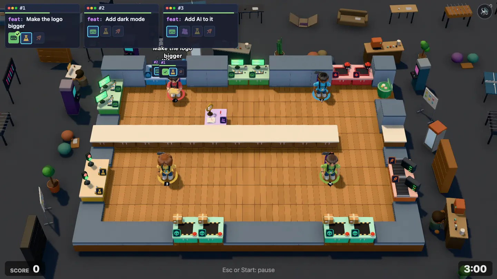
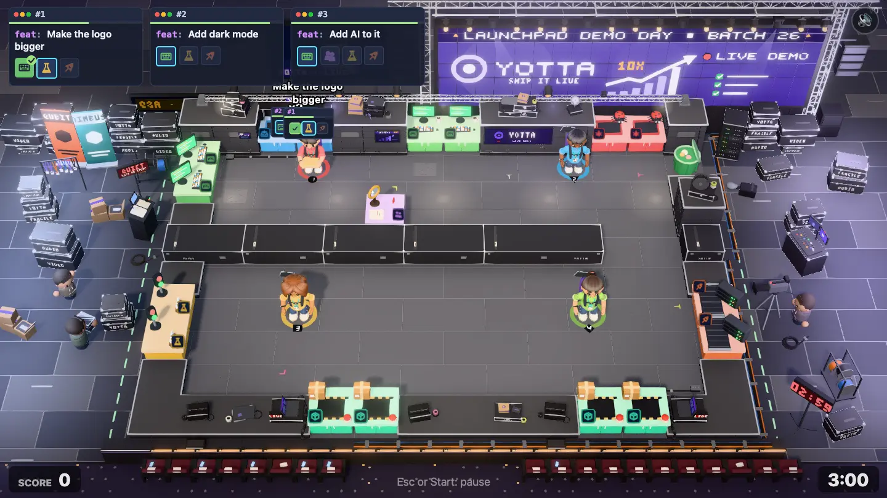
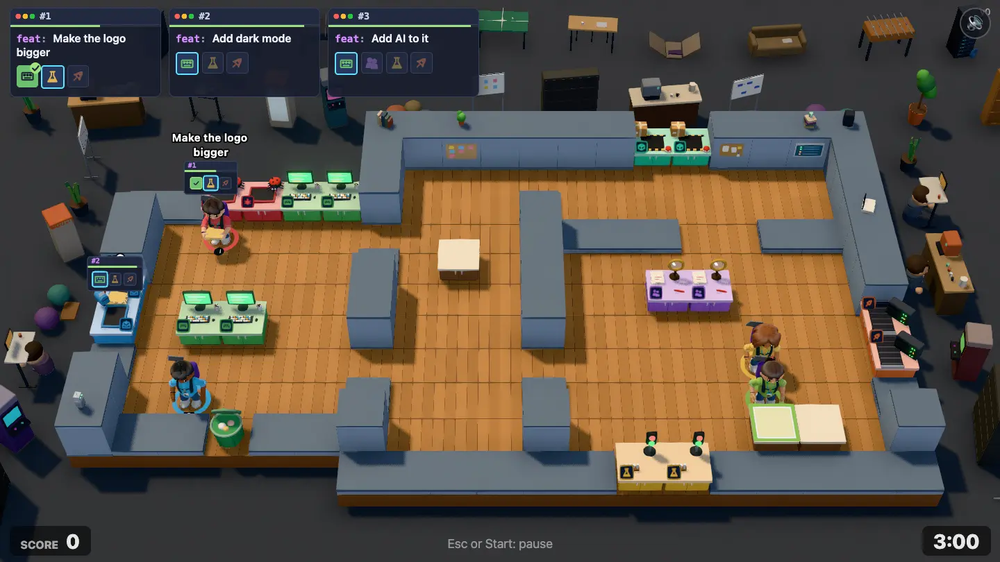
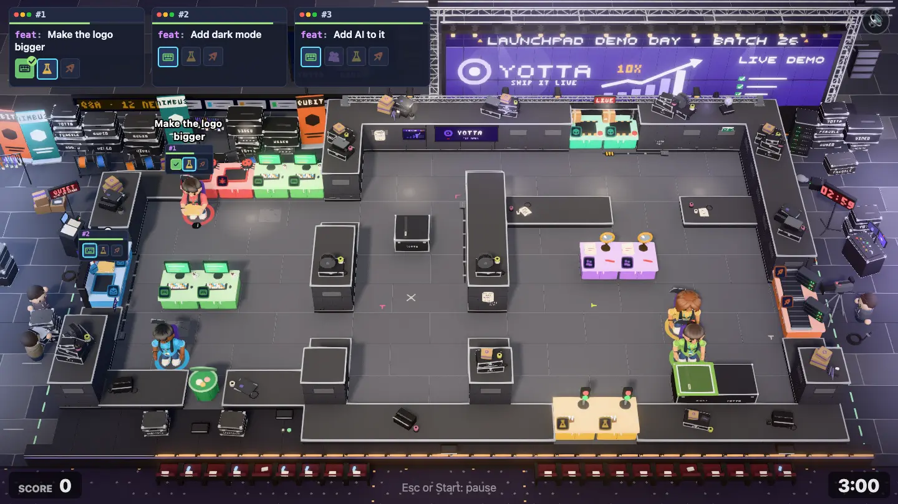

# Demo Day environment pass

**Status:** two rounds done (build, critic review, fixes). Level 2-2 (`demo-day`, "Demo Day"), the second level of the Startup chapter, gets a hand-built world after the garage ([garage-environment.md](garage-environment.md)), [Open Plan Office](open-plan-environment.md), [Down the Hall](down-the-hall-environment.md) and [Seed Round](seed-round-environment.md).

| Before                                       | After                                       | Before, redesign draft                             | After, redesign draft                             |
| -------------------------------------------- | ------------------------------------------- | -------------------------------------------------- | ------------------------------------------------- |
|  |  |  |  |

**Goal:** the world around the level tells one story, the way Overcooked 2 levels do. Render only (`src/render/`); the sim, maps and balance don't change.

## Where this sits on the road from garage to enterprise

| Level             | Where the company is                                                  | Look                                                   |
| ----------------- | --------------------------------------------------------------------- | ------------------------------------------------------ |
| 1-1 Garage        | Mom's garage in the suburbs                                           | cinder block, golden hour                              |
| 1-2 Open Plan     | a unit on a business park                                             | magnolia plasterboard, Monday morning                  |
| 1-3 Down the Hall | two rented rooms in a shared old factory                              | red brick, canal evening                               |
| 2-1 Seed Round    | the money landed: their own loft on a city-centre rooftop             | white steel and glass, blue hour, city lights          |
| **2-2 Demo Day**  | **on stage at the accelerator's Demo Day, pitching for the Series A** | **black stage, bright stage wash, a giant LED screen** |
| later             | glass offices, then HQ, then a campus                                 | glass, carpet, towers                                  |

Seed Round was the first time YOTTA (the startup's name, see the loft's rooftop sign) was above the street. Demo Day is the first time it is **in front of an audience**: the investors who decide whether it becomes a scale-up. Every step up the road is bigger and more "tech"; here the world is a conference hall built for one afternoon.

**Not food, not a kitchen.** No food, drink, kitchen, café, catering, bar, buffet, coffee cart, kegs, sacks, crates of produce, pizza boxes or market stalls, inside or outside. (Down the Hall read too much like a kitchen; Seed Round's first round did too, with brown plank desks and flat caps.) The props are stage, event and software props: flight cases, truss, moving-head lights, speaker stacks, stage monitors, a livestream camera, laptops, cable snakes, gaffer tape, lanyards, swag boxes, roll-up banners, pitch-deck slides, a countdown clock, a Q&A screen, investor seats with RESERVED cards.

The draft's leaking tap (`o`, a stand-in counter until the spills mechanic exists) and its spill zone (`%`) are **not** a drink tap when they're built: on this stage it is the **haze machine leaking fluid** (or a burst sprinkler pipe). Nothing in this pass dresses them.

## The story: build it live on stage

> It's Demo Day at the LAUNCHPAD accelerator: twelve startups, three minutes each, a hall full of investors. YOTTA promised a live demo, and the product isn't finished, so the founders are writing, testing and shipping features live on stage while the countdown runs, the investors shout feature requests and every shipped feature pops up on the giant screen behind them.

That is the level: tickets are the investors' requests, the ship hatch puts the feature on the big screen, and the round timer is the pitch slot's countdown clock.

Read from the fixed front camera (top of screen = back of the stage = upstage):

- **Back (top of screen): the giant LED screen.** A huge LED video wall on a black frame, standing on the upstage edge and rising above it, showing YOTTA's pitch slide (a violet-and-white YOTTA logo, a big growth arrow, "LIVE DEMO") and a lit header band "LAUNCHPAD DEMO DAY · BATCH 26". Flanked by two **truss towers** (silver box truss, square, with base plates) carrying **moving-head lights** and **line-array speaker stacks** hanging from them. A truss beam spans the top of the frame between the towers, with a row of par cans and moving heads on it (hung from the truss, never from nothing). The screen closes the top of the frame like Seed Round's skyline, and must not hide back-wall stations: its base sits behind the back wall and the picture starts above the wall tops.
- **The inbox** is the **stage door from the wings** under a lit "Q&A" sign: investors' feature requests come in on Q&A cards and on a tablet (a "Q&A · 12 new" screen beside the door). On the shipped map it's on the back edge, on the draft on the **left** edge; place it from the inbox tiles.
- **The ship hatch** is where features go live **on the big screen**: a demo console with a red "LIVE" tally light and a cable snake (thick black cable bundle with gaffer tape) running to the screen or the video desk. On the shipped map there are two ship hatches of 2 tiles on the **front** edge (keep everything low there; they face the audience, like stage-lip podiums); on the draft one of 2 tiles on the **back** edge, right under the screen.
- **Front (bottom of screen): the stage lip and the audience.** A thin strip: the stage's front edge (black fascia with a strip of warm footlights / an LED edge line), low stage monitor wedges (< 0.4) facing the stage, gaffer-taped cables, and past the lip, at the very bottom of the frame, the first row of the investors' seats from above: black chairs with white "RESERVED · INVESTOR" cards and a few phone screens glowing on seats. All under 0.6, no people. The camera shows only about 1.2 tiles in front of the slab.
- **Left: the wings (backstage left).** Where the next startups wait: flight cases stacked 2 to 3 high, a rolling rack of cable spools, a stage manager's desk (a "prompt desk": a small lectern with a cue light and a script), a "QUIET · LIVE ON STAGE" lit sign on a stand, a roll-up banner of the next startup, a coat rack of lanyards. Blue backstage working light.
- **Right: the tech side (stage right).** The livestream: a camera on a tripod with an operator, a video/vision mixer desk on a flight case with two small screens, a rack of AV gear with blinking LEDs, a large countdown clock on a stand facing the stage ("02:59", red digits), cable snakes on the floor, a fog/haze machine with a little haze wisp.
- **The draft's voids and room walls.** The draft has three rooms (left: the green room / backstage, middle: the wings corridor with the leak, right: the stage with the screen) and voids outside the outline at the top-left and along the bottom. Fill every void shape with the wings' or the tech side's dressing, or the stage's black floor and cases. Interior walls are the same stage-set walls as the outer ones.
- **Life:** a founder of the next startup rehearsing on the phone in the wings (`phoning`), a stagehand carrying a flight case (`carrying`), the camera operator (`idle`), the moving heads' beams slowly sweeping (optional, cheap), the LIVE tally and AV LEDs blinking, the haze wisp, the screen's slide (static is fine). Few, small, posed, never near the players.
- **Inside the room (the stage itself):** the room is the stage, walled in by YOTTA's **demo set**: low modular stage-set walls. Faces in matte charcoal-black scenery flats with a slim violet LED strip near the top (YOTTA's colour) and a darker kick plinth; caps in brushed aluminium (cool, light, with a lip), never a wide flat slab. Floor: black-grey **stage deck** (painted ply stage decks, 2×1 m panels: per-panel tone variation, thin lighter joints) with placed wear: white and fluorescent **spike tape marks** (small T and L marks, never under a spawn), a strip of glow tape at the edges, gaffer-taped cable runs from the doors, scuffs. Decals translucent and small, near edges. Counters: **black flight cases** with aluminium edging and corner caps, latches, a stencilled "YOTTA" — darker than every station top. On the wall faces: a confidence monitor (showing the next slide), a gaffer-taped set list, a "STAGE" fire exit pictogram, small LED wall panels. Wall tops: flight cases, cable reels, gaffer tape rolls, spare laptops, stage monitor wedges, swag boxes ("YOTTA" T-shirts, stickers), a trophy-less "PITCH" clicker on a case, lanyard boxes, a small fog machine, a mirror ball (once). Clustered 3 to 4 per long wall. Lights: **par cans and moving heads on a truss beam** along the back wall, strung between two truss uprights (never hanging from nothing).
- **Light: stage lighting.** A strong warm-white front wash (the "sun" is the front-of-house key light, from the front and high, about 45°) makes the stage bright and readable; cool blue and violet back light at the frame edges; the LED screen glows (violet-white); the wings in blue working light; the audience in darkness at the very bottom with tiny phone screens. Haze: a faint glow in the air under the truss. Mean luminance of the shipped frame about 100.

## The six Overcooked lessons, for this level

| Lesson                                 | Here                                                                                                                     |
| -------------------------------------- | ------------------------------------------------------------------------------------------------------------------------ |
| The frame is full, at several heights  | The LED screen and the truss beam at the back, truss towers with speakers, stacked flight cases in the wings, the camera |
| The room's edge is made of the setting | Stage-set walls (charcoal flats, violet LED strip, aluminium caps), the black stage fascia with footlights as foundation |
| Surfaces carry material and wear       | Painted stage decks with joints, spike tape, gaffer tape, scuffed flight cases, aluminium truss                          |
| One place, one story                   | A startup demo day on a big stage: nothing domestic, nothing industrial-food                                             |
| Light does the composition             | Warm stage wash on the play area, cool/violet edges, the glowing screen at the top, a dark audience at the bottom        |
| The outside connects to the play       | Requests come in through the Q&A stage door (inbox); shipped features go up on the giant screen (ship)                   |

## Rules

The rules in the [level-environment skill](../../.agents/skills/level-environment/SKILL.md) hold, plus:

- **Both maps:** the shipped `maps/level-05-demo-day.txt` (14×10, one room, inbox 2 tiles on the back edge, keyboards on the back and left edges, bug queue on the back edge, a long counter run across the middle, two ship hatches of 2 tiles on the **front** edge, pipelines on the right edge, no void) and the draft `maps/drafts/demo-day.txt` (19×11, three rooms with inner walls, voids at the top-left and along the bottom, inbox 2 tiles on the **left** edge, ship 2 tiles on the **back** edge, `?draft=demo-day`). Place everything from the outline, the void tiles and the ship and inbox tiles.
- **No food or drink props** anywhere (see above).
- Value hierarchy: dark walls and a dark stage deck make the stations pop, but the play floor must stay readable (mid-dark grey, not black: about 0x4a4c55 base) and the frame's mean luminance about 100. The bright things are the stations, the screen and the stage wash.
- Other levels keep their look: the new wall theme `stageSet` and floor theme `stageDeck` are used only by `demo-day`.

## Work split (round 1)

Three agents in one worktree at once, with strict file ownership. The shared plumbing (stub scene, stub dressing, themes, `LEVEL_LOOKS`) is done first.

| Track     | Owns                                                                                                                                                                                      |
| --------- | ----------------------------------------------------------------------------------------------------------------------------------------------------------------------------------------- |
| **Room**  | `rooms/stageSet.ts` (+test), `rooms/stageSetRoom.ts` (+test), `roomModels/stageSet.ts`, `setDressing/stageSetWallTops.ts`, the `stageSet`/`stageDeck` rows in `look.ts` and `mapShape.ts` |
| **World** | `scenes/demoDay.ts` (+test), `setDressing/demoDay.ts`                                                                                                                                     |
| **Light** | `atmosphere.ts` (+test), `stage.ts` (the three.js Stage, not the room), `WorldFx.ts`, `createLights` in `look.ts`                                                                         |

## Rounds

Round 1 ran three agents at once (Room, World, Light). The critic scored it 6.5/10 on the shipped map and 6/10 on the draft (before: 3/10). The story read at once: the LED wall and truss, the wings full of flight cases and the next startups' roll-ups, the livestream camera, the 02:59 clock and the RESERVED investor seats. Three things held it back. The stacked near-white stage light washed the stations to pastel, so the wings out-saturated them. The bright, wide aluminium caps (two panels per tile, white rims) read as a steel kitchen pass. The 3×5 pixel letters misread ("LAUNCHFAD DENO DAY").

Round 2, in three chunks:

- **Room:** dark lipped caps (charcoal top, brushed aluminium lip only on open edges, a violet LED line under it). Wall tops now carry paired clusters (3 to 4 per long wall, monitor wedges at the front ends, the mirror ball on the back wall). The deck is lighter with fewer flecks. Cables hug the walls with gaffer strips and a cable ramp. The draft's middle room gets a spike-tape X.
- **World:** the header and LIVE DEMO in the 5×5 font, so "LAUNCHPAD DEMO DAY · BATCH 26" reads. The arrow is clear of YOTTA. The screen is brighter (0x7a5ef4 to 0x8a72fc). Footlights now run the whole lip and the seat rows reach the HUD corners, with aisle step lights. The Q&A ticker sits out from under the order cards. Line arrays hang on the truss towers. The draft's front notch is dressed.
- **Light:** a near-neutral key just under the wash-out point; the wings are lit softer and further out. The edge glows and the haze glow are smaller. Two moving-head beams sweep ±20° over 8 s, deterministic and off on `low`.

Measured on the final shots:

| Measure                               | Round 1     | Final       |
| ------------------------------------- | ----------- | ----------- |
| Yellow bench top / front saturation   | 0.16 / 0.22 | 0.30 / 0.34 |
| Red bug queue saturation              | 0.26        | 0.34        |
| Front wall caps, mean L / saturation  | 128 / 0.14  | 92 / 0.08   |
| Frame mean luminance, shipped / draft | 95 / 98     | 91 / 86     |

Left for later:

- **Darker than the bar.** The frame is darker than the 100 target (91 shipped, 86 draft). It's a dark hall by design, and more light washes the stations out again. A neutral key at 98 dropped yellow to 0.24, so we kept the stations saturated.
- **Weak stations.** The green keyboard (0.23) and ship hatch (0.21) tops stay a little below 0.28. Their colours are pale to begin with.
- **The draft's spill zone.** The draft's middle room has a spike-tape X and a cable on the spill-zone tiles. Revisit it when the spills mechanic is built: its haze-machine leak, not a drink tap.
- **Hand-copied rig numbers.** `WorldFx.ts` copies the truss rig's height and batten layout from `scenes/demoDay.ts` by hand; a test catches drift.
- **Fixed scene id.** `stageSetRoom.ts` reads the `demo-day` lamp spots by its scene id.
- **Small gaps.** The wall caps have no joint every 2 tiles (`MapView.ts` picks wall looks by hash). The shipped left wall has no free caps for clusters. The front wedges read as dark boxes.
- Not checked on a real GPU.

## Done when

- [x] The shot reads as "a startup building its product live on stage at Demo Day, in front of investors" without explanation, and nothing in it reads as food or a kitchen.
- [x] The outside connects to the play: requests come in at the Q&A stage door, shipped features go up on the big screen.
- [x] No flat empty ground and no void in the 1440×810 frame.
- [x] Stations and players read at a glance; nothing hides them.
- [x] Works on the shipped map and on `?draft=demo-day`.
- [x] `npm run check` passes; other levels look as before.
