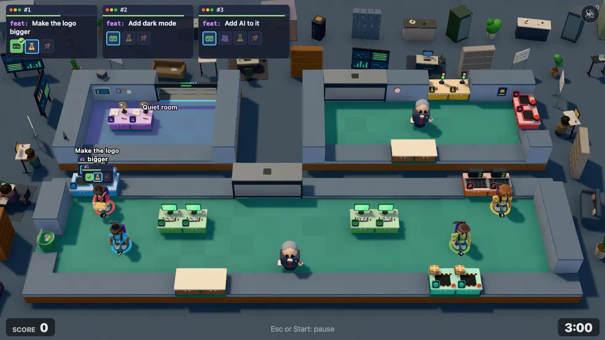

# Hot Desking environment pass

**Status:** in progress. Level 3-3 (`hot-desking`, "Hot Desking"), the last level of the Scale-Up chapter, gets a hand-built world after [Hypergrowth](hypergrowth-environment.md) (3-2), in the same building.

| Before                                          |
| ----------------------------------------------- |
|  |

**Goal:** the world around the level tells one story, the way Overcooked 2 levels do. Mostly render-only (`src/render/`). The map was redrawn just before this pass (three rooms, one lift, no stairs: see the [phase 23 entry](phase-23-level-redesign.md#3-3-hot-desking-hot-desking)). Small map changes are allowed when they make the design read better, as long as gameplay, the tests and the calibration move with them.

## The story in two sentences

> It's a spring Friday afternoon and YOTTA now fills three floors of the mid-rise from 3-1 and 3-2: the hot-desk floor at street level, the test lab above it and the one meeting room anyone can still book at the top. Nobody owns a desk any more, the desk-booking app is down, and the stairwell is taped off for the hot-desk refit, so everyone and everything goes up and down in the one lift, which stops at every floor in turn.

That is the level: tickets come in at the hot-desk floor's front desk (the inbox), go up the lift to the test lab (and the meeting room for reviews), come back down and leave through the revolving door onto the street (the ship). Two managers ride the lift too.

## Where this sits on the road

See [the storyline](../game/storyline.md#3-3-hot-desking-hot-desking). 3-1 was one finished floor high up, 3-2 the ground and first floor mid-move-in on a rainy day. 3-3 is the **same building, a few months later, full**: the boxes are unpacked, the desks are there but nobody owns one, and the building is shown as a **cutaway of three stacked floors** round one lift shaft. It's the last level before YOTTA leaves for its own HQ (4-1 Back to Back, the glass tower across the street), so the outside sets that up: the crane is gone, the tower across the street is finished and an estate agent is hanging a "TO LET" banner on it.

- **Material:** 3-1's building (plasterboard-and-glass partitions, aluminium head tracks, carpet tiles) worn in by a full office, plus what's new: **lockers** (hot desking means your stuff lives in a locker), **a cutaway building section** (concrete floor slabs with a ceiling void of ducts and cable trays between floors, the lift shaft running through the middle), and **the lift doors built into each floor's back wall**, flush, brushed steel with a lit floor indicator: no free-standing car boxes.
- **Light:** a bright spring Friday afternoon, low warm sun from the right (west), long soft shadows outside, the interior lit by warm office light. The top floor catches the most sun. Mean luminance on the frame about **100+** (before: measure it).
- **Outside:** the street at ground level in front and at the sides of the hot-desk floor; the upper floors look out over the city from height, with the finished glass tower across the street, top right.

**Not food, not a kitchen.** No catering, pizza boxes, kegs, fruit or bars. A Friday-afternoon cake on a meeting-room side table is the one exception allowed (one, small, out of the play area); coffee mugs are fine.

## Read it from the fixed front camera

The map (`maps/level-09-hot-desking.txt`, 22×12) is three islands. Top of screen = back.

```text
####LLL#   #LLL##TT###     rows 0-4, x 0-7: MEETING ROOM (top floor, "2")   x 11-21: TEST LAB (middle floor, "1")
#mmmmmm#   #.........B     B (21,1-2): bug queue on the test lab's right wall
#mRRmmm#   #....M....B     R (2-3,2): the review table; M: the second manager
#mmmmmm#   #.........#
########   ####CC#####     C (15-16,4): counters on the test lab's front wall
                           row 5: the gap between floors (void)
#II#####LLL#######PP##     rows 6-11: HOT-DESK FLOOR (street level, "0"); I (1-2,6) inbox, P (18-19,6) pipelines
#.1................3.#
#....KK......KK......#     K: two hot desks, reachable from both sides
X..2.............4...#     X (0,9): the bin, on the left wall
#.........M..........#
######CC########SS####     C (6-7,11) counters, S (16-17,11) ship on the FRONT wall
```

Lift cars (`L`, 3×1): meeting room (4-6,0), test lab (12-14,0), hot-desk floor (8-10,6). Voids: **the shaft** (x 8-10, rows 0-4) between the two upper rooms, right above the hot-desk floor's car; **the slab gap** (row 5, all across). (If the gameplay agent changes the map, place everything from the map as it is, never these numbers.)

- **The building as a cutaway (the big idea).** Read the frame as a dollhouse section through three floors. The void row 5 is the **floor slab and ceiling void between floors**: a concrete slab edge with a hazard-free clean cut face, under it ducts, a cable tray and a sprinkler pipe, all low (under the room's wall-top height) and dark-neutral. The shaft (x 8-10, rows 0-4) is the **lift shaft**: guide rails, cables, a dark concrete wall, the car roof of a car that's elsewhere, running from the top floor down to the hot-desk floor's car, so the three cars visibly belong to one lift. A floor number painted big on each slab edge ("0", "1", "2") helps "stacked" read. World owns the slab and the shaft; Room owns the walls and the car doors.
- **The lift doors (Room, with `liftCars.ts`).** The user's note on 3-2: the walls round the cars were too big. Here the cars sit **inside each room's back wall**: build them flush, as a lift lobby in the wall: a brushed-steel door frame no higher than the wall, a lit floor indicator with the three floors (the current one lit), up/down arrows that show which way the lift goes next (the sim's `dir`), a call button. Nothing sticks out above or in front of the wall line. When the doors are shut the car must read as "lift not here" (dark doors), not as a grey crate; keep 3-2's door leaves, light and chime. Do not change 3-2's or Hackathon's look.
- **The stairwell, taped off (the mechanic's reason).** On the hot-desk floor, a stairwell door in a wall face (by the lift, on the back wall) with red-and-white tape across it, a "STAIRS CLOSED — HOT DESK REFIT" sign and a fire-exit sign above. Room places it.
- **Back of the upper floors (above row 0) and right (x > 21): the city from height.** The meeting room and the test lab are upstairs: their back edges are the building's glass outer wall (3-1's curtain wall), and past it rooftops and the street a few storeys down. Top right, across the street, **the finished glass tower**: fully clad, no crane, an estate agent's cherry picker hanging a huge "TO LET" banner. Keep the mute button (1370–1440 × 0–60) clear.
- **Left (x < 0) and the hot-desk floor's sides: the street at ground level.** Pavement, a cycle rack full of bikes (Friday: people leave early), a coffee-cart awning, a couple of people leaving for the weekend with laptop bags (scaled 0.88, greyed, a tile from the room, an action pose). The bin (0,9) gets a wheelie bin and a recycling cage outside it.
- **Front (bottom of screen): thin.** About 1.2 tiles of ground in front of the slab. The **ship (16-17,11) is the revolving front door** onto the pavement: a revolving-door canopy and mat, under 0.6 high; a courier bike parked beside it. Pavement, a bollard or two, all under 0.6, no people.
- **Inside the rooms.**
  - **Hot-desk floor (x 1-20, rows 7-10): the joke's main stage.** 3-1's carpet tiles, worn in: a grey walkway path from the lift to the door, coffee rings by the desks (placed wear, faint, never under a spawn). The **inbox (1-2,6) is the front desk**: a reception counter with pigeonholes and a "DESK BOOKING" kiosk screen showing a red "SYSTEM DOWN" error, a paper sign-up sheet taped under it. **Wall tops: lockers**, banks of 3-4, steel grey with violet doors here and there, YOTTA on some; a coat stand, bags on top; a few with names on tape. The plan as a **desk-booking spreadsheet** printout on a wall face.
  - **Test lab (x 12-20, rows 1-3): the middle floor.** Pale vinyl or a cooler carpet so it reads as a different floor from the hot desks; a whiteboard of bug reproductions; device-testing shelves (phones on stands, a tablet rack) on the wall tops; the bug queue (21,1-2) as a "BUGS" in-tray rack.
  - **Meeting room (x 1-6, rows 1-3): the top floor, the only bookable room.** 3-1's meeting-room look (glass, a screen on the wall), a "BOOKED" panel by the lift that is always red, the one Friday cake on a side table on a wall top, chairs round the review table only from the back.
  - **Lights:** linear pendants along the back of each room only, on a wire wall to wall.
- **Light:** low warm spring afternoon sun from the right, about 40°, so the cutaway's slab edges catch a warm rim; interior warm-white; outside slightly cooler and hazy; mean luminance about 100+.
- **Life:** people heading home in the street, bikes, the cherry picker with the TO LET banner flapping, a pigeon on the slab edge, Segfault breathing. Few, small, never near the players.

## Running gags

| Gag             | Where                                                                                                  | Track |
| --------------- | ------------------------------------------------------------------------------------------------------ | ----- |
| YOTTA's logo    | on the lockers on the hot-desk floor's wall tops (violet doors with the logo)                          | Room  |
| Prod            | on the only desk nobody can book: a small desk with a "RESERVED: PROD" card, outside the play area     | World |
| Segfault        | asleep in an open, empty locker (a locker bank at the edge of the frame, or on a wall top), breathing  | Room  |
| The crane tower | gone: the glass tower across the street is finished, a "TO LET" banner going up from a cherry picker   | World |
| The plan        | a desk-booking spreadsheet on a hot-desk floor wall face: `1. Build it`, `2. ???`, `3. Profit` as rows | Room  |
| Hot desking     | lockers, the "SYSTEM DOWN" booking kiosk, name tape on lockers, people carrying their stuff            | Room  |
| The stairs      | taped off: "STAIRS CLOSED — HOT DESK REFIT"                                                            | Room  |

All cameos out of the play area, out from under the HUD, small enough to find and never readable as a player.

## The six Overcooked lessons, for this level

| Lesson                                 | Here                                                                                                                           |
| -------------------------------------- | ------------------------------------------------------------------------------------------------------------------------------ |
| The frame is full, at several heights  | City and the TO LET tower behind the upper floors, the shaft and slab section in the middle, the street at the sides and front |
| The room's edge is made of the setting | 3-1's partitions, lockers on the wall tops, the flush lift doors, the slab edges of the cutaway                                |
| Surfaces carry material and wear       | Worn carpet with a walkway and coffee rings, a different floor in the lab, concrete slab edges, steel lockers                  |
| One place, one story                   | Three floors of the same building, full, nobody owns a desk. No moving boxes (that was 3-2), no HQ glass (that's 4-1)          |
| Light does the composition             | Low warm afternoon sun from the right rimming the slab edges, the shaft darker, the top floor brightest                        |
| The outside connects to the play       | Tickets come in at the front desk, ride the one lift up and down, and leave by the revolving door onto the street              |

## Rules

The rules in the [level-environment skill](../../.agents/skills/level-environment/SKILL.md) hold, plus:

- **One map:** `maps/level-09-hot-desking.txt`. Place everything from its outline, its voids, its lift cabins (`L`), ship and inbox tiles; never fixed coordinates.
- **The lift is a mechanic.** `Mechanics.ts` and `liftCars.ts` show its state. Nothing covers a cabin tile; nothing hung over the shaft hides a car. Changes to `liftCars.ts` are allowed (it's shared), but 3-2's and Hackathon's lifts must look the same as before.
- **The managers are the player-sized people in suits in the play area.** No scene person may look like them.
- **Same building as 3-1 and 3-2.** Reuse `roomModels/midRise.ts`, `setDressing/midRise.ts`, `setDressing/midRiseWallTops.ts` and 3-2's pieces by import (new optional parameters are fine), but their defaults and those levels' looks must not change.
- **No 3-2 or 4-1 props:** no desk boxes or welcome balloons, no HQ brushed-steel lobby letters.
- Value hierarchy: lockers a muted steel grey (about 0x7d848b) with dusty violet doors, darker than every station top; the stations stay the brightest, most saturated things.
- Other levels keep their look: the new wall theme `upperFloors` and floor theme `threeFloors` are used only by `hot-desking`.

## Work split (round 1)

Three agents in one worktree at once, with strict file ownership. The shared plumbing (stub scene, stub dressing, themes, `LEVEL_LOOKS`) is done first.

| Track     | Owns                                                                                                                                                                                                                              |
| --------- | --------------------------------------------------------------------------------------------------------------------------------------------------------------------------------------------------------------------------------- |
| **Room**  | `rooms/upperFloors.ts` (+test), `rooms/upperFloorsRoom.ts` (+test), `roomModels/upperFloors.ts`, `setDressing/upperFloorsWallTops.ts`, `liftCars.ts` (+test), the `upperFloors`/`threeFloors` rows in `look.ts` and `mapShape.ts` |
| **World** | `scenes/hotDesking.ts` (+test), `setDressing/hotDesking.ts`                                                                                                                                                                       |
| **Light** | `atmosphere.ts` (+test), `stage.ts`, `WorldFx.ts`, `createLights` in `look.ts`                                                                                                                                                    |

## Done when

- [ ] The shot reads as "three floors of the same office building on a Friday afternoon, where nobody owns a desk" without explanation, and nothing in it reads as food or a kitchen.
- [ ] The storyline beat reads with no explanation: the cutaway of three floors round one lift, lockers and the broken booking kiosk, the taped-off stairs, the TO LET tower across the street.
- [ ] The lift cars are flush in the back walls: no boxes or walls sticking out, the doors and floor indicator read at a glance.
- [ ] The outside connects to the play: tickets come in at the front desk, leave by the revolving door; the lift is the only way between floors and looks it.
- [ ] The running gags are in place: logo lockers, Prod's reserved desk, Segfault in a locker, the TO LET tower, the desk-booking spreadsheet.
- [ ] No flat empty ground and no void in the 1440×810 frame.
- [ ] Stations, players, the managers and the lift cars read at a glance; nothing hides them.
- [ ] `npm run check` passes; other levels look as before.
