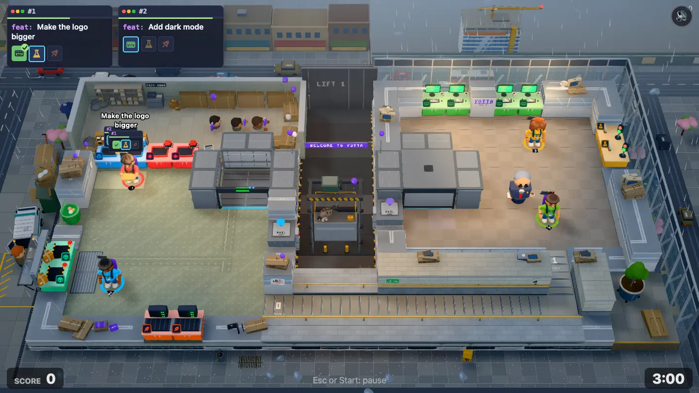

# Hypergrowth environment pass

**Status:** two rounds done (build, critic review, fixes), then a lift redesign that changed the map and the lift mechanic (below). Level 3-2 (`hypergrowth`, "Hypergrowth"), the second level of the Scale-Up chapter, gets a hand-built world after [Middle Management](middle-management-environment.md) (3-1), in the same building.

| Before                                          | After                                          |
| ----------------------------------------------- | ---------------------------------------------- |
|  |  |

**Goal:** the world around the level tells one story, the way Overcooked 2 levels do. Render only (`src/render/`); the sim, maps and balance don't change. (The lift redesign after round 2 is the exception: see [Lift redesign](#lift-redesign).)

## The story in two sentences

> It's a rainy spring day and YOTTA, flush with the new round's money and a hiring plan ("double the team by summer"), has taken the ground floor and the first floor of the mid-rise from 3-1, joined by one tiny lift, a long stairwell and a mail chute. They hire faster than the desks arrive: the ground floor is full of unopened flat-pack desk boxes and violet welcome balloons, the lift is always full of new starters clutching welcome packs, and outside a delivery van is unloading yet more desk boxes into the rain.

That is the level: tickets arrive in the ground-floor post room (the inbox), go up in the lift to the developers, come back down the mail chute and leave through the loading bay into the rain (the ship hatch). Derek rides the lift.

## Where this sits on the road

See [the storyline](../game/storyline.md#3-2-hypergrowth-hypergrowth). 3-1 Middle Management was one bright, clean, finished floor high up in the mid-rise on a spring morning, with the city small and far below. 3-2 is the **same building, lower down and messier**: the street is right outside the ground floor's loading bay, it's raining, and the fit-out can't keep up with the hiring. 3-3 Hot Desking is three floors on a Friday afternoon with nobody owning a desk, so 3-2 must not show desk-booking or lockers; it sets up the "more people than desks" ending ("someone suggests hot desking").

- **Material:** reuse 3-1's building (plasterboard-and-glass partitions, aluminium head tracks, carpet tiles upstairs) so it reads as the same building, plus what's new here: a **hard ground floor** (front of house: grey-green rubber/vinyl sheet with a walk-off mat at the loading bay and a pale "post room" lino), **the stairwell** (painted concrete block walls, steel nosings on the treads, a handrail), and **the lift** (brushed steel doors, a floor indicator).
- **Light:** a rainy spring day: soft, cool, diffuse daylight from a grey sky outside; inside, the office lights are on and warm-white, so the rooms glow against the wet grey-blue street. Low-contrast shadows. Rain streaks outside only. Mean luminance on the frame about **100+** (before: 92.1, saturation 0.38).
- **Outside:** the street **at ground level** this time (3-1 looked down on it): wet asphalt and pavement with puddles, umbrellas, the delivery van at the loading bay, cherry trees dripping (blossom on the wet pavement), and across the street the **crane tower almost done**, fully clad but for its top floors, the crane still on its roof with the red light.

**Not food, not a kitchen.** No catering, pizza boxes, kegs, fruit, crates or bars. Desk boxes are flat brown cardboard with a printed desk outline and "DESK" or "FLAT-PACK" on the side, never produce crates. Welcome balloons are YOTTA violet and white, a few, tied to box stacks, never a party.

## Read it from the fixed front camera

The map (`maps/level-08-hypergrowth.txt`, 22×12) is two islands. Top of screen = back.

```text
            ##KK#KK###      rows 0-8, x 12-21: FIRST FLOOR (engineering): keyboards back, tests right
            #........#
            #.....3..T
#IIBB####   ###......T      (the map after the lift redesign; the brief below was written for the map before it)
#.1..#LL#   #LL#.....#      L: the lift cars, ground (6-7,4-5) and first (13-14,4-5), walled in, doors at the front
#....#LL#   #LL#.M...#      M: Derek starts upstairs
X.......#   H.....4..#      H (12,6): the chute's top hatch; X (0,6): the bin
#.......H   #........#      H (8,7): the chute's bottom hatch
S.......#   ######.###      S (0,8-9): ship = the loading bay, on the LEFT wall
S.2.....##########.#        (18,8): the first floor's front door, top of the stairs
#..................#        row 10, x 8-18: the long stairwell along the front
####PP##############        P (4-5,11): pipelines on the front wall
```

Voids: the top-left (x 0-11, rows 0-2), **the shaft** (x 9-11, rows 3-8) between the islands, and the front-right corner (x 20-21, rows 9-11).

- **Back of the ground floor (top-left void, x 0-8, rows 0-2): the post room.** The **inbox (2-3, row 3) is the post room's pass-through**: pigeonholes, a franking machine, a mail trolley, grey mail sacks, parcels with labels, a "POST ROOM" sign; tickets arrive with the mail. In it (World), the queue of **new starters**: two or three people in a row holding welcome packs (violet tote bags), one with a balloon, `carrying`/`idle`, smaller and greyer than players, at least 1 tile from the wall. Unopened desk boxes stacked 2-3 high against the post room's walls with a few violet balloons. **HUD:** the order cards cover 0–690 × 0–140, so keep the post room low near its back and put the tall stuff (balloons, box towers) right of x≈700 on screen or low. The bug queue (5-6, row 3) is on the same wall: what's behind it stays low.
- **The shaft (x 9-11, rows 3-8) and above it (x 9-11, rows 0-2): the lift.** The ground cabin and the first-floor cabin face each other across the shaft. Build it as an open lift shaft between the two floors: guide rails, steel cables running up out of the frame to a motor housing, a counterweight, the shaft's dark concrete walls with a pit at the bottom, and the first floor's slab edge. **Segfault rides the lift:** asleep on the roof of the lift car or the counterweight in the shaft, breathing, never on a cabin tile. The lift doors themselves are Room's: the ground floor's wall at (8, 4-5) and the first floor's at (12, 4-5) become brushed-steel lift door frames with a floor indicator (0 and 1) and a call button. **The welcome banner** (the logo gag) hangs over the lift: a violet "WELCOME TO YOTTA" banner on a wire strung across the top of the shaft from the ground floor's wall to the first floor's (Room places it), with a couple of balloons.
- **Left (x < 0): the loading bay out into the rain.** The **ship hatch (0, 8-9) is the loading bay's roller shutter**, open, with yellow-black dock bumpers, a dock leveller plate, a strip curtain and a walk-off mat inside (Room: the wall swap and floor). Outside (World): a dock canopy, wet concrete apron, the **delivery van** backed up to the bay with its doors open and desk boxes inside, a pallet of desk boxes on a pump truck in the rain, a driver `carrying` a box toward the bay (scaled 0.88, greyed, a tile from the room), the street beyond with umbrellas. The bin (0,6) gets a wheelie bin and a cardboard recycling cage overflowing with desk-box cardboard and bubble wrap outside it. The van must be fully in frame and read from above (roof, windscreen, wheels, open rear doors), in a muted colour of its own (white or pale grey, a violet-free courier stripe).
- **Back of the first floor (row < 0, x 12-21) and right (x > 21): upstairs windows and the street.** The first floor is **upstairs**: its back and right edges are the building's outer wall, glass with rain running down it (World: a curtain-wall band like 3-1's `curtainWall`, streaked), and past it the wet street seen from one floor up: umbrellas from above, cherry trees in rows, cars with lights on, a bus. The **crane tower across the street** rises behind, top right, almost finished. The mute button (1370–1440 × 0–60) and the test benches on the right wall (21, 2-3) stay clear.
- **Front (bottom of screen): thin.** The camera shows about 1.2 tiles in front of the slab. Along the ground floor: wet pavement, a doormat, a "WET FLOOR" sign, a couple of umbrellas in a stand, all under 0.6, no people. The front-right void (x 20-21, rows 9-11) is **the landing**: **Prod** in a bigger pot on the stair landing beside the top of the stairs (x ≈ 20, rows 9-10), with a rain-streaked window; keep it under the timer's rect (1320–1440 × 755–810) clear.
- **Inside the room.**
  - **The ground floor (x 1-7, rows 4-10): front of house, mid-move-in.** Hard floor (grey-green rubber or vinyl sheet, slightly glossy), a walk-off mat at the loading bay, wet footprints and trolley tracks from the bay to the lift (placed wear, faint, never under a spawn), a pale lino patch in front of the post room hatch. Walls: 3-1's plasterboard-and-glass partitions. **Wall tops: flat-pack desk boxes**, 2-3 high, in clusters, some with a violet balloon tied on; a box of welcome packs; a stack of chairs still in plastic. The ground floor is the joke's main stage.
  - **The first floor (x 13-20, rows 1-7): engineering.** 3-1's carpet tiles (or a near twin), wall tops with monitors still boxed, a stack of laptops, a desk fan; fewer boxes than downstairs (the desks arrived up here first).
  - **The stairwell (row 10, x 8-18, and x 18, rows 8-9).** A different floor look: concrete treads with steel nosings across the walking direction, reading as a long flight; its walls (row 9, x 9-17, and row 11 from x 8) are painted block with a handrail on the wall top along the front, a "1" floor number stencilled at the top, a green fire-exit sign. It must still read as walkable floor.
  - **The chute (H at 12,3 and 8,7).** The hatches read as a mail chute: a steel hatch flap with "MAIL" and a down arrow plate; `Mechanics.ts` already draws the blinking arrows: keep them.
  - **Wall faces:** **the plan as an onboarding checklist** (a laminated sheet on the ground floor: "DAY 1 · ☑ Laptop · ☐ Desk · 1. Build it 2. ??? 3. Profit"), a "NEW STARTERS THIS WAY ↑" sign by the lift, a "DESKS ARRIVING TUESDAY" note crossed out and rewritten, a wall clock, a fire-exit sign, a floor directory by each lift door ("0 · POST ROOM / LOADING", "1 · ENGINEERING").
  - **Lights:** office linear pendants along the back of each floor only (3-1's), on a wire wall to wall.
- **Light:** overcast spring rain. A high, soft key (about 50°) so walls don't throw hard shadows; a cool grey-blue sky and fog outside; the interior a touch warmer and brighter than the outside; rain streaks as motes over the outside only (never over the play area); puddles that catch the sky. Mean luminance about 100+.
- **Life:** the new starters shifting in the queue, the driver carrying a box, umbrellas bobbing along the street, the van's hazard lights blinking, the crane's red light, rain, Segfault breathing on the lift. Few, small, never near the players.

## Running gags

| Gag             | Where                                                                                                        | Track        |
| --------------- | ------------------------------------------------------------------------------------------------------------ | ------------ |
| YOTTA's logo    | the "WELCOME TO YOTTA" banner over the lift, strung across the top of the shaft, violet, with a few balloons | Room         |
| Prod            | on the stair landing in the front-right corner (x ≈ 20, rows 9-10), in a bigger pot than 3-1's               | World        |
| Segfault        | riding the lift: asleep on the lift car's roof (or the counterweight) in the shaft, breathing                | World        |
| The crane tower | across the street, top right, almost done: clad to near the top, the crane still on its roof, red light      | World        |
| The plan        | an onboarding checklist on a ground-floor wall face: `1. Build it`, `2. ???`, `3. Profit` under DAY 1 ticks  | Room         |
| Spring rain     | rain streaks outside, puddles, umbrellas, blossom on the wet pavement                                        | World, Light |
| Hypergrowth     | desk boxes everywhere, welcome balloons, new starters with welcome packs, the van unloading more desks       | Room, World  |

All cameos out of the play area, out from under the HUD, small enough to find and never readable as a player.

## The six Overcooked lessons, for this level

| Lesson                                 | Here                                                                                                                                                              |
| -------------------------------------- | ----------------------------------------------------------------------------------------------------------------------------------------------------------------- |
| The frame is full, at several heights  | Post room and box towers at the back left, the lift shaft and its cables in the middle, the upstairs glass and crane tower at the back right, the van at the left |
| The room's edge is made of the setting | 3-1's partitions, the loading bay's shutter and dock bumpers, the lift doors, the stairwell's painted block and handrail                                          |
| Surfaces carry material and wear       | Rubber floor with wet footprints and trolley tracks, carpet tiles upstairs, stair treads with nosings, cardboard everywhere                                       |
| One place, one story                   | Two floors of 3-1's building on a rainy day, mid-move-in, hiring faster than the desks arrive. No lockers, no desk booking                                        |
| Light does the composition             | Warm lit rooms against a cool wet street; the lift shaft darker between them; puddles catching the sky                                                            |
| The outside connects to the play       | Tickets come in with the post (inbox), go up the lift and down the chute, and leave by the loading bay past the van (ship)                                        |

## Rules

The rules in the [level-environment skill](../../.agents/skills/level-environment/SKILL.md) hold, plus:

- **One map:** `maps/level-08-hypergrowth.txt` (22×12) is the only map. Place everything from its outline, its void tiles, its lift cabins (`L`), chute hatches (`H`), ship and inbox tiles; never fixed coordinates.
- **The lift and the chute are mechanics.** `Mechanics.ts` draws the cabin plates, floor pips and hatch arrows: no track edits it, nothing covers a cabin tile or a hatch, and nothing hung over the shaft hides a cabin.
- **Derek is the player-sized manager in the play area.** No scene person may look like him (no suits with lanyards).
- **Same building as 3-1.** Reuse `roomModels/midRise.ts`, `setDressing/midRise.ts` and `setDressing/midRiseWallTops.ts` by import (new optional parameters are fine), but their defaults and 3-1's look must not change.
- **No 3-3 props:** no lockers, no desk-booking screens, no "TO LET".
- Value hierarchy: desk boxes are a muted cardboard (about 0xa88a62, darker than every station top), balloons violet but small and few; the rubber floor mid-grey-green (about 0x7d8a84), not white; the stations stay the brightest, most saturated things.
- Other levels keep their look: the new wall theme `lowerFloors` and floor theme `mixedFloors` are used only by `hypergrowth`.

## Work split (round 1)

Three agents in one worktree at once, with strict file ownership. The shared plumbing (stub scene, stub dressing, themes, `LEVEL_LOOKS`) is done first.

| Track     | Owns                                                                                                                                                                                                       |
| --------- | ---------------------------------------------------------------------------------------------------------------------------------------------------------------------------------------------------------- |
| **Room**  | `rooms/lowerFloors.ts` (+test), `rooms/lowerFloorsRoom.ts` (+test), `roomModels/lowerFloors.ts`, `setDressing/lowerFloorsWallTops.ts`, the `lowerFloors`/`mixedFloors` rows in `look.ts` and `mapShape.ts` |
| **World** | `scenes/hypergrowth.ts` (+test), `setDressing/hypergrowth.ts`                                                                                                                                              |
| **Light** | `atmosphere.ts` (+test), `stage.ts`, `WorldFx.ts`, `createLights` in `look.ts`                                                                                                                             |

## Rounds

Round 1 ran three agents at once (Room, World, Light), with Overcooked 2 shots and our finished 3-1 frame as the bar. The critic scored it **6/10** (before: 3/10; 3-1 about 7). The frame was full, and the open lift shaft (LIFT 1, the car with Segfault on its roof, the WELCOME TO YOTTA banner), the post room with its queue of new starters, the van in the rain and the rain itself all read. What held it back:

- "Upstairs" didn't read: the street outside the first floor sat at the same level and scale as outside the ground floor.
- The stairwell read as a conveyor belt between two blank grey plateaus.
- The lift door tops (luminance 169) and some boxes (orange, saturation 0.56) outshone the stations.
- The grade was flat and grey (saturation 0.217); the rubber floor read as cool as the street.
- Smaller: the van clipped by the frame edge, a crane tower too small to read "almost done", cotton-candy cherry trees, a dark mat beside the ship that read as a hole, a black ellipse and a floating box in the shaft, thin ground-floor wall tops.

Round 2, in three chunks:

- **Room:** stair treads with risers, steel nosings, a "0" stencil at the foot and a "1" at the top, and a continuous safety-yellow handrail; two-tone coursed block on the stairwell; a glass balustrade upstairs; lift tops 0x7e868d with a big amber floor indicator facing up; cardboard 0x877c6b; low box, welcome-pack and chair clusters on the ground floor's walls; a lighter mat and visible wet tracks from the bay to the lift; the rubber floor 0x828a80.
- **World:** the street behind and right of the first floor dropped a storey (new optional `Scene.horizonY` and `GroundPatch.y`), with smaller cars, trees and a bus behind the glass, and public steps where the street drops; the van and driver fully in frame, the van's rear turned to the bay; an almost-done tower with two bare top floors, orange netting, a hoist and the crane; wet cherry trees with leaves and trunks; quieter boxes; a clean shaft; WET FLOOR pictograms, puddles and petals out front.
- **Light:** a warm pool per floor (upstairs brighter), a cooler sky and fog 0x8a96a2, the grade's saturate at 1.65 for this level only, rain down to the lowered street.

Measured on the final shots:

| Measure                                    | Before | Round 1 | Final   |
| ------------------------------------------ | ------ | ------- | ------- |
| Frame mean luminance                       | 92.1   | 104.8   | 107.5   |
| Frame mean luminance, `quality=low`        |        | 105.1   | 108.3   |
| Frame saturation                           | 0.38   | 0.217   | 0.254   |
| Ground floor minus street left (luminance) |        | 45      | 60      |
| Lift door tops                             |        | 169     | 133–139 |

Open Plan's frame differs from its docs shot by 1.15 per channel (animation): unchanged.

Left for later:

- **"Upstairs" reads only moderately.** The façade band under the first floor faces away from this near-top-down camera; the drop shows mostly as a smaller street through the glass.
- **The stair ramp is beaten by the light.** The treads ramp from dark to light in the data, but on screen the flight reads warm to cool.
- **The crane tower is still small** (about 65 px above the hoarding) and greyed by the fog.
- **Small text:** the WET FLOOR pictogram, the onboarding checklist and the DESKS ARRIVING note are only just legible at 1440×810; the chairs in plastic read as a dark lump.
- **The ship station's mint** is darker than the warm rubber floor round it; it separates by hue, not brightness.
- **The first-floor carpet is about as bright as the yellow test bench** (157 vs 155); the bench stands out by saturation.
- The critic did not re-score round 2. Not checked on a real GPU.

## Lift redesign

After round 2 the lift still felt like teleporting: its cabins were 2×2 patches of open floor with blue plates, open on two or three sides, and the sim moved riders to the other floor the moment the lift left. Now the lift is a place you walk into:

- **Sim (every lift, not the shuttle):** a car only lets people in while the lift stands open at that floor, and not in its last second (the chime, while the doors close). Riders wait in the shut car for the ride and step out when its doors open on the next floor. Paths ride cars but never walk through one; managers wait at shut doors.
- **Map:** both cars walled in on three sides with their doors at the front, toward the camera. The inbox and bug queue moved one tile left for the ground car's left wall; the chute's top hatch moved from (12,3) to (12,6), on the shaft wall by the upstairs lift lobby.
- **Render (`liftCars.ts`, every level with lifts):** a steel car floor with a sill in the lift's colour; jambs, a header with a light over the doors (green open, amber leaving, red broken) and the floor's pips; two steel leaves per doorway that slide shut over the chime second and open with a short slide on arrival; a roof once the doors are shut, with the riders and what they carry hidden inside. On 3-2 the walls round each car are its steel shell (handrail inside, panel seams); the painted doors and wall-top floor indicators of round 2 are gone.
- **Balance:** the ride now really takes its 2 s. Recalibrated bots: Hypergrowth [15, 120, 165, 235] (was [30, 110, 180, 205]), Hot Desking [15, 55, 55, 120] (was [25, 55, 85, 140]), Hackathon [105, 200, 300, 365] (was [120, 220, 325, 360]).

Left for later: Hot Desking's and Hackathon's cabins are still open on several sides, so their cars stand as free blocks with doors on more than one side (and Hot Desking's stacked express and local cabins touch). They need the same walling-in.

## Done when

- [x] The shot reads as "a startup's two new floors in the same office building on a rainy day, hiring faster than the desks arrive" without explanation, and nothing in it reads as food or a kitchen.
- [x] The storyline beat reads with no explanation: the ground floor full of desk boxes and balloons, the lift between the floors, new starters with welcome packs, the van unloading more desks in the rain.
- [x] The outside connects to the play: tickets come in at the post room, ship out of the loading bay; the lift and the chute look like a lift and a chute.
- [x] The running gags are in place: the welcome banner over the lift, Prod on the landing, Segfault riding the lift, the crane tower almost done, the onboarding checklist.
- [x] No flat empty ground and no void in the 1440×810 frame.
- [x] Stations, players, Derek, the lift cabins and the chute hatches read at a glance; nothing hides them.
- [x] `npm run check` passes; other levels look as before.
