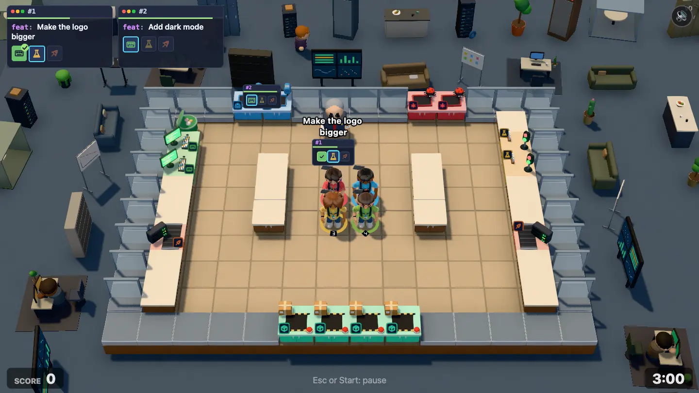
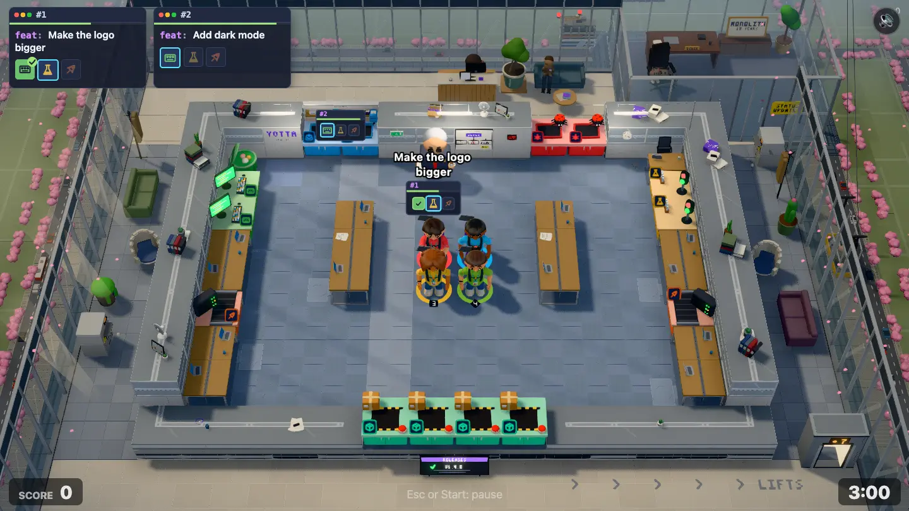
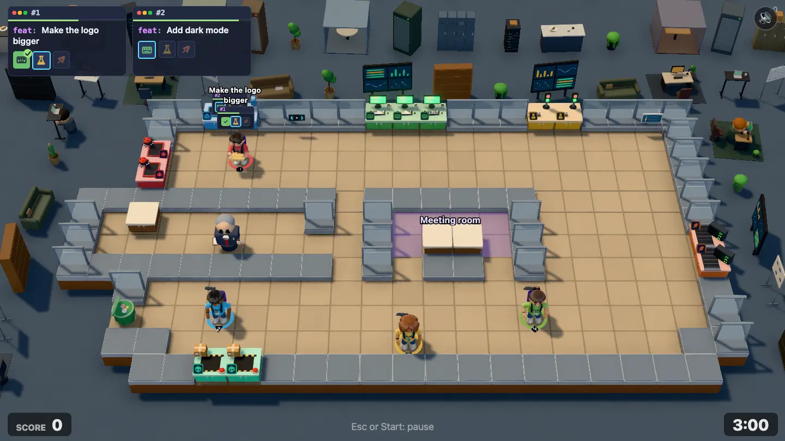
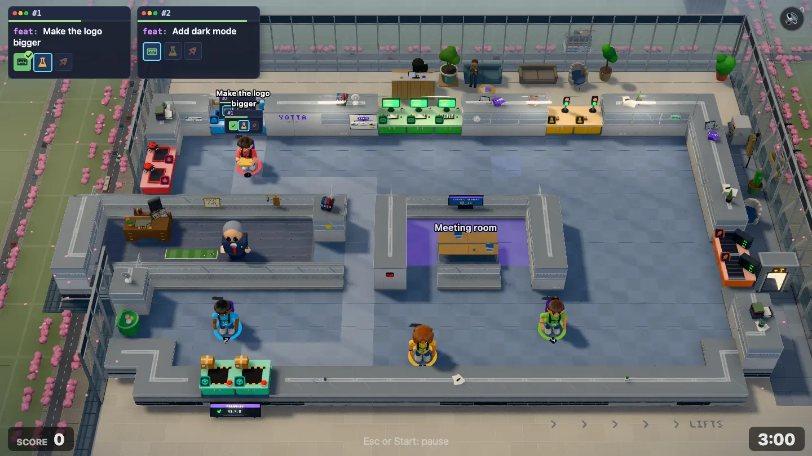

# Middle Management environment pass

**Status:** two rounds done (build, critic review, fixes). Level 3-1 (`middle-management`, "Middle Management"), the first level of the Scale-Up chapter, gets a hand-built world after the garage ([garage-environment.md](garage-environment.md)), [Open Plan Office](open-plan-environment.md), [Down the Hall](down-the-hall-environment.md), [Seed Round](seed-round-environment.md), [Demo Day](demo-day-environment.md) and [On Call](on-call-environment.md).

| Before                                                | After                                                | Before, redesign draft                                      | After, redesign draft                                      |
| ----------------------------------------------------- | ---------------------------------------------------- | ----------------------------------------------------------- | ---------------------------------------------------------- |
|  |  |  |  |

**Goal:** the world around the level tells one story, the way Overcooked 2 levels do. Render only (`src/render/`); the sim, maps and balance don't change.

## The story in two sentences

> It's a bright spring morning and YOTTA, Series A in the bank, has rented a whole floor of a mid-rise office building, with cherry blossom on the street below: the investors wanted "adult supervision", so meet Derek, ex-MONOLITH, YOTTA's first manager, whose glass corner office sticks out of the building and is bigger than the founders' desks put together. Derek isn't evil; he just needs a status update, and he walks into you on the way to ask for one.

That is the level: tickets arrive at reception with a visitor badge (the inbox), shipped work goes up on the release board by the lifts (the ship hatch), and the manager is Derek doing his rounds.

## Where this sits on the road

See [the storyline](../game/storyline.md#3-1-middle-management-middle-management). 2-3 On Call ended the Startup chapter at its lowest point, literally: a basement at 3 AM, cold tubes, snow in the light wells. 3-1 opens Scale-Up in the opposite place: **up**, on a bright, clean, new office floor in daylight, the first time YOTTA has a real office with a reception, lifts and a manager. 3-2 Hypergrowth is two floors of this same building on a rainy day, full of unopened desk boxes; 3-3 Hot Desking is three floors on a Friday afternoon. So 3-1 sets up the building's materials (later levels reuse them) and must **not** already show 3-2's joke (no piles of desk boxes, no welcome balloons).

- **Material:** the most "corporate" so far: light grey plasterboard partitions with glass on top (a frosted manifestation stripe), slim brushed-aluminium frames and head tracks, new two-tone carpet tiles, light oak-veneer and white laminate furniture, a stone-floored lift lobby. Nothing of the basement's block, the loft's white steel and birch, or the stage's black.
- **Light:** the brightest level so far. Clean, slightly cool spring-morning daylight coming in low from one side through the curtain wall, the mullions' shadows striped across the floor, soft fill. Petals drift outside. Mean luminance on the shipped frame about 105 (On Call ended at 91).
- **Outside:** the city in spring, **seen from above**: we're on an upper floor, so past the building's curtain wall the street is far below (cherry blossom canopies in pink, pavement, tiny cars and a bus), and across the street the crane tower, now half-clad in glass, rises to our level with its crane. MONOLITH's tower is a faint shape further off.

**Not food, not a kitchen.** No catering, pizza boxes, kegs, fruit bowls, crates or bars. One coffee machine on a side table and mugs on desks are fine. **No brushed-steel worktops:** the desks are white laminate or oak veneer, matte, darker than every station top.

## Read it from the fixed front camera

Top of screen = back of the level.

- **Back (top of screen): reception and the curtain wall.** Behind the room's back wall is the floor's reception. The **inbox is reception's pass-through**: at the inbox tiles the back wall becomes the reception counter's inner side, with a visitor-badge printer, a tray of clip-on visitor badges and lanyards, and a small "PLEASE SIGN IN" stand. Behind it (World): the reception desk proper (light oak, a monitor, a desk bell, a sign-in tablet), a receptionist on the phone (`phoning`), a visitor waiting on a low sofa with a badge on, and Prod in a ceramic pot. Beyond reception, the building's **curtain wall** closes the top of the frame: floor-to-ceiling glass in aluminium mullions with a spandrel band, and through it the crane tower across the street. **HUD:** the order cards cover 0–690 × 0–140, and on both maps the inbox sits under that band's right half, so reception's story pieces (sofa, visitor, Prod) spread right from the inbox, not up from it, and the logo is on the room side (see Running gags). The backdrop must not hide back-wall stations: the reception area is low near the back wall; tall things (the curtain wall) stand further back.
- **The ship hatch is the release board by the lifts.** On both maps the ship tiles are on the **front** edge, so keep it **low** (under 0.6): the hatch is a low, tilted, floor-standing **release board** screen at the ship ("RELEASES" with a green tick and a version number, YOTTA violet header) on the lift lobby's stone floor, and a strip of floor arrows "LIFTS" pointing off to the side. The **lift doors** themselves (brushed steel, a floor indicator over each, one door open) stand on the side outside the room nearest the ship, as far forward as fits without entering the front strip. On the shipped map the ship is front centre (x 5–8); on the draft it's front left (x 5–6), and the left of the draft's front is outside the building (see below), so the lifts may have to go right or at the front corner of the building line: the World track decides from the map.
- **Front (bottom of screen): the lift lobby floor, thin.** The camera shows only about 1.2 tiles in front of the slab. Stone-tile lobby floor (pale, with joints), the release board, the floor arrows, and a low set: a slim planter trough, a recycling bin trio. All under 0.6, no people.
- **Left and right: the rest of the floor, then the curtain wall and the air.** Out to the frame edges: the floor continues for a tile or two (carpet, a breakout corner with a low sofa and a pod chair, a printer with a "PAPER JAM" note, a coat stand), then the building's curtain wall, and past it **the drop to the street**: we look down on cherry trees in blossom, pavement, a bus stop and tiny traffic, far below (scaled and darkened by depth, like Seed Round's view). A window-cleaning cradle hanging outside the glass on one side, its ropes running up out of the top of the frame, with a window cleaner (`idle` or a wiping pose) is the spring-morning gag if it fits.
- **Derek's corner office.** The joke of the level: a glass box at a corner that sticks out of the building, with a big desk, a leather executive chair (**Segfault asleep on it**, he hasn't noticed), a framed "MONOLITH · 10 YEARS OF SERVICE" certificate, **his old MONOLITH lanyard** on a coat hook, a putting mat with a golf ball, a pot plant, a "STATUS UPDATE?" sticky note on the glass. Derek himself is the manager in the play area, never a prop.
  - **Shipped map** (`maps/level-07-middle-management.txt`, 14×10, no office in the map; the manager starts at the back by the inbox): the World builds the corner office outside the room at the back-right corner (behind the bug queue and the test benches), poking out past the building's curtain wall line.
  - **Draft** (`maps/drafts/middle-management.txt`, 22×12): the office **is** in the map: the walled room at x 1–7, rows 5–6, with Derek's desk counter at (2,5) and one door at (8,6), sticking out of the building's left side. The Room track dresses it inside (desk, chair, cat, lanyard, certificate on its wall faces); the World builds no second office.
  - `managerOffice(map)` in `src/render/three/rooms/managerOffice.ts` tells the two apart (null on the shipped map, the office's tiles and door on the draft). Both tracks use it.
- **The draft's meeting room** (x 11–14, rows 5–6, `m` floor, table at 12–13,6, doors at 11,7 and 14,7): glass-walled like the rest, with a wall TV on its wall face reading "STATUS UPDATE · 09:30" and a few chairs round the table. Its `m` floor tint is the sim's meeting-room marker: leave it readable.
- **The draft's voids.** The draft's left edge is the office sticking out: the voids above it (x 0–1, rows 0–3) and below it (x 0–1, rows 8–11) are **outside the building**: the air over the street, so fill them with the view down to the cherry trees and pavement, plus the building's outer wall (curtain-wall glass and spandrel) running along the void edges. The small corner voids at the front (x 0–2 and 20–21, rows 10–11) are low things only.
- **Inside the room.** **Walls:** office partitions: a light grey painted plasterboard lower part (about 0xc9ccce) with a brushed-aluminium skirting, topped by a **glass band** with a frosted manifestation stripe (a thin row of YOTTA-violet dots or dashes, small) in slim aluminium frames; the cap is a slim cool aluminium head track, never a wide flat slab. Coursing here means the partition's panel joints every 1.2 and the glass band's mullions, plus scuffs at trolley height. Where the camera looks through glass, what's behind must still read as outside the play area. **Floor:** new two-tone carpet tiles (cool blue-grey, quarter-turned, per-tile tone ±4%), a lighter-grey **walkway** band from reception to the lifts, and placed wear: castor marks and a chair-mat under desks, a coffee stain by a desk (small, translucent, never under a spawn), **one tile from a different batch** (a slightly different blue: the fit-out ran short). **Counters:** bench desks: white laminate or light oak tops with a grey cable spine, a monitor arm or a laptop on some, a mug; darker than every station top. **Wall faces:** the plan as **Derek's org chart** (a framed print: "Derek" on top, and under him three boxes "1. Build it", "2. ???", "3. Profit"), a "YOTTA" vinyl logo beside the inbox (see Running gags), a fire-exit sign, a wall clock, a "QUIET ZONE" sign nobody respects, a booked-solid room-booking panel. **Wall tops:** fat ring binders, a desk fan, a framed team photo, a potted succulent, a stack of "WELCOME TO YOTTA" printed guides, a box of new lanyards, in 3–4 clusters per long wall. **Lights:** office pendant fittings (long linear LED pendants) hung on a cable strung wall to wall along the back only, never over the front wall.
- **Light:** low spring-morning sun from one side through the curtain wall, raised enough (about 40–45°) that the back row isn't swallowed; the mullions' shadow stripes falling across the floor if the Light track can do it cheaply (no new shadow-casting lights; a cookie-like decal under the sun direction or a light texture is fine); a soft cool fill; the linear pendants' small warm-white pools along the back; petals drifting outside as the motes (not over the play area). Mean luminance on the shipped frame about 105.
- **Life:** the receptionist on the phone, the visitor shifting on the sofa, the window cleaner, petals drifting, a bus moving along the street below if cheap, the crane's red light blinking, Segfault breathing. Few, small, never near the players.

## Running gags

| Gag             | Where                                                                                                                           | Track                     |
| --------------- | ------------------------------------------------------------------------------------------------------------------------------- | ------------------------- |
| YOTTA's logo    | vinyl letters on reception: in YOTTA violet on the back wall's room face right beside the inbox (out of the order cards' band)  | Room                      |
| Prod            | in reception in a ceramic pot, on the reception side of the back wall, right of the inbox                                       | World                     |
| Segfault        | asleep on Derek's executive chair (he hasn't noticed), breathing                                                                | World shipped, Room draft |
| MONOLITH        | Derek's old MONOLITH lanyard on a coat hook in his office; MONOLITH's tower a faint shape on the skyline                        | World shipped, Room draft |
| The crane tower | across the street, half-clad in glass now, the crane on top with its blinking red light, seen through and past the curtain wall | World                     |
| The plan        | Derek's org chart on a wall face: Derek on top, under him `1. Build it`, `2. ???`, `3. Profit`                                  | Room                      |
| Spring          | cherry blossom canopies on the street below, petals drifting                                                                    | World, Light (motes)      |

All cameos out of the play area, out from under the HUD, small enough to find and never readable as a player.

## The six Overcooked lessons, for this level

| Lesson                                 | Here                                                                                                                                     |
| -------------------------------------- | ---------------------------------------------------------------------------------------------------------------------------------------- |
| The frame is full, at several heights  | Reception and the curtain wall at the back, the crane tower above it, Derek's office and the lifts at the sides, the street far below    |
| The room's edge is made of the setting | Plasterboard-and-glass partitions with aluminium head tracks, the reception counter at the inbox, the lift lobby's stone at the front    |
| Surfaces carry material and wear       | Carpet tiles with a walkway band, castor marks, the odd-batch tile, scuffed partitions, frosted manifestation, stone lobby joints        |
| One place, one story                   | One rented floor in a mid-rise on a spring morning, and its new manager. Nothing of the basement, the loft or the stage                  |
| Light does the composition             | Low morning sun from one side through the glass, mullion stripes on the floor, bright clean office light, the street below in soft shade |
| The outside connects to the play       | Tickets come in at reception with a visitor badge (inbox); shipped work goes up on the release board by the lifts (ship)                 |

## Rules

The rules in the [level-environment skill](../../.agents/skills/level-environment/SKILL.md) hold, plus:

- **Both maps:** the shipped `maps/level-07-middle-management.txt` (14×10, one rectangular room, no void; inbox 2 tiles on the **back** edge at x 4–5, bug queue on the back edge at x 10–11, keyboards on the left edge, test benches on the right, pipelines left and right at row 6, ship 4 tiles on the **front** edge at x 5–8, bin at the back-left; two desk islands of counters in the middle; the manager starts at (6,1)) and the draft `maps/drafts/middle-management.txt` (22×12, `?draft=middle-management`: a big open floor split by a spine of rooms, Derek's office sticking out on the left, a meeting room in the middle, voids at the left and in the front corners; inbox on the back edge at x 4–5, ship on the front edge at x 5–6). Place everything from the outline, the void tiles, the ship and inbox tiles and `managerOffice(map)`.
- **Derek is the player-sized manager in the play area.** No scene person may look like him (no suits with lanyards outside), and no prop may sit where he walks.
- **No 3-2 props:** no unopened desk boxes in piles, no welcome balloons, no "new starter" packs everywhere. One box of lanyards on a wall top is fine.
- Value hierarchy: the carpet mid-light cool grey (about 0x8a929c base, not white), partitions light grey, caps cool aluminium grey; glass reads as glass (light, with a reflection stripe), never as a bright slab. The bright, saturated things are the stations.
- Other levels keep their look: the new wall theme `midRise` and floor theme `corporateCarpet` are used only by `middle-management`. Chapter-2 set dressing (`setDressing/rooftop.ts`) may be imported, and given new optional parameters, but its defaults and other levels must not change.

## Work split (round 1)

Three agents in one worktree at once, with strict file ownership. The shared plumbing (stub scene, stub dressing, themes, `LEVEL_LOOKS`, `managerOffice`) is done first.

| Track     | Owns                                                                                                                                                                                       |
| --------- | ------------------------------------------------------------------------------------------------------------------------------------------------------------------------------------------ |
| **Room**  | `rooms/midRise.ts` (+test), `rooms/midRiseRoom.ts` (+test), `roomModels/midRise.ts`, `setDressing/midRiseWallTops.ts`, the `midRise`/`corporateCarpet` rows in `look.ts` and `mapShape.ts` |
| **World** | `scenes/middleManagement.ts` (+test), `setDressing/midRise.ts`                                                                                                                             |
| **Light** | `atmosphere.ts` (+test), `stage.ts` (the three.js Stage), `WorldFx.ts`, `createLights` in `look.ts`                                                                                        |

## Rounds

Round 1 ran three agents at once (Room, World, Light), with the Overcooked 2 mine level and our finished garage, Open Plan and On Call frames as the bar. The critic scored it **6/10** on the shipped map and **5.5/10** on the draft (before: 3/10 on both). It read as one clean office floor in a glass building, with reception behind the inbox, the release board at the ship, petals and mullion stripes. What held it back:

- "Up on a mid-rise" didn't read: the street was painted at floor level, so it looked like a park beside the building.
- The frame was the greyest we had shipped (saturation 0.19): overcast, not a spring morning.
- The oak desks were as bright as the test benches.
- The lift bank read as a beige fridge.
- On the draft, Derek's office read as a corridor, not the joke.
- Smaller: slab-like wall tops with a row of glints, pod chairs that read as lumps, window-cleaner ropes with no cradle in frame, a row of floor arrows by the HUD, an org chart that read as a line graph, the logo behind Derek's spawn, the street showing through the shipped office floor, and a crane tower that barely showed.

Round 2, in three chunks:

- **Room:**
  - The desks went darker (0x9e8460), below every station top.
  - The wall tops are a slim aluminium head track, with glints on one tile in three.
  - The carpet is bluer (0x7f8ea3), with an odd-batch tile and a blue-grey walkway.
  - Derek's draft office has a plush floor, a walnut executive desk with a DEREK nameplate and a credenza, a putting mat, the MONOLITH lanyard on the glass, and Segfault on a chair turned toward the camera.
  - The org chart is a tree: a violet DEREK box over three white boxes.
  - The YOTTA vinyl sits on a face with no spawn in front of it, so it shows at the start.
- **World:**
  - The city is small and in the far tier below a slab edge with a dark spandrel band. It has blossom in clumped rows, traffic on two streets each side, and the building's shadow.
  - The lifts are brushed steel facing the camera, with one car open and lit.
  - The pod chairs are open tub chairs.
  - The window cleaner's cradle is in frame, with thin ropes clear of the mute button.
  - At most five arrows lead to LIFTS.
  - No street shows through the office.
  - A new half-clad crane tower: glazed below, a bare concrete frame on top, the crane on its roof.
- **Light:**
  - A warmer sun raised to about 50°, so the back row stays lit.
  - A softer fill and a haze over the city below.
  - Brighter back pendants.
  - Faint sun shafts at the left.
  - A saturation grade (1.35) on this level's 3D canvas only.

Measured on the final shots:

| Measure                                   | Before        | Round 1       | Final         |
| ----------------------------------------- | ------------- | ------------- | ------------- |
| Frame mean luminance, shipped / draft     | 103.1 / 104.4 | 107.1 / 111.5 | 104.9 / 109.2 |
| Frame mean luminance, `quality=low`       |               | 109.9         | 106.4         |
| Frame saturation, shipped / draft         | 0.31          | 0.19 / 0.17   | 0.25 / 0.23   |
| Sunlit desk / yellow test bench luminance |               | 150 / 147     | 118 / 147     |
| Bug queue luminance (back row)            |               | 86            | 96            |

Open Plan measured 107.7 before and after (unchanged).

Left for later:

- **No true drop.** The street "far below" reads from scale, the slab band and the shadow, not real parallax: `Surroundings` puts an opaque horizon plane at the slab's foot. An optional `Scene.horizonY` in `surroundings.ts` and `scenes/types.ts` would let the city sit 2.5 lower.
- **The crane tower is small** (about 60 px) and hazed behind the back glass; from this camera you mostly see its roof. MONOLITH's tower shows only on the draft.
- **The grade is blunt.** The saturation filter lifts everything on this level, skin and wood included. The sun shafts barely show, and the draft has none.
- **Small text.** The DEREK nameplate, the certificate, PAPER JAM and the sticky notes are only just legible at 1440×810. Segfault reads as a small grey loaf.
- **Bright head track.** The aluminium ridge goes near-white in the sun on the back and side walls.
- **The draft's lifts** stand about four tiles up the right side, because the front corner is cut by the frame edge.
- **The window-cleaner cradle** reads only moderately through the curtain wall's glass and mullions.
- Not checked on a real GPU.

## Done when

- [x] The shot reads as "a startup's new office floor in a mid-rise on a spring morning, and its new manager" without explanation, and nothing in it reads as food or a kitchen.
- [x] The storyline beat reads with no explanation: we're up on a rented office floor, Derek's glass corner office sticks out, the city is in spring below.
- [x] The outside connects to the play: tickets come in at reception, shipped work goes up on the release board by the lifts.
- [x] The running gags are in place: the vinyl logo, Prod in reception, Segfault on Derek's chair, his MONOLITH lanyard, the half-clad crane tower, the org chart.
- [x] No flat empty ground and no void in the 1440×810 frame.
- [x] Stations, players and Derek read at a glance; nothing hides them.
- [x] Works on the shipped map and on `?draft=middle-management`.
- [x] `npm run check` passes; other levels look as before.
