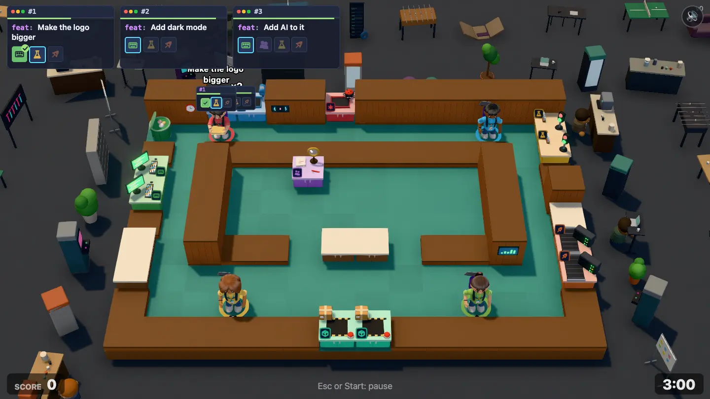
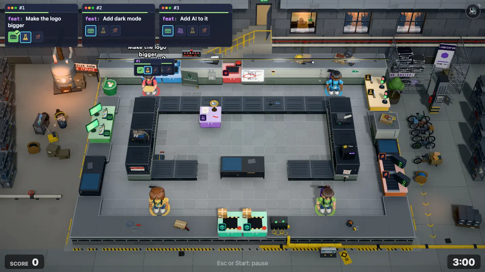
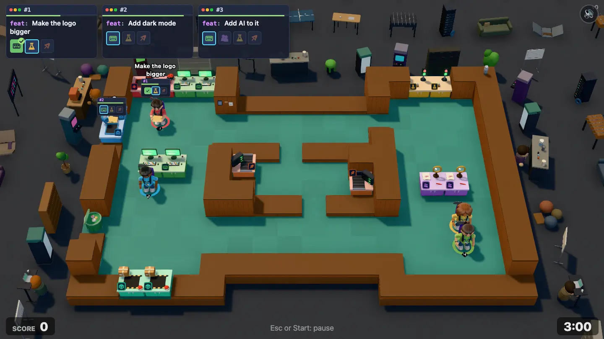
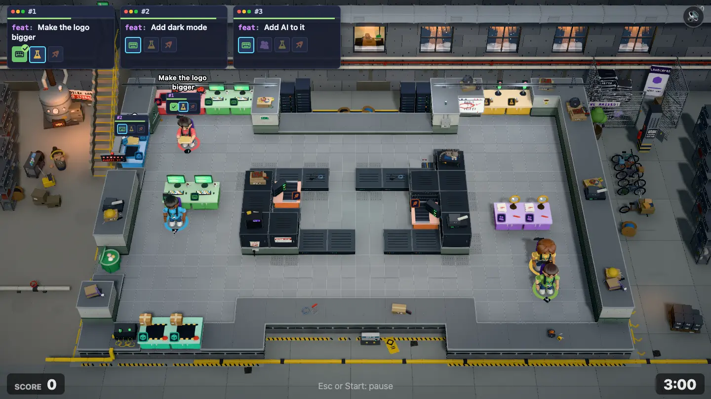

# On Call environment pass

**Status:** two rounds done (build, critic review, fixes). Level 2-3 (`on-call`, "On Call"), the last level of the Startup chapter, gets a hand-built world after the garage ([garage-environment.md](garage-environment.md)), [Open Plan Office](open-plan-environment.md), [Down the Hall](down-the-hall-environment.md), [Seed Round](seed-round-environment.md) and [Demo Day](demo-day-environment.md).

| Before                                      | After                                      | Before, redesign draft                            | After, redesign draft                            |
| ------------------------------------------- | ------------------------------------------ | ------------------------------------------------- | ------------------------------------------------ |
|  |  |  |  |

**Goal:** the world around the level tells one story, the way Overcooked 2 levels do. Render only (`src/render/`); the sim, maps and balance don't change.

## The story in two sentences

> It's 3 AM on a snowy winter night, the night after Demo Day went viral, and YOTTA's servers in the basement under the loft building are falling over: the founders, still in their Demo Day outfits, firefight the traffic spike in the server room while the pager on the stairs keeps going off. Around them the building sleeps, and the night cleaner's mop robot, Moppy, calmly mops the corridor round the server room as it does every night at 3 AM, wet floor and all.

That is the level: tickets are alerts coming in at the pager board by the stairs (the inbox), shipped work goes up the uplink to the racks ("DEPLOYED"), and the round timer is the night until the morning, when the Series A lands.

## Where this sits on the road

See [the storyline](../game/storyline.md#2-3-on-call-on-call). 2-1 Seed Round was the loft on the roof (white steel and glass, blue hour, the city); 2-2 Demo Day was the accelerator's stage (stage black, hot stage light, an audience). 2-3 goes **down**: same building as the seed round, but the basement. It is the first level that is all machines and no people, and the most "tech" so far: server racks, cable trays, a raised floor, fibre, blinking LEDs. It ends the Startup chapter at its lowest point (literally) before 3-1 Middle Management's bright spring office floor.

- **Material:** painted concrete block and bare poured concrete, steel cable trays, grey raised-floor tiles, black racks with blue and green LEDs. Nothing of the loft's white steel and birch, nothing of the stage's black flats.
- **Light:** cold fluorescent tubes on the play area, the racks' blue-green glow, the boiler's warm orange glow on one side, and orange sodium streetlight falling down the light wells with snow in it. Night outside, bright work light inside.
- **Outside:** there is no outside at ground level; the "outside" is the rest of the basement (boiler room, bike storage, the storage cage, the stairs) and, high in the back wall, the light wells up to the snowy street.

**Not food, not a kitchen.** No catering, pizza boxes, kegs, crates or bars. One coffee mug or an energy-drink can on a rack is fine. **No brushed-steel worktops** either: steel counters with a lip read as a kitchen pass (the Demo Day critic said so of its caps). Counters are dark, matte, powder-coated or plastic.

## Read it from the fixed front camera

Top of screen = back of the level.

- **Back (top of screen): the building's foundation wall with the light wells.** The room's back wall stands against the building's poured-concrete foundation wall (formwork lines, tie holes, a damp stain), which rises above the wall tops and closes the top of the frame. In it, 2 to 3 **light wells**: deep window shafts going up to street level, with a steel grating at the top, snow drifting down and settling on the sills, and orange sodium streetlight falling in. Through one of them (the one nearest the stairs), the **security guard asleep at the desk upstairs** is visible: a small lit lobby window at street level, a slumped figure with a cap, a desk lamp. Pipes and a big ventilation duct run along the foundation wall above the room, on brackets. The foundation wall must not hide back-wall stations: it starts behind the back wall, its lower part reads as the room's back wall, and the light wells are above the wall tops.
- **The inbox is the pager board by the stairs.** A concrete stair flight comes down from the lobby beside the inbox (outside the room, placed from the inbox tiles: behind it on the shipped map where the inbox is on the back edge, to the left of it on the draft where the inbox is on the left edge). On the wall at the inbox: a fire door propped open with a wedge, and over it the **pager board**: a wall-mounted alert panel with a row of red alert lamps (one blinking), a small screen "ALERTS · 37" and a pager hanging on a hook. Alerts come down the stairs.
- **The ship hatch is the uplink.** At the ship tiles (front edge on both maps, so keep it **low**: under 0.6): a deploy console on the floor-standing patch frame: a fibre patch panel with yellow fibre loops, a big green "DEPLOY" key switch, a green "DEPLOYED" lamp, and a yellow fibre duct running from it under the wall and off along the front. Shipped work goes up the uplink to the racks.
- **Front (bottom of screen): the corridor floor, thin.** The camera shows only about 1.2 tiles in front of the slab. The basement floor continues: painted concrete with a worn yellow-and-black safety line along the wall, a floor drain, the yellow fibre duct, and **Moppy's charging dock** (empty: Moppy is out on its route) with a tiny green "charging" light and a yellow WET FLOOR A-frame sign lying folded beside it. All under 0.6, no people.
- **Left: the boiler room.** A big old boiler (cylindrical, pipes going up, pressure gauges, a little window with an orange flame glow), an expansion tank, valve wheels, insulated pipes running up and along, a "BOILER ROOM · NO STORAGE" sign, and of course storage in front of it: boxes. A thin steam wisp from a valve. The **night cleaner** stands here (or on the right) on a break: headphones, a cup of coffee (`sipping`), the cleaning cart beside her with a mop bucket. She ignores everything.
- **Right: bike storage and the storage cage.** Bike racks with a few bikes (one cargo bike, one with a child seat), a storage cage of chicken-wire mesh with the startup's leftovers: **Demo Day's flight cases, the LAUNCHPAD roll-up banner and a deflated "WE RAISED!" balloon** (callbacks to 2-1 and 2-2, dumped downstairs), a stack of moving boxes. A fire extinguisher, a breaker panel.
- **The draft's voids.** The draft (`?draft=on-call`) is an H: two rooms (left and right) joined by two corridors round a walled server room in the middle, with voids above and below the middle (top: x 6–11, row 0; bottom: x 6–11, row 11). Fill both void shapes with basement: the top void with a rack row or a cable-tray run and a light well over it; the bottom void with low things only (the floor, Moppy's dock, the fibre duct, a mop bucket). Interior walls are the same walls as the outer ones.
- **Inside the room (the corridor ring and the server room).** On both maps an inner walled block is the server room and the ring round it is the corridor Moppy mops. **Walls:** painted concrete block, the lower part painted a muted grey-green, a darker dado band and a kick plinth, block coursing every 0.2 with staggered joints, scuffs and a damp patch; caps are a cool, light cast-concrete coping with a lip (never a wide flat tan slab). The **server room's own walls** (the interior block) may read as a server cage: the same block below and black rack fronts or a steel mesh with racks behind it on top, blinking LEDs. **Floor:** grey anti-static **raised-floor tiles** (0.5-tile grid, per-tile tone ±4%, thin light joints), a few perforated vent tiles (darker, dotted) along the server room walls, and placed wear: a lifted tile with cables showing near a wall, cable ties, a scuff trail. Translucent, small, near edges, never under a spawn. **Counters:** dark grey powder-coated rack shelves or decommissioned servers on a crash cart, darker than every station top, with a blue ESD mat or a laptop on some. **Wall faces:** the runbook whiteboard (the plan), a "SERVER ROOM · AUTHORISED ONLY" sign, a fire-exit pictogram, a breaker box, a thermostat reading 31°C, a "PLEASE DO NOT UNPLUG" note. **Wall tops:** cable reels, spare drives in a box, patch cables in loops, a rack-mount UPS, an energy-drink can pyramid (one per level, small), a hard hat, a box of zip ties, the Demo Day lanyards. Clustered 3–4 per long wall. **Lights:** fluorescent twin-tube battens on a cable tray strung wall to wall along the back (never hanging from nothing), one of them flickering.
- **Light:** cool fluorescent white key (the "sun"), high, about 45°, so the play area is bright and readable; the racks' blue-green glow; warm boiler glow at the left edge; orange sodium light in the light wells with **snow** falling through it (the motes); the red pager beacon blinking at the inbox. Mean luminance of the shipped frame about 100 (Demo Day ended at 91; don't go below that).
- **Life:** Moppy is the mechanic and isn't built yet, so the world has its dock but no robot. The night cleaner sipping coffee, the guard asleep upstairs (breathing), the boiler's steam wisp, the pager beacon blinking, rack LEDs blinking, snow falling, one flickering tube, Segfault breathing. Few, small, never near the players.

## Running gags

| Gag                       | Where                                                                                                           | Track |
| ------------------------- | --------------------------------------------------------------------------------------------------------------- | ----- |
| YOTTA's logo              | a violet YOTTA sticker on a server rack (a rack on the server-room wall tops or in the top void), findable      | Room  |
| Segfault                  | asleep on top of the warmest server (a rack on a wall top, away from spawns), `purr`, out of the play area      | Room  |
| Prod                      | brought down from the loft "for the oxygen": the seed round's far-too-big planter, squeezed in a corner outside | World |
| The plan                  | the incident runbook on a wall face: `1. Build it  2. ???  3. Profit`, with "2. ???" circled in red             | Room  |
| Demo Day / Seed callbacks | the storage cage: flight cases, the LAUNCHPAD roll-up, the deflated "WE RAISED!" balloon                        | World |
| The guard                 | asleep at the lobby desk, seen through a light well                                                             | World |

All cameos out of the play area, out from under the HUD, small enough to find and never readable as a player.

## The six Overcooked lessons, for this level

| Lesson                                 | Here                                                                                                                                |
| -------------------------------------- | ----------------------------------------------------------------------------------------------------------------------------------- |
| The frame is full, at several heights  | Foundation wall with light wells and ducts at the back, the boiler and its pipes left, bikes and the storage cage right, racks      |
| The room's edge is made of the setting | Painted block walls with concrete coping, cable trays and pipes on brackets, the server cage, the raised floor's edge as foundation |
| Surfaces carry material and wear       | Block coursing, formwork lines, damp stains, raised-floor tiles with vents and a lifted tile, the worn safety line                  |
| One place, one story                   | A building's basement at 3 AM: boiler, bikes, storage, servers. Nothing of the loft or the stage, except what got dumped down here  |
| Light does the composition             | Bright cold work light on the play area, blue-green rack glow, warm boiler at the left, orange snow light falling down the wells    |
| The outside connects to the play       | Alerts come down the stairs to the pager board (inbox); shipped work goes up the fibre uplink (ship)                                |

## Rules

The rules in the [level-environment skill](../../.agents/skills/level-environment/SKILL.md) hold, plus:

- **Both maps:** the shipped `maps/level-06-on-call.txt` (14×10, one room with an inner walled server room, inbox 2 tiles on the **back** edge at x 2–3, bug queue on the back edge, ship 2 tiles on the **front** edge at x 6–7, test benches and pipelines on the right edge, no void) and the draft `maps/drafts/on-call.txt` (18×12, an H round a walled server room, voids top and bottom middle, inbox 2 tiles on the **left** edge, ship 2 tiles on the **front** edge at x 2–3, `?draft=on-call`). Place everything from the outline, the void tiles and the ship and inbox tiles.
- **No food or drink props** (one mug or can excepted), and **no brushed-steel worktops**.
- Value hierarchy: the play floor mid-light grey (about 0x8c9094 base, not white), walls muted grey-green, caps cool concrete. The bright and saturated things are the stations; the rack LEDs and the pager beacon are small points.
- The draft's mop route (`r`) is plain floor until the mop-robot mechanic exists. Nothing in this pass dresses it, and no decal sits on it that could later be mistaken for the wet trail (no blue, glossy or puddle-like decals anywhere in the play area).
- Other levels keep their look: the new wall theme `basement` and floor theme `raisedFloor` are used only by `on-call`.

## Work split (round 1)

Three agents in one worktree at once, with strict file ownership. The shared plumbing (stub scene, stub dressing, themes, `LEVEL_LOOKS`) is done first.

| Track     | Owns                                                                                                                                                                                        |
| --------- | ------------------------------------------------------------------------------------------------------------------------------------------------------------------------------------------- |
| **Room**  | `rooms/basement.ts` (+test), `rooms/basementRoom.ts` (+test), `roomModels/basement.ts`, `setDressing/basementWallTops.ts`, the `basement`/`raisedFloor` rows in `look.ts` and `mapShape.ts` |
| **World** | `scenes/onCall.ts` (+test), `setDressing/onCall.ts`                                                                                                                                         |
| **Light** | `atmosphere.ts` (+test), `stage.ts` (the three.js Stage), `WorldFx.ts`, `createLights` in `look.ts`                                                                                         |

## Rounds

Round 1 ran three agents at once (Room, World, Light), with the Overcooked 2 mine level as the reference. The critic scored it **6/10** on the shipped map and **5.5/10** on the draft (before: 3/10 on both). The basement read at once: the stairs from the lobby, the boiler room, the bikes and the storage cage, the black racks of the server cage, the raised floor, and the uplink with its yellow fibre duct. What held it back:

- It didn't read as night: the light wells looked like warm house windows.
- The pager board sat under the inbox's ticket billboard.
- Segfault (orange, striped, on a grey towel) read as a roast chicken on a plate.
- The cardboard boxes were the most saturated thing on screen.
- Half of the server room's inner walls read as counters.
- A lifted floor tile read as a hole in the play area.

Round 2, in three chunks:

- **Room:**
  - The pager board moved to the wall tile after the inbox run (`pagerBoardTile`), so "ALERTS 37" shows beside the fire door.
  - Every inner wall is a dark rack cage, darker than the counters but distinct from them.
  - The lifted tile moved into a corner and shows cables in a grey pit.
  - The runbook is twice the size, hung on chains and tipped toward the camera.
  - The wall face and floor are darker; the cable tray and battens are thin and grey at one height on both maps.
  - The drink-can pyramid became a single can.
- **World:**
  - Segfault is a grey tabby with its tail over the server's edge, on an ESD-blue towel, and it breathes.
  - The light wells are night blue with a sodium wedge at the top and cold snow; the foundation wall is about 25% darker.
  - The guard is a silhouette asleep under a lit lobby window; the night cleaner has a bun and yellow headphones.
  - The boiler is silver-lagged and piped back into the wall.
  - There are half the box piles, in muted colours; the shelving holds grey archive bins.
  - The bottom corners have low dressing (a floor pipe, an archive pallet, a drain, Moppy's yellow route chevrons).
- **Light:**
  - The beacon follows the pager board.
  - Snow is white flakes and the sodium light is a narrow cone.
  - The well light sits high in the shaft and the boiler glow is shorter and softer.
  - A sodium pool lights the bottom-right corner.

Measured on the final shots:

| Measure                                   | Before      | Round 1     | Final       |
| ----------------------------------------- | ----------- | ----------- | ----------- |
| Frame mean luminance, shipped / draft     | 72.6 / 70.7 | 97.8 / 99.7 | 91.4 / 93.4 |
| Frame mean luminance, `quality=low`       |             | 102.6       | 96.6        |
| Play floor L                              |             | 162         | 151         |
| Inner walls L (counters about 51)         |             | 113–119     | 39–63       |
| Cardboard box saturation                  |             | 0.72        | 0.23–0.35   |
| Ship / red bug queue front saturation     |             | 0.56 / 0.51 | 0.56 / 0.51 |
| Yellow bench top / green keyboard front S |             | 0.26 / 0.18 | 0.27 / 0.18 |

Left for later:

- **Pale station tops.** The yellow bench top (S 0.27) and the green keyboard front (S 0.18) stay below the critic's 0.30 / 0.25. Light can't fix it: `stationModels.ts` draws station tops as `tint(color, 0.4)`, which is already that pale as a material. A smaller tint (about 0.3) would fix it, but touches every level.
- **"Dim" more than "3 AM".** The basement round the room reads dim rather than deep night. A darker hall would take a frame mean nearer 88, below the floor we keep for readability.
- **Small text.** The "???" inside the runbook's red circle, MOPPY on the dock and the NO STORAGE sign's letters are faint at 1440×810. The shapes read.
- **Static blinkers.** The LEDs beside Segfault and the pager board's lamps don't blink (room pieces can't move; a World `blink` piece at the same spot would do it). The battens' tubes don't flicker; only the point light stutters.
- **Draft details.** The draft's lobby door is under the order cards (only the flight shows); its runbook reaches 0.06 into the next station's tile; Moppy's route chevrons are squeezed against the right wall.
- **The cleaner's headgear** is a separate static piece, so it can drift a little off the head during a sip.
- **Moppy itself** isn't built: the mop-robot mechanic comes later, and the world has only its empty dock and route chevrons.
- Not checked on a real GPU.

## Done when

- [x] The shot reads as "a startup firefighting its servers in a basement at 3 AM on a snowy night" without explanation, and nothing in it reads as food or a kitchen.
- [x] The storyline beat reads with no explanation: we're under the loft building, it's the night after Demo Day, the pager is going off.
- [x] The outside connects to the play: alerts come down the stairs to the pager board, shipped work goes up the uplink.
- [x] The running gags are in place: the logo sticker, Segfault on the warm server, Prod, the runbook, the storage-cage callbacks.
- [x] No flat empty ground and no void in the 1440×810 frame.
- [x] Stations and players read at a glance; nothing hides them.
- [x] Works on the shipped map and on `?draft=on-call`.
- [x] `npm run check` passes; other levels look as before.
