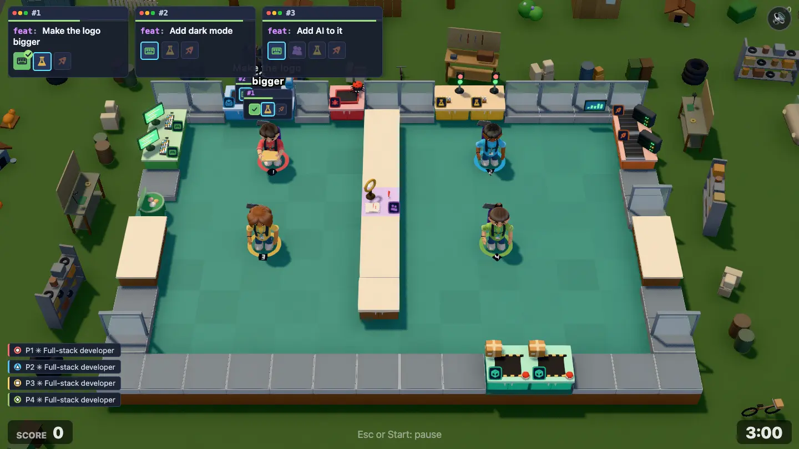
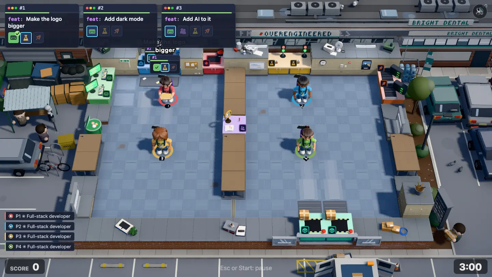
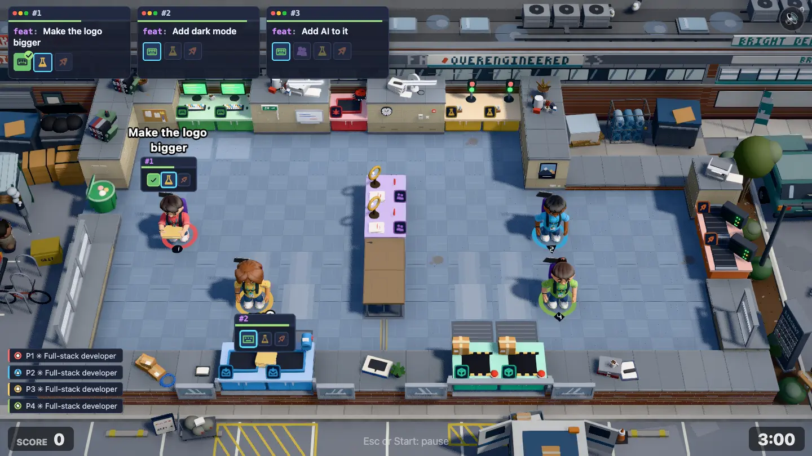

# Open Plan Office environment pass

**Status:** two rounds done (build, critic review, fixes). Level 1-2 (`open-plan`) gets a hand-built world, the second level after the garage pilot ([garage-environment.md](garage-environment.md)). Done together with [Down the Hall](down-the-hall-environment.md), so chapter 1 reads as a journey: suburb, edge of town, city.

| Before                                        | After                                        | After, redesign draft                              |
| --------------------------------------------- | -------------------------------------------- | -------------------------------------------------- |
|  |  |  |

**Goal:** the world around the level tells one story, the way Overcooked 2 levels do. Render only (`src/render/`); the sim, maps and balance don't change.

## The story: Unit 4

> The first angel cheque has cleared, so the founders move out of Mom's garage into Unit 4 of a tired 1990s business park on the ring road. It's a crisp Monday morning; the office is "open plan" because the money ran out before the walls did, and the neighbours (a print shop and a dental lab) have no idea what a startup is.

Read from the fixed front camera (top of screen = back of the level):

- **Back (top of screen): the business-park block.** The level's back wall is the block's wall: a long, low unit building in brown brick with a band of grey cladding panels and strip windows above. The inbox is the door to the shared lobby and post room, where the mail and the landlord's "tickets" come from. Over our stretch, a cheap vinyl banner with the startup's name, hung over the old tenant's ghost lettering. The neighbouring units carry on left and right in the same block (Kwik Print with a roller shutter, a dental lab with blinds down). Low enough never to hide a back-wall station.
- **Front (bottom of screen): the car park, a thin strip.** The ship hatch is the glass front door onto the car park; a courier van stands at it with its back doors open (the shipped work goes out there). Painted bays, wheel stops, a kerb. Everything low: the camera shows only about 1.2 tiles in front of the slab.
- **Left: the bin store.** Big commercial wheelie bins, a bale of flattened delivery boxes, a smoking shelter with a bench and a cigarette bin, a bike rack with one bike.
- **Right: the rest of the car park.** The founders' leased hatchback in a bay, a landscaped verge with sad corporate shrubs and bark mulch, the business-park sign listing its tenants, a lamp post, a cage of water-cooler bottles.
- **Life:** the print-shop guy on a smoke break by the bin store, a courier loading the van, maybe someone parking. Few, small, posed, never near the players.
- **Inside the unit:** painted plasterboard walls (magnolia, with a skirting board and a dado line), some runs of the old glass partitions with a frosted band, a corkboard, whiteboard, a fire-exit sign, a wall clock, a thermostat. Grey-blue carpet tiles laid in alternating pile direction, a worn path from the door, coffee stains, a taped-down cable cover, chair mats. Counters are cheap beech-effect office desks on metal legs; the divider is a desk row. Fluorescent strip lights on wires strung wall to wall along the back.
- **Light:** a bright, cool morning: sun high from the front right, crisp and nearly white, a pale blue sky at the frame edges, a soft cool fill. Brighter and cooler than the garage's golden hour.

## The six Overcooked lessons, for this level

| Lesson                                 | Here                                                                                                      |
| -------------------------------------- | --------------------------------------------------------------------------------------------------------- |
| The frame is full, at several heights  | The block's wall and roofline at the back, parked cars and vans at the sides, the bin store, the verge    |
| The room's edge is made of the setting | Plasterboard with skirting and dado, glass partitions, the block's brick plinth as the foundation         |
| Surfaces carry material and wear       | Carpet tiles with pile direction and stains, scuffed skirting, painted bays and oil spots in the car park |
| One place, one story                   | A business park unit on Monday morning: nothing suburban, nothing city                                    |
| Light does the composition             | Cool bright morning, strip lights inside, edges falling off into the car park                             |
| The outside connects to the play       | Tickets from the lobby door (inbox), work out through the front door to the courier van (ship)            |

## Rules

The rules in the [level-environment skill](../../.agents/skills/level-environment/SKILL.md) hold, plus:

- **Both maps:** the shipped `maps/level-02-open-plan.txt` (14×10, inbox at the back, ship at the front) and the draft `maps/drafts/open-plan.txt` (16×9, `?draft=open-plan`, a void notch at the back right, inbox **and** ship both on the front edge). Place everything from the outline, the void tiles and the ship and inbox tiles: the courier van goes wherever the ship hatch is, the lobby door wherever the inbox is.
- Other levels keep their look: the new wall and floor themes are used only by `open-plan`.

## Work split

Round 1 runs five agents at once in one worktree (see the Down the Hall brief): per level a **Room** and a **World** agent, plus one **Light** agent for both atmospheres.

| Track     | Owns                                                                                                                                                                                                 |
| --------- | ---------------------------------------------------------------------------------------------------------------------------------------------------------------------------------------------------- |
| **Room**  | `rooms/officePark.ts` (+test), `roomModels/officePark.ts`, `setDressing/officeParkWallTops.ts`, the `officePark` and `carpetTiles` rows in the `look.ts` color tables and `mapShape.ts` `WALL_DECOS` |
| **World** | `scenes/openPlan.ts` (+test), `setDressing/businessPark.ts`                                                                                                                                          |
| **Light** | `atmosphere.ts` (+test), `stage.ts`, `WorldFx.ts`, `createLights` in `look.ts`                                                                                                                       |

## Rounds

Round 1 built the room (plasterboard and glass partitions, brick plinth, carpet tiles with placed wear, beech desks, lobby and glass front doors, strip lights), the world (the unit block with the OVERENGINEERED banner over the old tenant's ghost lettering, the car park, the bin store and smoking shelter, the verge and tenant sign) and the Monday-morning light. The critic scored it 5/10 (before: 2.5/10): desks and wall caps outshone the stations, the frame was bleached grey (mean luminance 115), the courier van was off frame, the roof was a dead band and nothing moved.

Round 2, in three chunks: room values (darker desks, caps and walls, strip lights moved clear of the stations on a pale wire, wall-top clusters, cap joints, glass doors that read as glass), the world (the van with open doors and a parcel cage in frame, a post trolley and reception sign at the inbox, roof plant and parapet, living props: smoke, a blinking beacon, a flag, pecking pigeons and gulls, a swaying shrub, a smoking pose) and the light (cooler sky and fill, mean luminance about 106, frame saturation 0.29).

Left for later: on the shipped map the reception sign over the back-wall inbox is under the order cards whenever 2–3 orders show; the front-wall clusters read small (they're capped at 0.35 high); the dental blinds' slats are about a pixel each. Not checked on a real GPU.

## Done when

- [x] The shot reads as "a startup's first office in a business-park unit" without explanation.
- [x] No flat empty ground and no void in the 1440×810 frame.
- [x] Stations and players read at a glance; nothing hides them.
- [x] Works on the shipped map and on `?draft=open-plan`.
- [x] `npm run check` passes; other levels look as before.
