# Phase 23: Level redesign

**Status:** in progress. Layer 1 (this file, `maps/drafts/`, the sketch and report tools) is in; layer 2 has the Garage drafts, waiting for review; the other chapters come in the next layers. Nothing in the game changes until the greybox step.

**Goal:** levels that differ in size and shape (small rooms, big halls, two rooms joined by a hallway where people bump into each other) and a layout play element per chapter, not only furniture placement. Today all 16 campaign maps are the same 14×10 rectangle (Big Tech 16×10) with furniture moved around. Every level must work from 1 to 4 players on one map.

## Confirmed decisions

- Redraw all 16 maps **in place**: same level ids, names, chapter order and what each chapter teaches. Saves keep their stars; star thresholds are retuned.
- **One signature layout gimmick per chapter**, Overcooked style. Per chapter: x-1 teaches the chapter's existing mechanic on a plain layout, x-2 introduces the layout gimmick, x-3 combines.
  - Garage: no new code; the founder's house (tiny garage, kitchen with serving hatch, hallway).
  - Startup: **Spills** (slippery wet-floor / cold-brew zones).
  - Scale-Up: **Lifts** (floors side by side linked by a lift on a cycle; stairwell as slow alternative).
  - Enterprise: **Reorgs** (partition walls and rolling desks shift on a telegraphed schedule).
  - Big Tech: no new code; gaps and belts on a campus with buildings, skybridges and an atrium.
- **One map per level for all player counts**; balance with spawns, station counts, alternative routes and the existing order-rate scaling.
- **Two human gates** before anything ships: (1) this design doc with ASCII maps and rendered images, (2) playable greybox maps in the real game.

## Design rules

Checked per map, partly by `npm run level-report`.

- **Variety:** sizes from ~10×7 to ~22×12; each chapter has a small, a medium and a large map; no two levels share an outline. The fixed auto-fit camera stays; the size cap is checked for readability at 1280×720 in gate 2.
- **Solo:** the full feature loop (inbox → keyboard → test → pipeline → ship) is walkable; P1 spawns near inbox and keyboards; no gimmick ever needs two players.
- **Four players:** at least 2 keyboards everywhere (3–4 on pairing and big levels), 2+ test benches and pipelines from chapter 2; teams split naturally because spawns 3 and 4 sit in the second room.
- **Bumping by design:** every map has one intentional chokepoint (1-wide door or short hallway) where flows cross, plus a second route (longer walk, throw, belt or lift) so 4 players never deadlock. Long 1-wide corridors only with a bypass.
- **Camera:** no tall wall hides a station or a player (interior walls with room behind are already cut down).
- **Bots** can play every level (bot star test, `npm run sim`), so new mechanics need bot support.

## Level concepts

The sketches below turn these into ASCII maps; the concepts may still change in review.

| #   | Level (id)                              | Size (approx) | Shape and rooms                                                                                                                                    | Gimmick in play              | 1p / 4p notes                            |
| --- | --------------------------------------- | ------------- | -------------------------------------------------------------------------------------------------------------------------------------------------- | ---------------------------- | ---------------------------------------- |
| 1-1 | The Garage (`garage`)                   | 10×7 small    | One single-car garage, roll-up door is the ship hatch, workbench counters                                                                          | none (tutorial)              | Short solo loop; 4p crowding is the joke |
| 1-2 | Open Plan Office (`open-plan`)          | 16×9 medium   | First rented office: open room split by a desk-row divider with one gap and a review island; throw over it                                         | rooms, throwing              | Walk-around exists for solo              |
| 1-3 | Down the Hall (`scale-up`)              | 20×9 large    | Two rooms joined by a long hallway (2 wide, 1-wide doors at both ends); review room at the far end                                                 | hallway bumping              | Spawns 3/4 in far room                   |
| 2-1 | Seed Round (`seed-round`)               | 15×10 medium  | Coworking loft, L-shaped, desk island in the middle, incidents                                                                                     | none new                     | Two pipelines                            |
| 2-2 | Demo Day (`demo-day`)                   | 18×10 large   | Coworking floor + stage hall; a spilled-kombucha lane between them; counter wall with a gap                                                        | **Spills intro**             | Dry detour exists                        |
| 2-3 | On Call (`on-call`)                     | 18×11 large   | Night shift: ring corridor round a server room, freshly mopped (wet) corridor sections; two ways round                                             | Spills + long walks          | Ring gives 4p two directions             |
| 3-1 | Middle Management (`middle-management`) | 18×11 large   | Biggest single open floor so far, wide aisles, one manager                                                                                         | none new                     | Room for 4                               |
| 3-2 | Hypergrowth (`hypergrowth`)             | 21×10 large   | Two floors side by side (islands): ground (inbox, ship, pipelines) and first (keyboards, tests), one lift + a long 1-wide stairwell; manager rides | **Lifts intro**              | Solo waits for the lift or takes stairs  |
| 3-3 | Hot Desking (`hot-desking`)             | 22×11 large   | Two floors of desk rows, two lifts (express + local), two managers, reviews                                                                        | Lifts + managers             | Second lift relieves 4p queue            |
| 4-1 | Back to Back (`back-to-back`)           | 20×10 large   | HQ: long corridor with offices off it and a glass meeting room; calm meetings                                                                      | hallway bumping              | Corridor 2 wide                          |
| 4-2 | Synergy (`synergy`)                     | 18×11 large   | Meeting room up a corridor; partitions fold away / close on a schedule (opens a shortcut, then shuts it)                                           | **Reorg intro** (partitions) | Always one open route                    |
| 4-3 | The Reorg (`the-reorg`)                 | 20×12 large   | Whole floor reorganises twice per round: partitions slide, rolling desks move (with their tickets); everything on                                  | Reorgs, finale               | Telegraphed 3 s ahead                    |
| 5-1 | The Atrium (`the-atrium`)               | 20×11 large   | Two buildings across an atrium, a 1-wide skybridge, belt bridges                                                                                   | gaps, belts                  | Skybridge + walk-round for solo          |
| 5-2 | Design Sprint (`design-sprint`)         | 18×10 medium  | Small cosy design studio (whiteboards) joined by a hallway to a big engineering hall built for pairing                                             | design, pairing              | Studio fits 2                            |
| 5-3 | Monorepo (`monorepo`)                   | 22×10 large   | FE building and BE building with the merge "integration room" between them, reached by two corridors; belt across                                  | merge, gaps, belts           | Teams split FE/BE                        |
| 5-4 | Hackathon (`hackathon`)                 | 22×12 large   | Big hall with a belt loop + side rooms; everything at once (optionally one partition shift as a callback)                                          | everything                   | Many routes                              |

## Gimmick specs

Each is built later with a lab level, tests, 3D, bots and an intro card.

- **Spills** (`_` wet floor): per-tile traction multiplier on accel/decel in `movement.ts` (tunables in `balance.ts`); players slide and overshoot; prediction uses the same rule. 3D: glossy puddle and a wet-floor sign. Bots: path cost, no special logic.
- **Lifts** (`L` cabin tiles, paired by id/order): plain-data lift state in `GameState` (which floor, doors open/closed, timer); players (and what they carry) standing in the cabin when it departs arrive on the paired cabin; capacity by cabin size; the manager can ride. 3D: glass cabin, doors, floor indicator. Bots: the path graph gets lift edges with an expected wait. Tests: cycle timing, carry, capacity, push-out, determinism.
- **Reorgs** (`=` partition, rolling counter marks and a phase schedule in the level settings): `GameState` holds the current layout phase; `getTile` reads the live tile; a shift is telegraphed (stripes and a countdown) then applied; players inside a closing tile are pushed out; tickets on rolling desks move with them; stations never move. 3D: sliding partitions, rolling desks. Bots: replan on a shift. Tests: schedule, push-out, ticket carry, determinism, reachability in every phase.
- Online: protocol version bump (new tiles and state); `verify:prediction` covers spills and lifts.

## Tools

Draft maps live in [`maps/drafts/`](../../maps/drafts/README.md), one `<level-id>.txt` per level, in the normal map format plus the future chars `_` (wet floor), `L` (lift cabin) and `=` (partition). Until those mechanics exist the tools read `_` and `L` as floor and `=` as wall. The game never loads drafts.

```sh
npm run sketch -- <level-id>         # current and draft side by side -> docs/plan/images/level-redesign/<level-id>.svg
npm run sketch -- --drafts           # every level with a draft
npm run sketch -- --all              # every campaign level
npm run level-report -- <level-id>   # numbers for the current map and its draft
npm run level-report -- --all --table  # the markdown table below
npm run level-report -- --drafts --table
npm run draft-shots -- <level-id>... # draft in the real 3D game -> docs/plan/images/level-redesign/<level-id>-3d.webp
npm run draft-shots -- --drafts      # every level with a draft
```

The sketch draws every tile type in its own color with a legend, spawns 1–4 numbered in the player colors, belts with arrows, gaps hatched and the void left empty; future chars get their own look (wet floor glossy blue, lift a boxed `L`, partition a dashed wall). Both maps are drawn at the same scale, so sizes compare at a glance.

`draft-shots` renders a draft in the actual game: it makes a temporary git worktree at `HEAD`, copies each draft over its live `maps/level-XX-*.txt` (with the stand-ins above, so future chars show as floor or wall), starts vite there and runs `scripts/screenshots.ts` for that level. It always removes the worktree afterwards. Runs share Chrome's debug port, so parallel runs wait on a lock (`/tmp/isv-draft-shots.lock`).

The report, per map (pure logic in `scripts/mapTools/`, tested):

- **Size** and **floor** (walkable tiles; spawns, manager starts and meeting tiles count as floor).
- **Stations:** tiles per type by map char (`I2` is a 2-tile inbox or two inboxes: two players can use it at once).
- **Solo run:** steps from spawn 1 to the inbox, a keyboard, a test bench, a pipeline and the ship, on the shortest route.
- **Loop:** steps of the shortest round trip inbox → keyboard → test bench → pipeline → ship → back to the same inbox tile: what a solo player walks per feature.
- **Chokepoints** (grid `x,y` from the top-left, 0-based): `cut` is a 1-wide floor tile (or a run of them) whose blocking splits spawns and stations apart; `detour +N` is a 1-wide spot whose blocking makes the loop N steps longer (at least 4 steps and 25%). A standing player is a blocker, so these are where players bump.
- **Reachable:** whether every station can be walked up to from every spawn (throws and belts don't count); otherwise `not <char> x,y` per station.

## Current state (baseline)

`npm run level-report -- --all --table` on the current maps:

| Level                 | Size  | Floor | Stations                   | Solo run | Loop | Chokepoints                                                      | Reachable |
| --------------------- | ----- | ----- | -------------------------- | -------- | ---- | ---------------------------------------------------------------- | --------- |
| 1-1 The Garage        | 14×10 | 85    | I1 B1 K2 T2 P1 S1 X1       | 24       | 32   | none                                                             | all       |
| 1-2 Open Plan Office  | 14×10 | 89    | I2 B1 K2 T2 R1 P2 S2 X1    | 37       | 50   | cut 6,8                                                          | all       |
| 1-3 Down the Hall     | 14×10 | 81    | I2 B1 K2 T2 R1 P2 S2 X1    | 16       | 28   | none                                                             | all       |
| 2-1 Seed Round        | 14×10 | 76    | I2 B2 K4 T2 P2 S4 X1       | 23       | 30   | none                                                             | all       |
| 2-2 Demo Day          | 14×10 | 85    | I2 B2 K4 T2 R1 P2 S4 X1    | 37       | 52   | none                                                             | all       |
| 2-3 On Call           | 14×10 | 71    | I2 B1 K2 T2 R1 P2 S2 X1    | 28       | 42   | detour 2,1 +38; detour 1,2–1,3 (2) +38; detour 12,2–12,6 (5) +22 | all       |
| 3-1 Middle Management | 14×10 | 74    | I2 B2 K2 T2 P2 S4 X1       | 26       | 32   | none                                                             | all       |
| 3-2 Hypergrowth       | 14×10 | 72    | I2 B2 K2 T2 P2 S4 X1       | 26       | 38   | none                                                             | all       |
| 3-3 Hot Desking       | 14×10 | 76    | I2 B2 K4 T2 R2 P2 S2 X1    | 23       | 34   | none                                                             | all       |
| 4-1 Back to Back      | 14×10 | 74    | I2 B2 K2 T2 P2 S2 X1       | 32       | 38   | none                                                             | all       |
| 4-2 Synergy           | 14×10 | 82    | I2 B2 K2 T2 P2 S4 X1       | 23       | 36   | none                                                             | all       |
| 4-3 The Reorg         | 14×10 | 82    | I2 B2 K4 T2 R2 P2 S2 X1    | 22       | 32   | none                                                             | all       |
| 5-1 The Atrium        | 16×10 | 85    | I2 B2 K2 T3 P2 S2 X1       | 44       | 52   | cut 6,8–8,8 (3)                                                  | all       |
| 5-2 Design Sprint     | 16×10 | 80    | I2 B1 K4 T2 P2 S2 X1 W4    | 28       | 38   | none                                                             | all       |
| 5-3 Monorepo          | 16×10 | 92    | I2 B1 K6 T3 P2 S2 X1 G1    | 28       | 36   | none                                                             | all       |
| 5-4 Hackathon         | 16×10 | 69    | I2 B2 K4 T4 P2 S2 X1 W2 G1 | 27       | 36   | detour 6,8 +16; detour 9,8–10,8 (2) +16                          | all       |

What it shows: every level is the same 14×10 (Big Tech 16×10) box with 69–92 floor tiles, and a solo loop of 28–52 steps. Twelve of sixteen levels have no chokepoint at all; the four that do have them by accident of furniture (the one gap in Open Plan's divider, On Call's 1-wide side corridors, the walkway under the Atrium, the strip under Hackathon's belt loop). The redesign aims for clearly different sizes and one intended chokepoint with a bypass per map.

## Levels

Each level gets: the draft map, the sketch (current left, draft right), its report row, the intent, and solo and 4-player notes. Gate 1 review comments go under each level.

### Chapter 1: Garage

Layout gimmick: no new code: the founder's house (rooms, serving hatch, hallway). Sketches: [garage](images/level-redesign/garage.svg), [open-plan](images/level-redesign/open-plan.svg), [scale-up](images/level-redesign/scale-up.svg). 3D renders: [garage](images/level-redesign/garage-3d.webp), [open-plan](images/level-redesign/open-plan-3d.webp), [scale-up](images/level-redesign/scale-up-3d.webp).

#### 1-1 The Garage (`garage`)

**Concept:** 10×7 small. One single-car garage, roll-up door is the ship hatch, workbench counters. Gimmick: none (tutorial). 1p / 4p: Short solo loop; 4p crowding is the joke.

- **Draft:** `maps/drafts/garage.txt`

  ```text
  ##BI#KK#
  #......#
  #..1...###
  X......2T#
  #..CCC...T
  #.3...4..P
  ###SS#####
  ```

- **Sketch:** 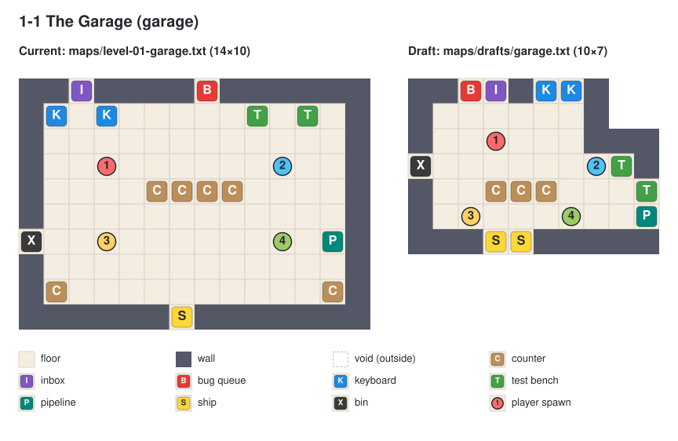
- **3D render:** 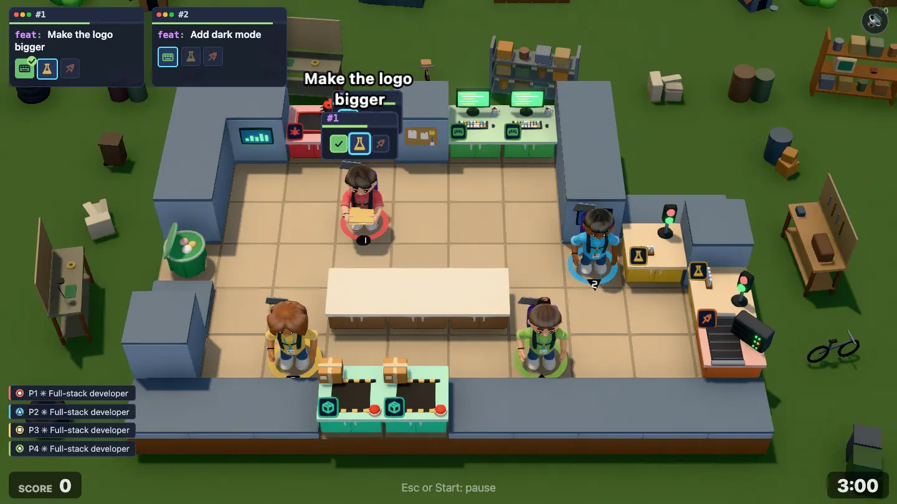
- **Report:**

  | Level                    | Size  | Floor | Stations             | Solo run | Loop | Chokepoints           | Reachable |
  | ------------------------ | ----- | ----- | -------------------- | -------- | ---- | --------------------- | --------- |
  | 1-1 The Garage (current) | 14×10 | 85    | I1 B1 K2 T2 P1 S1 X1 | 24       | 32   | none                  | all       |
  | 1-1 The Garage (draft)   | 10×7  | 32    | I1 B1 K2 T2 P1 S2 X1 | 14       | 20   | detour 4,5–5,5 (2) +6 | all       |

- **Intent:** the smallest map in the game: a single-car garage, L-shaped because the house's utility room takes the back-right corner. The tutorial stations sit in a row on the back wall (bug queue, inbox, two keyboards), tests and the one pipeline step down the right side, and the roll-up door at the front is a 2-wide ship hatch, right in front of the camera. A workbench (3 counters) stands in the middle where the car would be. Players bump in the 1-wide strip between the workbench and the roll-up door (4,5–5,5): everyone who ships squeezes through there.
- **Solo:** spawn 1 stands under the inbox and keyboards: 14 steps to grab, code, test, deploy and ship the first ticket; a loop is 20 steps (current 32). Inbox → keyboard → test bench → pipeline → ship is one lap round the workbench, so the tutorial hints (inbox, keyboard, ship) are all on screen edges the player faces.
- **4 players:** 32 floor tiles for four people (current 85): crowding is the joke. Spawns: 1 under the inbox, 2 at the test benches, 3 and 4 either side of the roll-up door. The only chokepoint is the strip in front of the roll-up door; the bypass is the 2-wide lane behind the workbench, and the workbench takes tickets for hand-offs. One pipeline for everyone stays (as today), so the queue there is the other bump.
- **Review:** approved at gate 1 (2026-10-31)

#### 1-2 Open Plan Office (`open-plan`)

**Concept:** 16×9 medium. First rented office: open room split by a desk-row divider with one gap and a review island; throw over it. Gimmick: rooms, throwing. 1p / 4p: Walk-around exists for solo.

- **Draft:** `maps/drafts/open-plan.txt`

  ```text
  ##KK##B##TT#
  #..........#
  #..........#####
  X......R.......#
  #.1....R...2...P
  #......C.......P
  #...3..C...4...#
  #..............#
  ####II###SS#####
  ```

- **Sketch:** 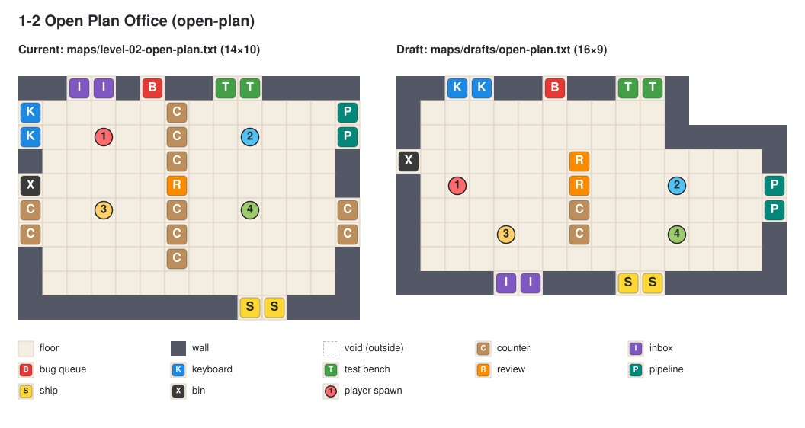
- **3D render:** 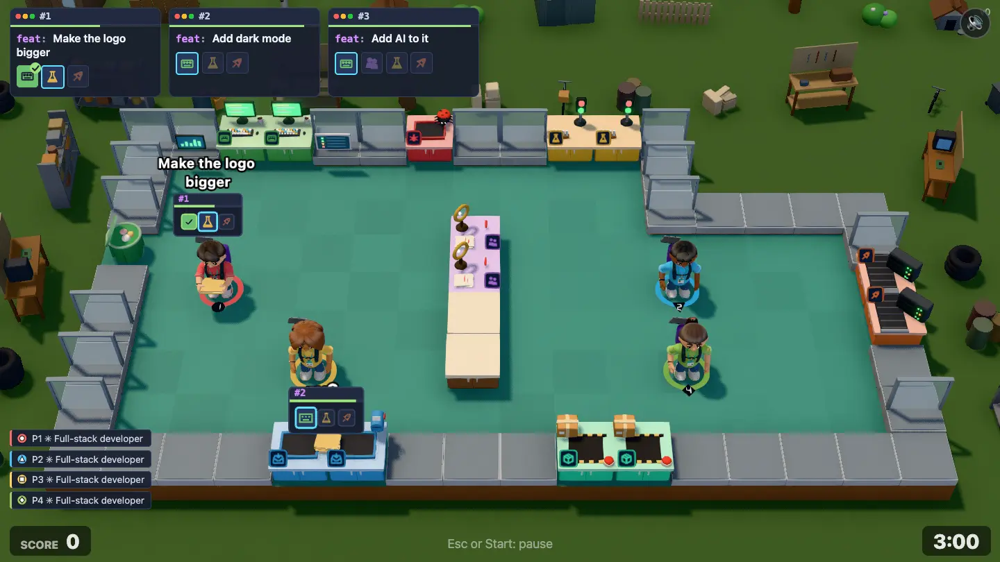
- **Report:**

  | Level                          | Size  | Floor | Stations                | Solo run | Loop | Chokepoints    | Reachable |
  | ------------------------------ | ----- | ----- | ----------------------- | -------- | ---- | -------------- | --------- |
  | 1-2 Open Plan Office (current) | 14×10 | 89    | I2 B1 K2 T2 R1 P2 S2 X1 | 37       | 50   | cut 6,8        | all       |
  | 1-2 Open Plan Office (draft)   | 16×9  | 86    | I2 B1 K2 T2 R2 P2 S2 X1 | 33       | 34   | detour 7,7 +10 | all       |

- **Intent:** the first rented office: one open floor with a stepped outline (the landlord's storage takes the top-right corner). A desk-row divider (column 7) splits it into a code side (left: keyboards, inbox, bug queue, bin) and a ship side (right: test benches, pipelines, ship). The divider is two review desks (7,3–7,4) and two counters (7,5–7,6): a review is done across the desk, one player on each side, and coded tickets are thrown or put over the counters. The divider leaves a 2-wide aisle along the back wall (the walk-around) and one 1-wide gap at the front (7,7), between inbox and ship. The work goes round clockwise: inbox (front left) → keyboards (back left) → over the back aisle → test benches (back right) → pipelines (right wall) → ship (front right) → back through the gap. Players bump in the gap.
- **Solo:** spawn 1 between the keyboards and the inbox; the full lap is 34 steps (current 50), the first ticket 33. Solo uses the gap on the way back; with it blocked the lap goes round the back aisle (+10). No order needs a review solo, so the review desks are only a counter.
- **4 players:** spawns 1 and 3 on the code side, 2 and 4 on the ship side, so the team splits along the divider: the left pair takes tickets and codes, then puts them on the divider counters; the right pair tests, deploys and ships. Reviews pull one player from each side to the review desks. Players walking back to the inbox meet the ones going to the ship in the gap; the back aisle is the 2-wide bypass and the counters are the throw-over.
- **Review:** approved at gate 1 (2026-10-31)

#### 1-3 Down the Hall (`scale-up`)

**Concept:** 20×9 large. Two rooms joined by a long hallway (2 wide, 1-wide doors at both ends); review room at the far end. Gimmick: hallway bumping. 1p / 4p: Spawns 3/4 in far room.

- **Draft:** `maps/drafts/scale-up.txt`

  ```text
  ##II#KK##
  #.......#     ######
  B.1.....#######..3.K
  #.............C....K
  T.......C.......RR.#
  T..CC.2.#######..4.#
  X.......P     #....#
  #.......P     ######
  ###SS####
  ```

- **Sketch:** 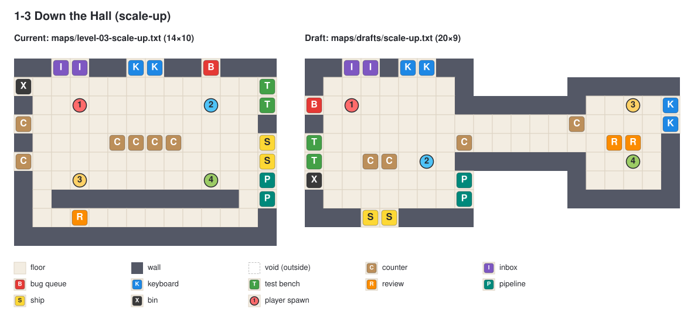
- **3D render:** 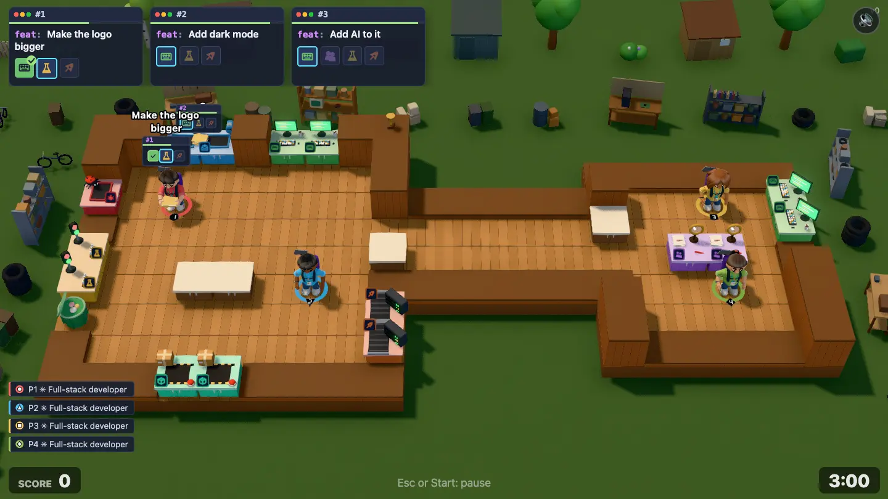
- **Report:**

  | Level                       | Size  | Floor | Stations                | Solo run | Loop | Chokepoints       | Reachable |
  | --------------------------- | ----- | ----- | ----------------------- | -------- | ---- | ----------------- | --------- |
  | 1-3 Down the Hall (current) | 14×10 | 81    | I2 B1 K2 T2 R1 P2 S2 X1 | 16       | 28   | none              | all       |
  | 1-3 Down the Hall (draft)   | 20×9  | 77    | I2 B1 K4 T2 R2 P2 S2 X1 | 23       | 30   | cut 8,3; cut 14,4 | all       |

- **Intent:** the founder's house: a big main room (left, 9×9) and a small review room (right, 6×7) joined by a 5-long, 2-wide hallway. Each end has a 1-wide door (8,3 and 14,4), set diagonally so people going opposite ways cross in the hall, and a serving-hatch counter next to it (8,4 and 14,3) to pass tickets through the wall when the door is jammed. The main room has the whole feature line (inbox, keyboards, bug queue, test benches, pipelines, ship); the review room has a 2-tile review table in the middle (16–17,4, room on all sides for a pair) and two more keyboards on its back wall. Half the features need a review, so with two or more players tickets go down the hall and come back to be tested and shipped. Players bump in the doors and the hallway.
- **Solo:** never needs the hallway: solo has no reviews, and the main room holds the full lap of 30 steps (current 28; first ticket 23). The far keyboards are optional.
- **4 players:** spawns 1 and 2 in the main room, 3 and 4 in the review room. The main-room pair takes tickets and runs test, deploy and ship; the review-room pair codes and reviews. Tickets go down the hall fresh and come back reviewed, so the hall has traffic both ways. The two doors are the only cuts in the map (the report's `cut 8,3; cut 14,4`), which the concept asks for; none is on the solo lap. The bypass is for tickets, not people: the hatch next to each door. Two players need the review room at once, so with 2 players both walk the hall for every review; the main room keeps its own keyboards so the hall is never needed just to code. For review: if the doors jam too much in greybox, the far door can become 2-wide.
- **Review:** approved at gate 1 (2026-10-31)

### Chapter 2: Startup

Layout gimmick: **Spills** (`_` wet floor: players slide and overshoot). From 2-2 on, the spills move: a **leaky tap** (`o`) floods a **spill zone** (`%`) during the round, and in 2-3 a **mop robot** drives a loop (`r`) and leaves a wet trail. 2-1 has no spills: it teaches incidents in a new building shape. Sketches: [seed-round](images/level-redesign/seed-round.svg), [demo-day](images/level-redesign/demo-day.svg), [on-call](images/level-redesign/on-call.svg). 3D renders: [seed-round](images/level-redesign/seed-round-3d.webp), [demo-day](images/level-redesign/demo-day-3d.webp), [on-call](images/level-redesign/on-call-3d.webp).

The sketches draw wet tiles glossy blue, the spill zone as light blue with a dashed ring, the tap as a brown `o` block and the robot route as a ringed dot. The 3D renders use stand-ins until these are built: wet floor, spill zone and robot route show as plain floor, and the tap shows as a counter. Each level below says where they are. The report reads `_`, `%` and `r` as floor, so its numbers are for walking dry. Each level that has a spill zone also gets a "flooded" report row, with `%` read as wall: the routes if nobody wants to cross the wet floor.

#### New mechanics (Startup)

- **Leaky tap + spill zone** (`o` + `%`, first in 2-2). The tap is a solid tile, like a station. The `%` tiles round it are dry floor that the tap can flood.
  - **Behaviour:** on a timer (level setting, about every 40 s), the tap starts leaking. The zone floods ring by ring outward from the tap (about one ring every 2 s, by path distance through `%` tiles) until every `%` tile is wet, and stays wet while the tap leaks. Any player can fix it: hold work at the tap for about 2 s, like a station. The flood stops, and the tiles dry back ring by ring from the outside (about 8 s for the zone). Then the timer starts again. Wet tiles behave exactly like `_`.
  - **Telegraphing:** the tap drips and wobbles about 5 s before a leak, with a small "drip" sound. While it leaks, it shows a jet and a progress ring for the fix, like a station. Wet tiles get the same glossy puddle look as `_`; drying tiles fade.
  - **Reuses:** station hold-work (the fix), incident-style timers in the level settings, spill traction (`_`). New: per-tile wet state in `GameState` (a plain list of tile indexes with a timer), and `getTraction` reads it.
  - **Solo:** never forced through the zone: every level with a zone has a dry route round it (longer), and the tap is reachable from dry floor, so one player can fix it on the way past.
  - **4 players:** someone has to decide: babysit the tap, re-route the team, or slide through and accept the bumps. "Who's on the tap?!" is the shout.
  - **Bots:** wet tiles get a path cost (as `_`). Bots fix the tap only when idle or when it blocks their path.
  - **Stand-in:** `o` = counter `C` (the 3D render shows a counter), `%` = floor.
- **Mop robot** (`r` route, first in 2-3). An office cleaning robot drives a fixed loop in the night shift.
  - **Behaviour:** the `r` tiles form one closed loop, each with exactly two `r` neighbours. The robot starts at a set tile and drives the loop in one direction (level setting), a bit slower than a player walks. Every tile it passes stays wet for about 6 s, so a wet trail follows it round. It shoves players in its way (the manager shove: `MANAGER_SHOVE_SPEED` and the bump cooldown in `balance.ts`), and a dash into it stops dead, as with the manager. It never stops for anyone.
  - **Telegraphing:** a blinking orange light, a beam on the floor 2 tiles ahead and a shiny trail that fades.
  - **Reuses:** manager movement on fixed tiles (no pathfinding) and its shove, spill traction for the trail.
  - **Solo:** the robot is an obstacle with a timetable: wait a second or go the other way round. It never blocks a station: every station on the route also has an access tile off it.
  - **4 players:** the trail moves, so "which way round is dry" keeps changing and the team has to call it.
  - **Bots:** treat the robot like a manager (moving obstacle) and its trail like `_`.
  - **Stand-in:** `r` = floor.

#### 2-1 Seed Round (`seed-round`)

**Concept:** 15×11 medium. Coworking loft in a U round the building's stairwell, with the founders' office and the server closet as real rooms in the two arms. Gimmick: none new (incidents). 1p / 4p: Two pipelines, two ways round the pod.

- **Draft:** `maps/drafts/seed-round.txt`

  ```text
  ###############
  #.............#
  #..2..KK......S
  X.....KK...3..S
  #.............#
  #.##.##TT#....#
  #..1.#   #.##.#
  I....#   #....#
  I....#   #....P
  #..C.#   #..4.P
  ######   ##BB##
  ```

- **Sketch:** 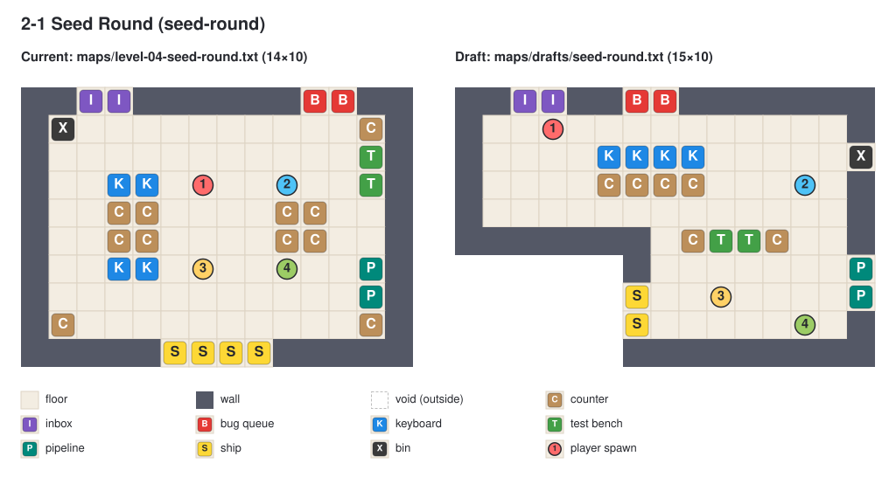
- **3D render:** 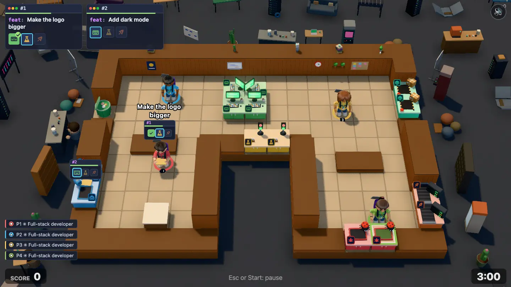
- **Report:**

  | Level                    | Size  | Floor | Stations             | Solo run | Loop | Chokepoints            | Reachable |
  | ------------------------ | ----- | ----- | -------------------- | -------- | ---- | ---------------------- | --------- |
  | 2-1 Seed Round (current) | 14×10 | 76    | I2 B2 K4 T2 P2 S4 X1 | 23       | 30   | none                   | all       |
  | 2-1 Seed Round (draft)   | 15×11 | 83    | I2 B2 K4 T2 P2 S2 X1 | 27       | 40   | detour 6,4–7,4 (2) +10 | all       |

- **Intent:** a loft in a U. The stairwell (cols 6–8, rows 6–10) is a hole in the middle of the front; its balustrade carries the two test benches (7–8,5), facing the back. The back of the U is the open loft (rows 1–4): a desk pod of four keyboards in a 2×2 block (6–7,2–3) in the middle, the ship on the right wall (14,2–3), the bin on the left (0,3). The two arms are **real rooms** with walls and two 1-wide doors each:
  - **Founders' office** (left arm, cols 1–4, rows 6–9): the inbox (0,7–8) is on its wall and the founders' desk (counter, 3,9) stands in it. Doors at (1,5) and (4,5). Every ticket starts here.
  - **Server closet** (right arm, cols 10–13, rows 7–9): both pipelines (14,8–9) and the bug queue (11–12,10) are in here, so every deploy and every incident starts in the closet. Doors at (10,6) and (13,6).

  The work goes round the pod: office → pod → tests at the balustrade → closet → ship → office. Incidents skip the tests: closet (bug) → pod → closet (deploy) → ship. The strip between the pod and the tests (6–7,4) is where code goes down and players come back: flows cross there. The bypass is round the back of the pod (+10, the report's `detour 6,4–7,4`).

- **Solo:** spawn 1 in the office next to the inbox. First ship 27 steps, a loop is 40 (current 30). The loop is longer because the office and the closet are rooms with doors, not open corners. Every room has two doors, so solo never queues on a door.
- **4 players:** spawn 1 in the office, 2 and 3 in the loft (left and right of the pod), 4 in the closet. A natural split: one on the inbox and the founders' desk, two at the pod, one in the closet on tests, deploys and bugs. The pod has room for four on all sides. Players bump in the strip in front of the tests and in the room doors. Two pipelines, so the closet never queues on one.
- **Review:** _human feedback from gate 1_

#### 2-2 Demo Day (`demo-day`)

**Concept:** 19×11 large. Coworking room, a foyer with a leaking kombucha tap, and a hall with the stage behind it; the ship is the demo screen on the stage. Gimmick: **Spills intro + leaky tap** (new). 1p / 4p: Dry route over the stage always exists.

- **Draft:** `maps/drafts/demo-day.txt`

  ```text
        #######SS####
        #...........#
  ##BBKK#...#.......#
  #.1.......####..###
  #.....#_o_#.......#
  I.....#%_%#..RR...#
  I.KK..#%%%#.......P
  #.....%%%%.....3..P
  #.2...#%%%#....4..#
  ###X###%%%#....CC.#
        ######TT#####
  ```

- **Sketch:** 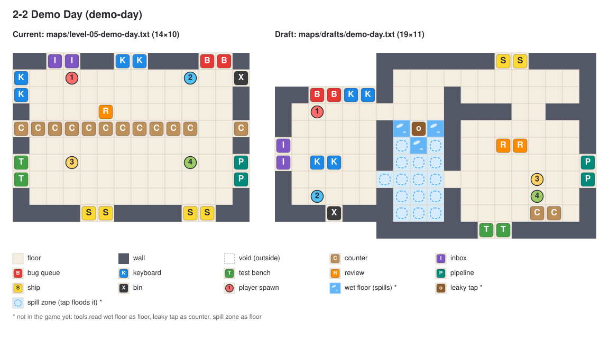
- **3D render:** 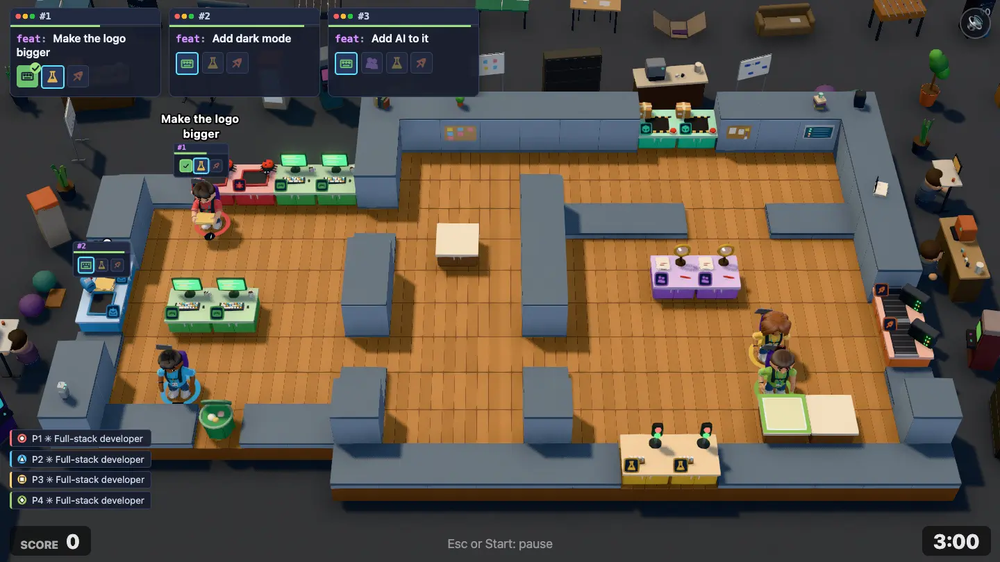
- **Report:**

  | Level                            | Size  | Floor | Stations                | Solo run | Loop | Chokepoints       | Reachable |
  | -------------------------------- | ----- | ----- | ----------------------- | -------- | ---- | ----------------- | --------- |
  | 2-2 Demo Day (current)           | 14×10 | 85    | I2 B2 K4 T2 R1 P2 S4 X1 | 37       | 52   | none              | all       |
  | 2-2 Demo Day (draft)             | 19×11 | 112   | I2 B2 K4 T2 R2 P2 S2 X1 | 34       | 48   | detour 10,7 +12   | all       |
  | 2-2 Demo Day (draft, zone flood) | 19×11 | 97    | I2 B2 K4 T2 R2 P2 S2 X1 | 46       | 60   | cut 10,1; cut 6,3 | all       |

- **Intent:** three rooms in a row, all with walls and doors:
  - **Coworking** (left, cols 1–5, rows 3–8): inbox (0,5–6), bug queue and two keyboards on the back wall (2–5,2), two more keyboards as an island (2–3,6), bin (3,9). Two doors to the foyer: the back door (6,3), dry, and the front door (6,7), in the spill zone.
  - **Foyer** (cols 7–9, rows 1–9) with the kombucha bar: the **leaky tap** (8,4), three puddles that are always wet (`_` at 7,4, 9,4 and 8,5) and the **spill zone** (`%`) over the whole front of the foyer (rows 5–9 plus the coworking front door at 6,7: 15 tiles). The top of the foyer (rows 1–3) stays dry, and the tap can be fixed from there (8,3).
  - **Hall** (cols 11–17, rows 4–9): one 1-wide main door from the foyer (10,7), review table (13–14,5), pipelines (18,6–7), test benches on the front wall (12–13,10), a demo table to park tickets (15–16,9).
  - **Stage** (cols 11–17, rows 1–2), behind the hall: the ship is the demo screen on its back wall (13–14,0). Way in from the hall: steps (14–15,3). Way in from the foyer: a narrow **backstage door** (10,1).

  The short lap goes coworking → front door → foyer → main door → tests → pipelines → steps → ship → backstage door → foyer top → back door → inbox. When the tap is dry, the front of the foyer is the fast way to the hall (and the puddles by the tap already make it slippery). When it leaks, the front floods: the front door and the main door are only reachable over wet floor. The team then either slides through (fast, bumpy), fixes the tap (someone runs to 8,3) or goes the dry way: back door → backstage door → stage → steps → hall. That dry way is the "zone flood" row: loop 60 instead of 48, and both the backstage door and the back door become cuts, with outbound tickets and returning players squeezing through the same 1-wide backstage door. The chokepoint when dry is the main door (detour +12 over the stage).

- **Solo:** spawn 1 next to the back keyboards. First ship 34 steps, loop 48 (current 52), 60 on the dry way when the foyer floods. Solo is never forced onto wet floor, and the tap is on the dry return route (backstage → foyer top), so fixing it costs one stop.
- **4 players:** spawns 1 and 2 in coworking, 3 and 4 in the hall. The coworking pair codes; the hall pair reviews, tests, deploys and ships. When the tap leaks, someone has to call it: one runs to the tap while the others re-route over the stage, or everyone slides. The backstage door is where the outbound and return flows meet when the foyer is wet.
- **Review:** _human feedback from gate 1_

#### 2-3 On Call (`on-call`)

**Concept:** 18×12 large. Night shift: an H of two rooms joined by two corridors round an enclosed server room, and a mop robot driving the ring. Gimmick: **Mop robot** (new). 1p / 4p: Ring gives two ways round; the robot decides which is dry.

- **Draft:** `maps/drafts/on-call.txt`

  ```text
  #BBKK#      ##TT##
  #....########....#
  I.1.rrrrrrrrrr...#
  I...r.......#r...#
  #...r###.####r...#
  #.KKr#P....##r...#
  #.2.r##....P#rRR.#
  #...r####.###r...#
  X...r........r.3.#
  #...rrrrrrrrrr.4.#
  #....########....#
  ##SS##      ######
  ```

- **Sketch:** 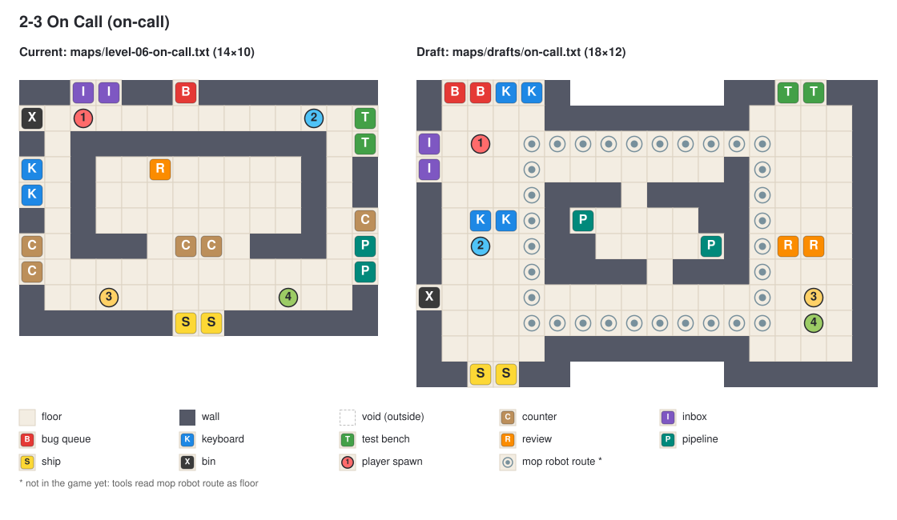
- **3D render:** 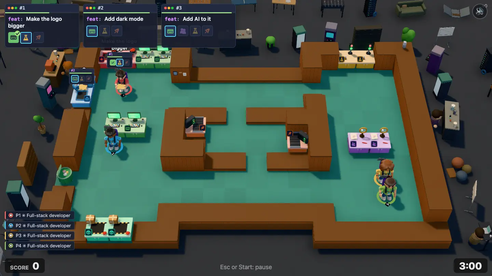
- **Report:**

  | Level                 | Size  | Floor | Stations                | Solo run | Loop | Chokepoints                                                      | Reachable |
  | --------------------- | ----- | ----- | ----------------------- | -------- | ---- | ---------------------------------------------------------------- | --------- |
  | 2-3 On Call (current) | 14×10 | 71    | I2 B1 K2 T2 R1 P2 S2 X1 | 28       | 42   | detour 2,1 +38; detour 1,2–1,3 (2) +38; detour 12,2–12,6 (5) +22 | all       |
  | 2-3 On Call (draft)   | 18×12 | 117   | I2 B2 K4 T2 R2 P2 S2 X1 | 41       | 50   | none                                                             | all       |

- **Intent:** an H of three rooms, all with walls and doors:
  - **Desks room** (left, cols 1–4, rows 1–10): bug queue (1–2,0) and keyboards (3–4,0) on the back wall, a keyboard island (2–3,5), inbox (0,2–3), bin (0,8), ship (2–3,11) on the front wall. It opens onto both corridors with 2-wide openings.
  - **Ops room** (right, cols 13–16, rows 1–10): test benches (14–15,0), review table (14–15,6). Doors: a 1-wide fire door at the top (12,2) and a 2-wide door at the bottom (12,8–9).
  - **Server room** (middle, cols 6–11, rows 5–6): the two pipeline racks (6,5 and 11,6), free-standing so both can be used. Doors: top (8,4) and bottom (9,7), offset so the room is a shortcut between the corridors. Every deploy happens in here.

  The corridors (top rows 2–3, bottom rows 8–9, both 2-wide) and the two room edges make a ring. The **mop robot** drives that ring: route `r` is the rectangle with corners (4,2), (13,2), (13,9) and (4,9), through the desks room (col 4, right past the island keyboards), both corridors, both ops doors and the ops room (col 13, past the review table). Its wet trail follows it, so one half of the ring is always wet and the dry half moves. All wetness here is dynamic (no fixed `_` tiles). Players choose: top or bottom, or cut through the server room, and the robot keeps changing the answer. The report shows no chokepoint because the ring is its own bypass.

- **Solo:** spawn 1 by the inbox. First ship 41 steps, loop 50 (current 42; long walks are the theme). Every station on the robot's route also has an access tile off it (island keyboards from 3,4 or 3,6; review from 14,5, 14,7 or 16,6), so solo never has to stand in its way, only cross it.
- **4 players:** spawns 1 and 2 in the desks room, 3 and 4 in the ops room. The desks pair takes, codes and ships; the ops pair tests and reviews; everyone deploys in the server room. Coded tickets go right, reviewed and tested ones come back left, and the robot sends both flows round whichever side is dry. The narrow spots are the fire door (12,2), the server room doors and wherever the robot is right now.
- **Review:** _human feedback from gate 1_

### Chapter 3: Scale-Up

Layout gimmick: **Lifts** (`L` lift cabin). Sketches: _not drawn yet_.

#### 3-1 Middle Management (`middle-management`)

**Concept:** 18×11 large. Biggest single open floor so far, wide aisles, one manager. Gimmick: none new. 1p / 4p: Room for 4.

- **Draft:** `maps/drafts/middle-management.txt`: _not drawn yet_
- **Sketch:** _`images/level-redesign/middle-management.svg` (current left, draft right) goes here_
- **Report:** _row from `npm run level-report -- middle-management --table` goes here_
- **Intent:** _what the layout teaches and where players bump_
- **Solo:** _the solo route and how long it is_
- **4 players:** _how the team splits, the chokepoint and its bypass_
- **Review:** _human feedback from gate 1_

#### 3-2 Hypergrowth (`hypergrowth`)

**Concept:** 21×10 large. Two floors side by side (islands): ground (inbox, ship, pipelines) and first (keyboards, tests), one lift + a long 1-wide stairwell; manager rides. Gimmick: **Lifts intro**. 1p / 4p: Solo waits for the lift or takes stairs.

- **Draft:** `maps/drafts/hypergrowth.txt`: _not drawn yet_
- **Sketch:** _`images/level-redesign/hypergrowth.svg` (current left, draft right) goes here_
- **Report:** _row from `npm run level-report -- hypergrowth --table` goes here_
- **Intent:** _what the layout teaches and where players bump_
- **Solo:** _the solo route and how long it is_
- **4 players:** _how the team splits, the chokepoint and its bypass_
- **Review:** _human feedback from gate 1_

#### 3-3 Hot Desking (`hot-desking`)

**Concept:** 22×11 large. Two floors of desk rows, two lifts (express + local), two managers, reviews. Gimmick: Lifts + managers. 1p / 4p: Second lift relieves 4p queue.

- **Draft:** `maps/drafts/hot-desking.txt`: _not drawn yet_
- **Sketch:** _`images/level-redesign/hot-desking.svg` (current left, draft right) goes here_
- **Report:** _row from `npm run level-report -- hot-desking --table` goes here_
- **Intent:** _what the layout teaches and where players bump_
- **Solo:** _the solo route and how long it is_
- **4 players:** _how the team splits, the chokepoint and its bypass_
- **Review:** _human feedback from gate 1_

### Chapter 4: Enterprise

Layout gimmick: **Reorgs** (`=` partitions, rolling desks). Sketches: _not drawn yet_.

#### 4-1 Back to Back (`back-to-back`)

**Concept:** 20×10 large. HQ: long corridor with offices off it and a glass meeting room; calm meetings. Gimmick: hallway bumping. 1p / 4p: Corridor 2 wide.

- **Draft:** `maps/drafts/back-to-back.txt`: _not drawn yet_
- **Sketch:** _`images/level-redesign/back-to-back.svg` (current left, draft right) goes here_
- **Report:** _row from `npm run level-report -- back-to-back --table` goes here_
- **Intent:** _what the layout teaches and where players bump_
- **Solo:** _the solo route and how long it is_
- **4 players:** _how the team splits, the chokepoint and its bypass_
- **Review:** _human feedback from gate 1_

#### 4-2 Synergy (`synergy`)

**Concept:** 18×11 large. Meeting room up a corridor; partitions fold away / close on a schedule (opens a shortcut, then shuts it). Gimmick: **Reorg intro** (partitions). 1p / 4p: Always one open route.

- **Draft:** `maps/drafts/synergy.txt`: _not drawn yet_
- **Sketch:** _`images/level-redesign/synergy.svg` (current left, draft right) goes here_
- **Report:** _row from `npm run level-report -- synergy --table` goes here_
- **Intent:** _what the layout teaches and where players bump_
- **Solo:** _the solo route and how long it is_
- **4 players:** _how the team splits, the chokepoint and its bypass_
- **Review:** _human feedback from gate 1_

#### 4-3 The Reorg (`the-reorg`)

**Concept:** 20×12 large. Whole floor reorganises twice per round: partitions slide, rolling desks move (with their tickets); everything on. Gimmick: Reorgs, finale. 1p / 4p: Telegraphed 3 s ahead.

- **Draft:** `maps/drafts/the-reorg.txt`: _not drawn yet_
- **Sketch:** _`images/level-redesign/the-reorg.svg` (current left, draft right) goes here_
- **Report:** _row from `npm run level-report -- the-reorg --table` goes here_
- **Intent:** _what the layout teaches and where players bump_
- **Solo:** _the solo route and how long it is_
- **4 players:** _how the team splits, the chokepoint and its bypass_
- **Review:** _human feedback from gate 1_

### Chapter 5: Big Tech

Layout gimmick: no new code: gaps and belts on a campus (buildings, skybridges, an atrium). Sketches: _not drawn yet_.

#### 5-1 The Atrium (`the-atrium`)

**Concept:** 20×11 large. Two buildings across an atrium, a 1-wide skybridge, belt bridges. Gimmick: gaps, belts. 1p / 4p: Skybridge + walk-round for solo.

- **Draft:** `maps/drafts/the-atrium.txt`: _not drawn yet_
- **Sketch:** _`images/level-redesign/the-atrium.svg` (current left, draft right) goes here_
- **Report:** _row from `npm run level-report -- the-atrium --table` goes here_
- **Intent:** _what the layout teaches and where players bump_
- **Solo:** _the solo route and how long it is_
- **4 players:** _how the team splits, the chokepoint and its bypass_
- **Review:** _human feedback from gate 1_

#### 5-2 Design Sprint (`design-sprint`)

**Concept:** 18×10 medium. Small cosy design studio (whiteboards) joined by a hallway to a big engineering hall built for pairing. Gimmick: design, pairing. 1p / 4p: Studio fits 2.

- **Draft:** `maps/drafts/design-sprint.txt`: _not drawn yet_
- **Sketch:** _`images/level-redesign/design-sprint.svg` (current left, draft right) goes here_
- **Report:** _row from `npm run level-report -- design-sprint --table` goes here_
- **Intent:** _what the layout teaches and where players bump_
- **Solo:** _the solo route and how long it is_
- **4 players:** _how the team splits, the chokepoint and its bypass_
- **Review:** _human feedback from gate 1_

#### 5-3 Monorepo (`monorepo`)

**Concept:** 22×10 large. FE building and BE building with the merge "integration room" between them, reached by two corridors; belt across. Gimmick: merge, gaps, belts. 1p / 4p: Teams split FE/BE.

- **Draft:** `maps/drafts/monorepo.txt`: _not drawn yet_
- **Sketch:** _`images/level-redesign/monorepo.svg` (current left, draft right) goes here_
- **Report:** _row from `npm run level-report -- monorepo --table` goes here_
- **Intent:** _what the layout teaches and where players bump_
- **Solo:** _the solo route and how long it is_
- **4 players:** _how the team splits, the chokepoint and its bypass_
- **Review:** _human feedback from gate 1_

#### 5-4 Hackathon (`hackathon`)

**Concept:** 22×12 large. Big hall with a belt loop + side rooms; everything at once (optionally one partition shift as a callback). Gimmick: everything. 1p / 4p: Many routes.

- **Draft:** `maps/drafts/hackathon.txt`: _not drawn yet_
- **Sketch:** _`images/level-redesign/hackathon.svg` (current left, draft right) goes here_
- **Report:** _row from `npm run level-report -- hackathon --table` goes here_
- **Intent:** _what the layout teaches and where players bump_
- **Solo:** _the solo route and how long it is_
- **4 players:** _how the team splits, the chokepoint and its bypass_
- **Review:** _human feedback from gate 1_

## Delivery

Stacked PRs on `main`, one layer per child session, each opening its own PR.

| Layer | Contents                                                                                                                               |
| ----- | -------------------------------------------------------------------------------------------------------------------------------------- |
| 1     | This file, `maps/drafts/`, `scripts/mapSketch.ts` and `scripts/levelReport.ts` (npm `sketch`, `level-report`), tests, baseline numbers |
| 2     | Garage sketches: drafts for 1-1, 1-2, 1-3, their images and report rows, intent and 1p/4p notes                                        |
| 3–6   | Startup, Scale-Up, Enterprise and Big Tech sketches, one layer each, after the Garage review                                           |

After gate 1: the greybox loader, the three mechanics (one layer each) and the per-chapter rollout, planned in detail once the sketches are approved.

## Workflow and gates

1. **Design doc (gate 1):** this file with rules, gimmick specs and, per level, an ASCII draft, intent, solo/4p notes and the old-vs-new image. The human reviews and iterates the maps on paper.
2. **Greybox (gate 2a):** DEV-only `?draft=<level-id>` loads a draft map in the real 3D game with the current settings; not-yet-built tiles fall back to stand-ins (wet → floor). `npm run sim` report for 1–4 bots per draft. Couch-test Garage, Startup x-1, Scale-Up x-1, Enterprise x-1 and Big Tech drafts.
3. **Mechanics, one PR each, each gated in its lab level:** spills → lifts → reorgs.
4. **Greybox (gate 2b):** play the gimmick levels (2-2, 2-3, 3-2, 3-3, 4-2, 4-3) with the real mechanics; iterate the drafts.
5. **Rollout per chapter (one PR per chapter):** replace `maps/level-XX`, retune star thresholds for 1–4 players with `npm run sim`, update blurbs, intro cards and hints in `content.ts`, map looks, scenes with hardcoded coordinates (`sceneCatalog.ts`; move mechanic scenes to lab levels), the demo list, `docs/game/levels.md` and `mechanics.md`, the screenshots skill, protocol bump.
6. **Final couch balance pass** with 1, 2, 3 and 4 players.

## Notes and risks

- Bigger maps shrink characters with the fixed fit camera; 22×12 is a soft cap until gate 2 says otherwise.
- 1-wide hallways can jam with soft player push; keep them short and always with a bypass; check in greybox.
- Lifts and reorgs add dynamic state to an otherwise static `LevelMap`; keep it plain JSON and deterministic; movement, interact, throw, conveyor, path and render go through one live-tile accessor.
- Existing `sceneCatalog.ts` scenes and screenshots assume current garage coordinates; they move to lab levels or get recomputed.
- Out of scope: new ticket mechanics, the role/domain rollout (phase 22), world map changes.

## Done when

Gate 1 (design):

- [x] Design doc, `maps/drafts/`, sketch and report tools with tests; baseline numbers for the current maps
- [ ] Garage drafts, images, report rows and notes; reviewed
- [ ] Startup drafts; reviewed
- [ ] Scale-Up drafts; reviewed
- [ ] Enterprise drafts; reviewed
- [ ] Big Tech drafts; reviewed

Gate 2 and rollout get their own boxes once gate 1 is through.
