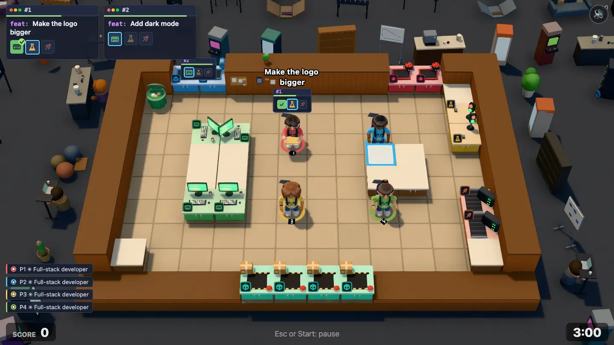
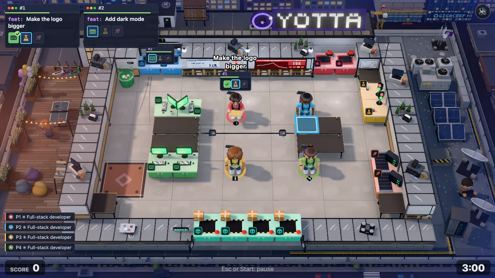
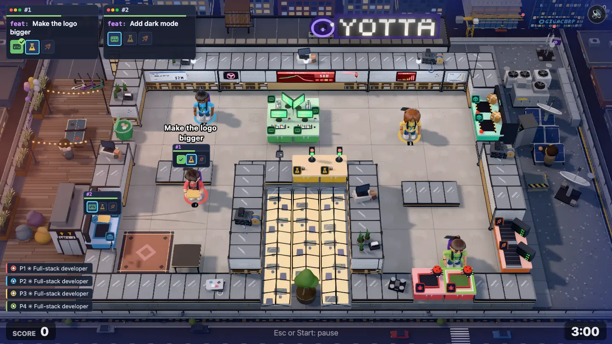

# Seed Round environment pass

**Status:** two rounds done (build, critic review, fixes). Level 2-1 (`seed-round`, "Seed Round"), the first level of the Startup chapter, gets a hand-built world after the garage ([garage-environment.md](garage-environment.md)), [Open Plan Office](open-plan-environment.md) and [Down the Hall](down-the-hall-environment.md).

| Before                                         | After                                         | After, redesign draft                               |
| ---------------------------------------------- | --------------------------------------------- | --------------------------------------------------- |
|  |  |  |

**Goal:** the world around the level tells one story, the way Overcooked 2 levels do. Render only (`src/render/`); the sim, maps and balance don't change.

## Where this sits on the road from garage to enterprise

| Level              | Where the company is                                          | Look                                              |
| ------------------ | ------------------------------------------------------------- | ------------------------------------------------- |
| 1-1 Garage         | Mom's garage in the suburbs                                   | cinder block, golden hour                         |
| 1-2 Open Plan      | a unit on a business park                                     | magnolia plasterboard, Monday morning             |
| 1-3 Down the Hall  | two rented rooms in a shared old factory                      | red brick, canal evening                          |
| **2-1 Seed Round** | **the money landed: their own loft on a city-centre rooftop** | **white steel and glass, blue hour, city lights** |
| later              | glass offices, then HQ, then a campus                         | glass, carpet, towers                             |

Every step up is higher off the ground and more "tech". Seed Round is the first time the company is **above the street**: the world is a roof and a skyline, not a yard or a quay. On the horizon the next steps already stand: a glass tower going up under a crane and a corporate HQ with a big lit logo.

**Not food.** Down the Hall read too much like a kitchen (biscuit works, kegs, sacks, a coffee van). Seed Round has **no** food, drink, kitchen, café, bar, barbecue, kegs, sacks, crates of produce or market stalls. One espresso machine inside at most, and none outside. The props are tech-startup and rooftop props: servers, cables, screens, antennas, HVAC, solar panels, scooters, bean bags, a ping-pong table, balloons, a novelty cheque.

## The story: the penthouse loft

> The founders closed their seed round last week and blew a chunk of it on the top floor of a converted city-centre block: a white-steel-and-glass rooftop loft with a terrace, a skyline view and their logo in lights on the roof. It's blue hour on launch night, the product has real customers for the first time, and production is already on fire.

Read from the fixed front camera (top of screen = back of the level):

- **Back (top of screen): the building's core and the logo.** The back wall is the face of the stair and lift core: a white-rendered block with black steel trim, the lift motor room and a timber-clad water tank on top, and on its roof the startup's logo in big lit letters on a steel frame (a rooftop sign, like a hotel's). Above and beyond it, the skyline closes the top of the frame: lit office windows, a glass tower under construction with a tower crane (blinking red light on the jib), and further off a big corporate tower with a glowing logo (where the game ends up). Low enough never to hide a back-wall station.
- **The inbox** is the lift/stair door from the core: tickets arrive up the lift (a lit floor indicator over the door, a "LOFT · 7" plaque). On the shipped map it's on the back edge, on the draft on the **left** edge; place it from the inbox tiles.
- **The ship hatch** is where work goes live: it opens onto the roof where the comms gear stands — a rack cabinet with blinking lights, a satellite dish and an antenna mast with a red aviation light. Shipping beams it to production. On the shipped map it's 4 tiles on the **front** edge (keep everything there low), on the draft 2 tiles on the **right** edge.
- **Front (bottom of screen): the roof edge, a thin strip.** Grey roof membrane or pavers, a low parapet with a steel coping and a glass balustrade (low, < 0.6), and past it the drop: at the very bottom of the frame the street far below (tiny lit cars, street lamps seen from above, a zebra crossing). Everything low; the camera shows only about 1.2 tiles in front of the slab.
- **Left: the terrace.** Timber decking, planters with grasses, string lights on posts, outdoor bean bags, a ping-pong table, a hammock, the founders' electric scooters on a rack. A deflating "WE RAISED!" balloon bunch tied to a rail. No grill, no bar.
- **Right: the plant deck.** Roof machinery: HVAC condenser units with fans, ducts, solar panels on frames, the satellite dish and the antenna mast, a cable tray, a roof access hatch, gravel. This is where shipped work goes.
- **The draft's void** (a 3×5 notch in the front middle, between the two arms of the room): a **sunken light well / skylight court**: a glass roof light with the floor below glowing up through it, or a small sunken terrace with a tree in a big planter. It must fill whatever void shape the map has.
- **Life:** a founder pacing on the phone with an investor on the terrace, a sysadmin carrying a server blade to the rack, pigeons on the parapet (peck), the crane's blinking light, the HVAC fans, swaying grasses, a flag on the mast, balloons bobbing. Few, small, posed, never near the players.
- **Inside the loft:** walls white-painted with black steel trim and posts, the lower part birch plywood (built-in shelving, the startup look); polished concrete floor (light warm grey) with saw-cut joints, a floor-box cable channel and placed wear (scooter tyre marks from the lift, scuffs at desks, a rug zone). Counters: black steel trestles with a dark-stained ply top (darker than every station top). On the walls: a big wall-mounted status dashboard (red graph: prod is on fire), a growth chart whiteboard, the oversized novelty seed cheque, a neon logo sign, a red rotating incident beacon. Wall tops: monitor stacks, cable spools, server boxes, plants in concrete pots, a VR headset, swag boxes. Lights: black linear LED pendants or globe pendants on a steel cable strung wall to wall along the back.
- **Light:** blue hour just after sunset: a deep blue-violet sky at the frame edges, a last warm glow low in the west (left), the city lights coming on (warm windows, the logo, aviation lights), cool-white LED interior light making the play area bright. Mean luminance of the shipped frame about 100.

## The six Overcooked lessons, for this level

| Lesson                                 | Here                                                                                                                        |
| -------------------------------------- | --------------------------------------------------------------------------------------------------------------------------- |
| The frame is full, at several heights  | Skyline and crane at the back, the lift core and logo sign, terrace posts and string lights, the plant deck's dish and mast |
| The room's edge is made of the setting | White steel-framed walls with a birch ply band, a parapet with steel coping as the foundation                               |
| Surfaces carry material and wear       | Polished concrete with joints and scuffs, decking, roof membrane with seams, gravel, galvanised steel                       |
| One place, one story                   | A funded startup's rooftop loft in the city on launch night: nothing suburban, nothing industrial-food                      |
| Light does the composition             | Blue-hour sky, warm last glow on the left, lit city windows, the glowing logo, cool interior light                          |
| The outside connects to the play       | Tickets come up the lift (inbox); shipped work goes out to the dish and mast on the roof (ship)                             |

## Rules

The rules in the [level-environment skill](../../.agents/skills/level-environment/SKILL.md) hold, plus:

- **Both maps:** the shipped `maps/level-04-seed-round.txt` (14×10, one room, inbox 2 tiles on the back edge, bug queue on the back edge, ship 4 tiles on the **front** edge, no void) and the draft `maps/drafts/seed-round.txt` (15×11, a U-shaped room round a 3×5 void notch in the front middle, inbox 2 tiles on the **left** edge, ship 2 tiles on the **right** edge, bug queue on the front edge, `?draft=seed-round`). Place everything from the outline, the void tiles and the ship and inbox tiles.
- **No food or drink props** anywhere in the scene (see above).
- Other levels keep their look: the new wall theme `loft` and floor theme `polished` are used only by `seed-round`.

## Work split (round 1)

Three agents in one worktree at once, with strict file ownership. The shared plumbing (stub scene, stub dressing, themes, `LEVEL_LOOKS`) is done first.

| Track     | Owns                                                                                                                                                                 |
| --------- | -------------------------------------------------------------------------------------------------------------------------------------------------------------------- |
| **Room**  | `rooms/loft.ts` (+test), `rooms/loftRoom.ts` (+test), `roomModels/loft.ts`, `setDressing/loftWallTops.ts`, the `loft`/`polished` rows in `look.ts` and `mapShape.ts` |
| **World** | `scenes/seedRound.ts` (+test), `setDressing/rooftop.ts`                                                                                                              |
| **Light** | `atmosphere.ts` (+test), `stage.ts`, `WorldFx.ts`, `createLights` in `look.ts`                                                                                       |

## Rounds

Round 1 ran three agents at once (Room, World, Light). The critic scored it 6.5/10 (before: 2.5): the rooftop and skyline read at once, but the brown plank desks and wide flat lavender caps made the room read like a kitchen, the YOTTA sign and the crane and aviation lights didn't glow, the terrace grasses read as onions, the draft's lift lobby as a stove and its skylight as a cracked floor.

Round 2, in three chunks: the room (steel-and-glass caps with black posts, dark ply desks, three composed clusters per wall, a 3-tile red incident dashboard, a darker floor with tyre arcs and a cable channel), the world (warm-white YOTTA channel letters with a violet halo, the crane and GIGACORP fully in frame, fountain grasses, a real lift lobby, a glass skylight over a lit office, a cable tray from the ship to the prod rack, real dishes, side-on scooters) and the light (`ScenePiece.hot`: small outside lights keep their glow and bloom; a rotating red incident beacon beside the dashboard; bluer frame edges with a coral glow on the terrace; floor glints). Mean luminance 98 shipped, 100 draft.

Left for later: on the shipped map the beacon and the left end of the back wall sit under the first ticket label; the wall is full there, so the neon logo is dropped. The black cable channel between the desk islands reads a little strong; the tyre arcs are subtle. The front cable tray is a thin line from this camera. The draft's skylight is one of the brighter areas. Not checked on a real GPU.

## Done when

- [x] The shot reads as "a startup's rooftop loft in the city at blue hour, launch night" without explanation, and nothing in it reads as food or a kitchen.
- [x] The skyline shows the road ahead (a tower going up, a corporate HQ in the distance).
- [x] No flat empty ground and no void in the 1440×810 frame.
- [x] Stations and players read at a glance; nothing hides them.
- [x] Works on the shipped map and on `?draft=seed-round`.
- [x] `npm run check` passes; other levels look as before.
