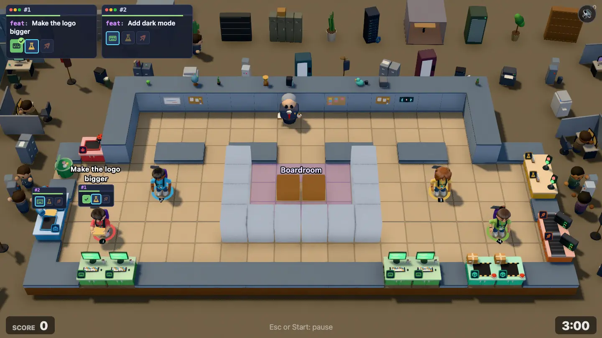

# Synergy environment pass

**Status:** brief written, round 1 next. Level 4-2 (`synergy`, "Synergy"), the second level of the Enterprise chapter, gets a hand-built world after [Back to Back](back-to-back-environment.md) (4-1). Same building (YOTTA Tower), new floor and a new time of day. It reuses 4-1's tower kit and adds what 4-3 The Reorg builds on: the boardroom, the folding walls, MONOLITH's people. **The bar:** 4-1 Back to Back. The user's notes for this pass: **the folding walls must look and move like the real thing**, and the last few levels have had **less detail and fewer nice additions around them**, so the density target is higher than for any level so far (see "Detail budget").

| Before                                      |
| ------------------------------------------- |
|  |

**Goal:** the world around the level tells one story, the way Overcooked 2 levels do. Render-only (`src/render/`); the sim, the maps and balance don't change. Two screenshot scenes join the docs (`src/sim/sceneCatalog.ts`): `levels/synergy-open` (the boardroom folded open) and `mechanics/synergy-folding` (the walls half a second from closing).

## The story in two sentences

> It's a hot summer afternoon on the boardroom floor of YOTTA Tower, a few floors above 4-1's offices, and MONOLITH's executives have come across the river for a "synergy workshop": identical black suits in reception, a facilitator with a flip chart, the two logos side by side on the welcome screen. At the facilitator's signal the boardroom's folding walls trundle away into their pockets so everyone can "align", the whole floor turns into one hall of sticky notes, and then the walls roll back and the boardroom is a boardroom again, whether or not you were in it.

That is the level: ideas come in off the workshop's sticky-note wall (the inbox) on the dev side, get coded on the dev side's keyboards, tested and piped on the ops side and go out at the ops side's deploy desk (the ship). Between the two sides sits the boardroom: closed, you go round it (the back corridor or the front passage); open, you go straight through it. The boardroom table is in two halves on castors that roll apart when the walls open.

## Where this sits on the road

See [the storyline](../game/storyline.md#4-2-synergy-synergy). 4-1 Back to Back was the morning in YOTTA's own glass HQ: glass offices, a stone lift lobby, the city far below in a heat haze, MONOLITH's black tower level with them across the river, looking back. **4-2 is the afternoon MONOLITH stops looking and walks in.** It's the same tower, so the tower kit carries over (glass partitions with the violet dot band, the unitised curtain wall, slate carpet, the city below, MONOLITH across the river), but this floor is **the expensive one**: walnut and leather, the good carpet, a boardroom with operable walls, an executive reception. 4-3 The Reorg is this floor again, reorganised by consultants, so 4-2 must not show consultants, removal men, partition trolleys or the lowercase `yotta.`; it sets them up (the walls already move, and the facilitator is the first outsider with a clicker).

- **Material:** a step up from 4-1. **The boardroom's operable walls** are the new material: tall acoustic panels in walnut veneer with a violet-grey fabric inset, brushed steel edges, on a steel floor track. The boardroom carpet is **"the good carpet"**: deep charcoal with a violet border band, under a long walnut table. The dev and ops sides are 4-1's tower floor, warmer (late sun): slate carpet, terrazzo in the back corridor. The back wall faces the **executive reception**: dark stone, walnut slats, a big welcome screen.
- **Light:** a **summer afternoon**, still hot but no longer bleached: the sun lower and warmer (about 38-42°, from the front-right/west, so shadows fall back-left, never over the back row), long warm light raking across the carpet, blinds down on the west side, the city below golden with long shadows. Warmer than 4-1, not brown: mean luminance about **105+**, stations the most saturated things.
- **Outside:** the same city as 4-1 seen from a bit higher and later in the day; MONOLITH's black tower across the river is still there, but its people are **here now**: a convoy of identical black cars in the drop-off far below, their driver(s) waiting.

**Not food, not a kitchen.** The storyline's catering trolleys are **covered** (a cloth over each, maybe a cloche shape), off the play area, never anything edible on display. Water jugs, glasses, coffee cups and a coffee urn are fine.

## Read it from the fixed front camera

The map (`maps/level-11-synergy.txt`, 20×10, with `level-11-synergy.phase2.txt` for the open layout) is one floor: a back corridor, the boardroom in the middle, the dev side left, the ops side right, a front passage. Top of screen = back.

```text
  ################      row 0: the back wall (x 2-17); voids top-left (x 0-1) and top-right (x 18-19), rows 0-2
  #......M.......#      rows 1-2: the back corridor (x 3-16); M (9,1) the manager's spawn
  #..............#
#B#.##.##..##.##.###    row 3: B (1,3) bug queue; wall stubs x 4-5, 7-8, 11-12, 14-15; gaps at x 3, 6, 9-10, 13, 16
X......=mmmm=......T    X (0,4) the bin; '=' folding walls; T (19,4)
#...2..=mDDm=..3...T    the boardroom: x 7-12, rows 4-7; meeting tiles m (x 8-11, rows 4-6); table halves D (9,5) (10,5); T (19,5)
I......=mmmm=......#    I (0,6) (0,7) the inbox, on the left wall
I.1....======....4.P    row 7: the boardroom's front folding wall (x 7-12); P (19,7) (19,8)
#..................P    row 8: the front passage
##KK#########KK#SS##    row 9: K (2-3,9) dev keyboards, K (13-14,9) ops keyboards, S (16-17,9) ship
```

Phase 2 (open): every `=` is floor and the table halves roll to (7,5) and (12,5); the meeting tiles stay. Every tile, door and station must be placed from the map (its outline, its voids, `reorgTiles`, its meeting tiles, ship and inbox tiles), never these numbers. The scene must work in **both** phases and during the fold.

- **Back (above row 0): the executive reception.** The back wall (x 2-17, row 0) is glass onto a reception at the same floor level: dark stone and walnut-slat walls, a long reception desk, and in the middle, above the boardroom, the **welcome screen**: YOTTA's violet logo and MONOLITH's white-on-black logo side by side, "× EXPLORING SYNERGIES ×" under them (the chapter's logo gag). MONOLITH's entourage waits here: identical black suits, sunglasses, black briefcases lined up, a coat rack of identical black coats. **Covered catering trolleys** parked against the wall. The facilitator's **flip chart** (Segfault on top of it). Order cards cover 0-690 × 0-140, so what stands behind the left half stays low; the welcome screen and anything tall go right of x≈700. The top corners (voids x 0-1 and x 18-19, rows 0-2) are curtain wall and city, not empty.
- **The back corridor (rows 1-2)** is play area: the **executive corridor** with its terrazzo and walk line. Its back wall faces (row 0, the face the camera sees) carry the reception's glass and the art (the synergy matrix, the board portraits).
- **Row 3's wall stubs (x 4-5, 7-8, 11-12, 14-15)** face the hall: the **best wall faces in the level**, seen square-on. Workshop kit on their tops (sticky-note pads, markers, a Bluetooth speaker, a timer), and their front faces dressed: whiteboards covered in sticky notes, a "PARKING LOT" board, a "HOW MIGHT WE…" poster. The stubs at x 7-8 and x 11-12 are where the **folding walls' storage pockets** are (see below).
- **Left (x < 0): the dev side's curtain wall and the city.** The **inbox (0,6-7) is the workshop's sticky-note wall**: a tall board on the left wall, densely covered in sticky notes in 4-5 colours, a "IDEAS" header and a few notes peeling off; tickets come off this wall. The **bin (0,4)** is a "PARKED" box / shredder-style bin for discarded sticky notes. Outside: the curtain wall with blinds, the city below in afternoon light, and **far below, at the bottom-left past the tower's edge, the drop-off with MONOLITH's black cars** (or put the drop-off on the right if it frames better).
- **Right (x > 19): the ops side's curtain wall, the river and MONOLITH.** The ops stations (T, T, P, P) stand along the right wall; between and behind them, the curtain wall with the west sun coming through (blinds down). Across the river, **MONOLITH's black tower**, level with this floor, its glass catching the afternoon sun (a warm glint on black), its logo; a **helipad** on it with a black helicopter, rotor turning slowly or parked. Clear of the mute button (1370-1440 × 0-60) and the right-hand stations.
- **Front (below row 9): the tower's façade dropping away.** The camera shows about 1.2 tiles in front of the slab, so the front strip is thin: the curtain wall's spandrel bands dropping down, a window-cleaning gondola parked low on the façade (under 0.6 high relative to the floor, at a corner, not under the HUD's score or timer), and below, the city. The **ship (16-17,9) is the ops side's deploy desk**: a console in the front wall with a "DEPLOY" strip, two screens, a rubber-duck and a "DEPLOYS: n" counter, its outer face low.
- **Inside.**
  - **The boardroom (x 7-12, rows 4-7).** "The good carpet" with a violet border (calm under the meeting overlay in `WorldFx.ts`); the long walnut table in two halves on castors (the `D` tiles), leather chairs only where they can't hide anything (off the play tiles or as low backs); name cards on the table: "YOTTA", "MONOLITH", "MOM" (Mom has a board seat). A pendant over the table from the back (never near the front wall), on a visible wire or bracket. "BOARDROOM" in vinyl on the folding walls' outer faces.
  - **The dev side (x 1-6, rows 4-8)** and **the ops side (x 13-18, rows 4-8)**: the tower's slate carpet, warmer; placed wear (castor marks behind the keyboards, a walk line to the ship, scuffs at the passage). Wall tops in 3-4 clusters per run: monitors, laptops on stands, a desk fan, binders, sticky-note pads, a "DO NOT DISTURB – SYNERGY IN PROGRESS" tent card, a stack of MONOLITH-branded notebooks (swag), lanyards.
  - **Prod** is in the boardroom, used as the workshop's **"parking lot"**: a small tree in a big planter, its leaves stuck with sticky notes, a "PARKING LOT" label on the pot. The boardroom is play area, so Prod stands on a wall tile at the boardroom's back edge (row 3, at x 7-8 or x 11-12, beside a pocket) or in the reception right behind the boardroom's back gap: in view, never on a floor tile.
  - **The plan** is rewritten as a **synergy matrix**: a 2×2 grid on a framed board ("1. Build it / 2. Synergy / 3. Profit", axes "ALIGNMENT" and "LEVERAGE"), on a back-corridor wall face or a row-3 stub face.
  - **Lights:** slim linear pendants along the back of the dev and ops sides, from a wire strung wall to wall; the boardroom pendant from the back.

## The folding walls (the level's star)

The storyline's joke and the level's mechanic are the same object, so it gets its own track and the most care. Today they are grey boxes (`Mechanics.ts` stand-in) that pop in and out. They must look and move like a real **operable wall system** (the kind hotels and boardrooms have): a row of tall, flat, solid panels on a track, each moving on its own, stacking into a pocket.

**What it is.**

- **Panels:** one panel per tile edge, as tall as the room's partitions (`WALL_HEIGHT`), about 0.12 thick, a fine gap between neighbours. Walnut veneer face with a violet-grey fabric inset (the acoustic bit), a brushed-steel edge and a slim kick plate, a small recessed handle. The outward faces (toward the dev and ops sides and the front passage) carry the "BOARDROOM" vinyl and the violet dot band at eye height; the inward faces carry the workshop's sticky notes (a few on each), so when the walls are stacked you see sticky notes.
- **Track:** a steel track **in the floor** (no ceiling exists): a fine brushed line along every partition tile's centre, round the boardroom's U (the two sides and the front) and into the pockets. It stays visible when the walls are open, so the walls' place reads before they arrive. A brass end stop at each end.
- **Pockets:** the panels stack, face to face, in two **storage pockets**: closets at the boardroom's back corners, on the wall stubs at x 7-8 and x 11-12 of row 3 (placed from the map: the wall tiles next to the partition run's ends). Built as a walnut closet with its door open while the walls are out; when the walls are stacked, you see the panels' edges in the pocket (a stack of slim walnut slabs). Nothing of a pocket sits on a floor tile.
- **The boardroom table:** the two `D` halves are a long walnut boardroom table split in the middle (you see the seam when together). Each half has a steel frame with castors and a power grommet with a cable; when the walls open they roll apart to the boardroom's sides and become standing workshop tables (sticky notes and markers on them in the open phase).

**How it moves** (visual-only state in render, driven by the sim's tick: `state.tick`, `state.settings.reorgs`, `reorgWarning`, so a screenshot scene can catch any moment):

- **Warning (the sim's 3 seconds):** the warned tiles' floor track lights amber and blinks faster as the time comes (keep it at least as readable as today's orange plates: it's the gameplay telegraph); a small amber beacon at each pocket turns. On closing, the pocket doors swing open in the first second.
- **Closing (floor → wall):** in the **last ~1 s of the warning**, the panels leave the pockets one after another, a train along the track, each panel turning flat to its place as it arrives, so the wall is **complete and solid by the tick the tiles turn solid**. (Players standing there are pushed out by the sim at that tick; the panels sweeping in is the warning they get.)
- **Opening (wall → floor):** in the last ~0.5 s of the warning the panels unlatch (a small shudder, a gap opening between them); at the switch they **fold**: each pair hinges into a shallow zigzag and slides back along the track into the pockets within ~0.6 s, stacking face to face. The pocket doors close after them.
- **Table:** the halves roll in step with the walls (apart on opening, back together on closing), wheels turning, finishing within the same window. A ticket on a desk is placed by the sim at the switch tick; keep the roll short so the ticket and the desk don't visibly drift apart.
- **Quality:** on `low`, panels snap (no train), the beacons stop turning; the track still lights.
- **Sound** is out of scope (no audio change in this pass).

**Rules for the walls:** a tile that is solid in the sim reads solid by the time it is; a tile that is walkable never shows a whole panel standing on it longer than the ~0.6 s fold; nothing from the walls (panels, pockets, beacons, a moving panel's top) hides a station, a player's ring or the meeting room's label; the walls must work in both directions any number of times; deterministic (no `Math.random`).

## Running gags

| Gag          | Where                                                                                                                                    | Track                |
| ------------ | ---------------------------------------------------------------------------------------------------------------------------------------- | -------------------- |
| YOTTA's logo | side by side with MONOLITH's on the welcome screen in the reception behind the boardroom; small violet YOTTA marks on the folding walls  | World (screen), Room |
| MONOLITH     | its black suits, sunglasses and briefcases in reception, black cars in the drop-off far below, its tower and helicopter across the river | World                |
| Prod         | a small tree used as the "PARKING LOT": sticky notes on its leaves, a label on its pot, at the boardroom's back edge                     | Room                 |
| Segfault     | asleep on top of the facilitator's flip chart in reception (breathing), findable, not under the order cards                              | World                |
| The plan     | rewritten as a synergy matrix, framed, on a wall face                                                                                    | Room                 |
| Mom          | a "MOM" name card at the boardroom table (she has a board seat); a framed board portrait of her in the corridor is a bonus               | Room                 |
| Sticky notes | everywhere: the inbox wall, the stubs' boards, Prod, the walls' inner faces, the tables in the open phase                                | all                  |

All cameos out of the play area, out from under the HUD, small enough to find and never readable as a player.

## Detail budget

The user's note: the last levels have had less detail and fewer nice additions around them. This pass must be **denser than 4-1**, and the critic scores density explicitly. Minimums for round 1:

- **Reception (back):** at least 12 distinct story props (welcome screen, reception desk, black-suited people with poses, briefcases, coat rack, covered trolleys, flip chart with the cat, water station, lanyard table, a "MONOLITH VISITORS" sign stand, plants, a security gate or rope).
- **Each side outside (left, right):** at least 3 layers of depth (curtain wall and blinds, the near city, the far city / river / MONOLITH) and at least 4 story props or living things each.
- **Wall tops:** every run of 3+ wall tiles has a cluster; the row-3 stubs each carry their own little scene; at least 20 distinct wall-top props across the level, no two neighbours alike.
- **Wall faces the camera sees:** every face on rows 0 and 3 is dressed (board, art, screen, sticky notes, signage); at least 10 distinct face pieces.
- **Life:** at least 8 living things (the helicopter's rotor, a fan, people's poses, the cat breathing, the clock, a screen loop, the city's tiny cars, a pigeon, blinds swaying in the AC, the facilitator's clicker), all skipped on `low` and a tile from the play area.
- **Floor:** placed wear on every zone, not just tone noise.

## The six Overcooked lessons, for this level

| Lesson                                 | Here                                                                                                                                      |
| -------------------------------------- | ----------------------------------------------------------------------------------------------------------------------------------------- |
| The frame is full, at several heights  | The reception and its welcome screen at the back, the city below and MONOLITH right, the façade dropping away in front                    |
| The room's edge is made of the setting | Glass onto reception, the curtain wall, walnut operable walls with their pockets, the sticky-note wall                                    |
| Surfaces carry material and wear       | Walnut veneer and fabric, the good carpet with its border, a brass-and-steel floor track, slate carpet with castor marks, terrazzo, stone |
| One place, one story                   | One boardroom floor on the afternoon MONOLITH visits. No 4-1 terrace or lift lobby, no 4-3 consultants or removal men                     |
| Light does the composition             | A warm low afternoon sun from the west raking across the hall, the reception lit cool and expensive, the city golden below                |
| The outside connects to the play       | Ideas come off the workshop wall, ship at the deploy desk; MONOLITH waits behind the glass while its walls (the workshop) open and close  |

## Rules

The rules in the [level-environment skill](../../.agents/skills/level-environment/SKILL.md) hold, plus:

- **Two layouts.** `maps/level-11-synergy.txt` and `maps/level-11-synergy.phase2.txt`. Everything static must work in both (the room is drawn from `withoutReorgTiles`, so partition tiles are floor to `MapView`: their floor is the boardroom's carpet or the sides', decided by the Room track). Check every shot in both phases plus `mechanics/synergy-folding`.
- **A manager walks this level** (`M`). Scene people must never read as players or as the manager: smaller (0.88), greyed, an action pose, a tile from the room.
- **The meeting room is play.** Nothing tall in front of it hides its label or table; the meeting overlay stays readable on the good carpet.
- **Same building as 4-1.** New files for this floor (`rooms/boardroom.ts`, `rooms/boardroomRoom.ts`, `roomModels/boardroom.ts`, `setDressing/boardroomWallTops.ts`, `scenes/synergy.ts`, `setDressing/synergy.ts`, `boardroom/`); importing 4-1's tower pieces is welcome, changing their defaults is not. 4-1 must look exactly as before.
- **Value hierarchy:** walnut is dark and fine; the danger here is warm light making carpet, walnut and stone compete with the stations. Counter tops, wall caps and floors stay darker and less saturated than every station top.
- Other levels keep their look: the new wall theme `boardroom` and floor theme `boardroomFloors` are used only by `synergy`.

## Work split (round 1)

Four agents in one worktree at once, with strict file ownership. The shared plumbing (themes, `LEVEL_LOOKS`, stub scene, stub dressing, the `movingTiles` hook in `rooms/types.ts` and `Mechanics.ts`, the stub `FoldingWalls`, the two screenshot scenes) is done first.

| Track     | Owns                                                                                                                                                                                                                          |
| --------- | ----------------------------------------------------------------------------------------------------------------------------------------------------------------------------------------------------------------------------- |
| **Walls** | `boardroom/` (folding walls, pockets, floor track, rolling table; +tests)                                                                                                                                                     |
| **Room**  | `rooms/boardroom.ts` (except its `movingTiles` line), `rooms/boardroomRoom.ts` (+tests), `roomModels/boardroom.ts`, `setDressing/boardroomWallTops.ts`, the `boardroom`/`boardroomFloors` rows in `look.ts` and `mapShape.ts` |
| **World** | `scenes/synergy.ts` (+test), `setDressing/synergy.ts`                                                                                                                                                                         |
| **Light** | `atmosphere.ts` (+test), `stage.ts`, `WorldFx.ts`, `createLights` in `look.ts`                                                                                                                                                |

## Done when

- [ ] The shot reads as "YOTTA's boardroom floor, the afternoon MONOLITH came to visit" without explanation, and nothing in it reads as food or a kitchen.
- [ ] The storyline beat reads with no explanation: the two logos side by side, MONOLITH's suits behind the glass, the boardroom with its walls, the sticky notes everywhere.
- [ ] The folding walls look like a real operable wall (panels, track, pockets) and move like one: the train closing, the fold opening, the table rolling, telegraphed and readable, solid on time.
- [ ] The outside connects to the play: the sticky-note wall (inbox), the deploy desk (ship), the boardroom open and closed.
- [ ] The running gags are in place: both logos, MONOLITH, Prod as the parking lot, Segfault on the flip chart, the synergy matrix, Mom's name card.
- [ ] The detail budget is met and the critic rates density above 4-1.
- [ ] No flat empty ground and no void in the 1440×810 frame, in both phases.
- [ ] Stations, players, the boardroom label and the reorg warning read at a glance; nothing hides them.
- [ ] Mean luminance about 105+, stations the most saturated things on screen.
- [ ] `npm run check` passes; other levels (4-1 included) look as before.
