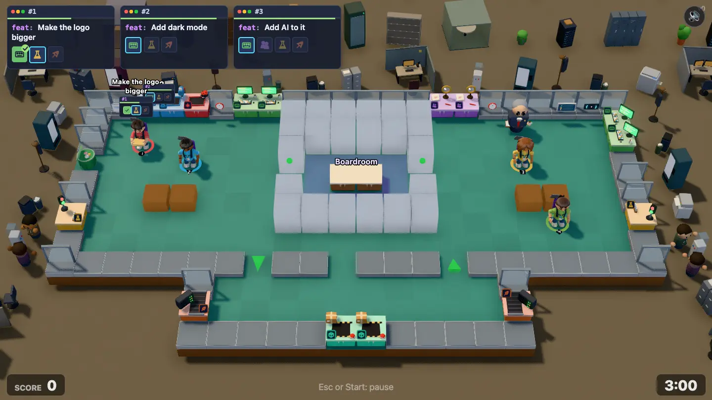
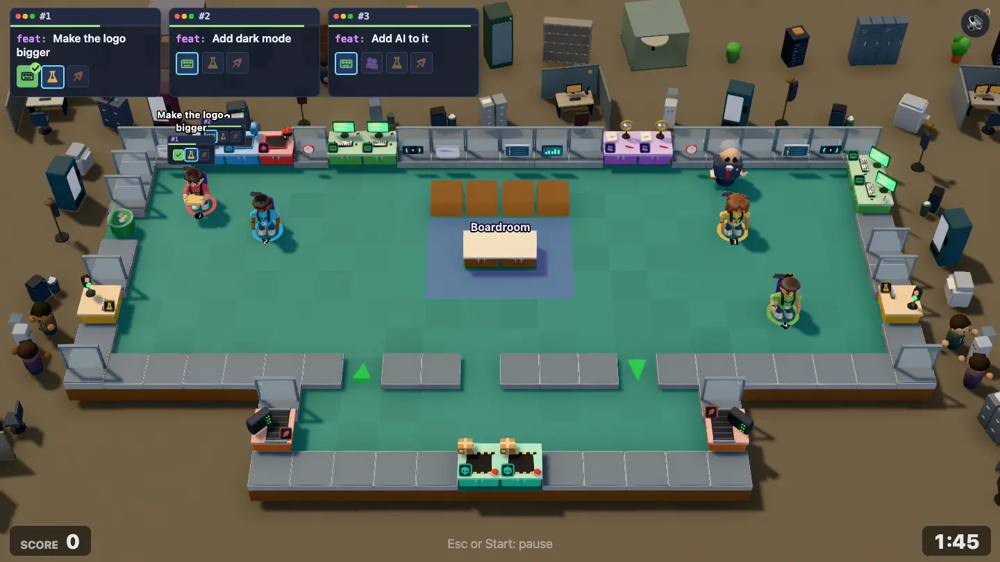
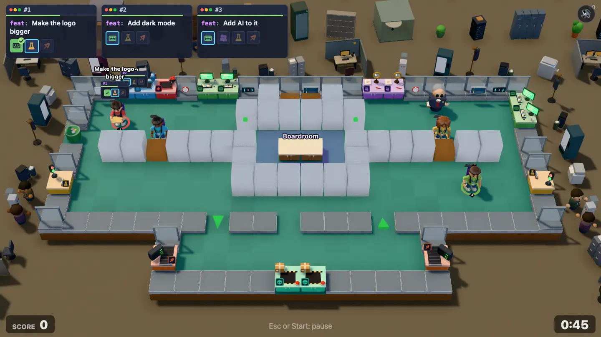

# The Reorg environment pass

**Status:** brief and plumbing; round 1 not started. Level 4-3 (`the-reorg`, "The Reorg"), the Enterprise finale, gets a hand-built world after [Synergy](synergy-environment.md) (4-2). Same floor of YOTTA Tower, the next day; the consultants have taken it over. **The bar:** 4-2 Synergy, plus the user's new Overcooked 2 references for **style and creativity**: a snowy castle kitchen under siege by gingerbread men, a mine over water with rope bridges, two ships with a steak flying between them, the Negi Sushi neon street kitchen. Each of those has one **big idea** in its surroundings that you can tell from a thumbnail. This level needs one too (see "The big idea").

| Before (Silos)                                | Before (Open Plan)                                      | Before (Matrix)                                      |
| --------------------------------------------- | ------------------------------------------------------- | ---------------------------------------------------- |
|  |  |  |

**Goal:** the world around the level tells one story, the way Overcooked 2 levels do. Render-only (`src/render/`); the sim, the maps and balance don't change. Three screenshot scenes join the docs (`src/sim/sceneCatalog.ts`): `levels/the-reorg-open-plan` (phase 2), `levels/the-reorg-matrix` (phase 3) and `mechanics/the-reorg-shifting` (Silos, 1.5 s before the floor turns into Open Plan).

## The story in two sentences

> It's the summer morning after the synergy workshop, on the same boardroom floor of YOTTA Tower, and the consultants have moved in: the floor is a moving day that never ends, with partition walls on castors, floor tape, removal crates and a slide deck that is now 80 pages long, while the brushed-steel YOTTA letters are being unscrewed and a new lowercase `yotta.` (with a full stop) is hoisted up in their place. The floor is reorganised twice before lunch (Silos, then Open Plan, then Matrix), the badge turnstiles to the shipping lobby flip every time, and nobody knows where anything is, except across the river, where MONOLITH's own reorg has gone so badly that its staff stand outside holding their desk boxes.

That is the level: tickets come off the consultant's handover desk (the inbox) at the back, get coded, reviewed and tested on the fixed outer walls, and go through the badge turnstiles into the shipping lobby at the front, where the pipelines stand and the release goes down in the goods lift (the ship). In between, the floor is the consultants' and it keeps moving.

## Where this sits on the road

See [the storyline](../game/storyline.md#4-3-the-reorg-the-reorg). 4-1 Back to Back was YOTTA's glass HQ in a heatwave morning; 4-2 Synergy the boardroom floor on the afternoon MONOLITH came to "align", walnut and the good carpet, the walls folding away. **4-3 is the same floor turned into a building site of corporate change**, the chapter's finale and its biggest map. 5-1 The Atrium is MONOLITH's old campus after YOTTA buys it: so 4-3 must set that up (MONOLITH visibly falling apart across the river, the `yotta.` rebrand going up) without showing the campus, cherry pickers or the purchase.

- **Material:** 4-2's expensive floor, stripped. The boardroom (fixed, in the middle) keeps its walnut table and the good carpet; around it the carpet is pulled up in strips to show **raised-floor access tiles** (grey, with lift-out handles), **ghost lines** where yesterday's walls stood (cleaner, darker carpet), and fresh **floor tape** in the consultants' colours marking the next layout ("SILO A", "SQUAD 3", "TRIBE", "CHAPTER"). The new material is **the consultants' kit**: modular partitions on castors (white frames, frosted panels with a consultancy-teal stripe), roll cages, removal crates (blue plastic, numbered lids), cardboard wardrobe boxes, bubble wrap, a pallet truck.
- **Light:** **summer, all day**. The round's three phases are three times of day: Silos in the morning, Open Plan at noon (the sun high and white), Matrix after lunch (warmer, lower). See "Light". Mean luminance about **105+**, stations the most saturated things on screen.
- **Outside:** the same city as 4-1 and 4-2, from the same height, a day later. MONOLITH's black tower across the river is now the punchline.

**Not food, not a kitchen.** No catering, no lunch, no pizza boxes, even though it's "before lunch". Coffee cups, a coffee machine on a trolley and water bottles are fine.

## The big idea (creativity)

The Overcooked references don't just dress the edge; each has **one thing in the surroundings that tells the whole joke and moves**: the gingerbread men besieging the castle, the rope bridges swaying over the water, a steak in mid-air between two ships, the neon sign over the sushi bar. Here it is **"moving day, forever"**: the whole floor and everything around it is mid-move, and the moving never stops.

- **The partitions move like real ones** (the level's star, see "The moving partitions"): they roll in on castors as a train, they fold away onto trolleys. The removal kit outside echoes them, so the mechanic and the world are the same story.
- **The logo swap is the neon sign of this level:** the old steel `YOTTA` letters half unscrewed (one hanging by a screw, one on the floor in bubble wrap), and the new `yotta.` lit sign being hoisted on ropes, the **full stop** last and largest, carried separately by two removal men like a precious object. It is the brightest, most readable thing outside the room, at the top of the frame, right of the order cards.
- **MONOLITH melting down, visible from here:** across the river its tower has letters missing or dangling from its crown sign, its windows half dark, a crowd of tiny people outside with desk boxes, and a removal van of its own. Reads in one glance as "their reorg went worse".
- **Life everywhere, telling the move:** removal men pushing partition trolleys (action poses: pushing, carrying a panel between two), consultants pacing with laptops and a clicker, a pallet truck, a roll cage rattling, a box of tape rolls. All outside the play area, smaller (0.88) and greyed.
- **Chunky Overcooked shapes:** props a bit oversized and bevelled, few but bold colours (crate blue, tape yellow, consultancy teal, YOTTA violet), clear silhouettes from above. No fussy small clutter that turns into noise.

## Read it from the fixed front camera

The map (`maps/level-12-the-reorg.txt`, 22×12; phases `…phase2.txt`, `…phase3.txt`) is one wide floor on a stem: the work floor (x 1-20, rows 1-7) with the boardroom in its middle, and the shipping lobby (x 6-15, rows 9-10) in front. Top of screen = back.

```text
  ##IIB#KK######RR######   row 0: the back wall; I (2-3,0) inbox, B (4,0) bug queue, K (6-7,0) keyboards, R (14-15,0) review
  #.......======...M...K   rows 1-7: the work floor (x 1-20); M (17,1) the manager; K (21,1-2) keyboards on the right wall
  #.1.....======.......K   phase 1 (Silos): partitions '=' wall the boardroom block (x 8-13, rows 1-6) off from the silos
  X...2...=mmmm=...3...#   X (0,3) the bin
  #.......dmCCmd.......#   the boardroom (meeting tiles x 9-12, rows 3-5; table CC at 10-11,4); meeting doors d (8,4) (13,4)
  #..DD...=mmmm=...DD..#   rolling desks D (3-4,5) and (17-18,5)
  T.......======....4..T   T (0,6) and (21,6) test benches on the side walls
  #....................#   row 7: the front strip of the floor
  #######+##.###+#######   row 8: badge turnstiles + (7,8) and (14,8), the staff door (10,8)
       #..........#        rows 9-10: the shipping lobby (x 6-15)
       P..........P        P (5,10) and (16,10): pipelines on the lobby's side walls
       #####SS#####        S (10-11,11): the ship, in the lobby's front wall
```

Phase 2 (Open Plan): every partition is floor, the four desks roll into one bench behind the boardroom (9-12,2). Phase 3 (Matrix): a partition runs across row 4 (x 2-3, 5-8, 13-16, 18-19) with two desks in it as hatches (4,4) and (17,4), the boardroom closes again with its doors at (8,3) and (13,3), and the last two desks are a hatch above it (10-11,1). Everything must be placed from the map (outline, voids, `reorgTiles`, meeting tiles, marks, ship and inbox tiles), never these numbers, and **work in all three phases and during both shifts**.

- **Back (above row 0): the move's staging area.** Behind the back wall is 4-2's executive reception, now the consultants' staging area: stacked crates, roll cages, partition trolleys, a consultant's laptop on a crate, **the logo swap** (see above). The order cards cover 0-690 × 0-140, so the left half stays low (crates, cages) and the logo, the hoist and anything tall go right of x≈700, clear of the mute button (1370-1440 × 0-60). Back wall faces (row 0, the face the camera sees, between the stations): the consultants' posters ("REORG 3.0: NOW WITH MORE ALIGNMENT"), an org chart printout covered in red pen, **the plan as an 80-page slide deck** (see gags), a "YOU ARE HERE (PROBABLY)" floor plan with three plans taped over each other.
- **The inbox (2-3,0) is the consultant's handover desk:** a desk in the back wall's line with a teal "HANDOVER" sign, binders, a stack of numbered envelopes, a laptop showing a slide; tickets come off it. **The bug queue (4,0)** keeps a "KNOWN BUGS" board; **the review desk (14-15,0)** a "SIGN-OFF" board with a rubber stamp.
- **Left (x < 0) and right (x > 21): the curtain wall and the city.** The side walls carry the bin (0,3), the test benches (0,6) and (21,6) and the right-hand keyboards (21,1-2). Between them, the tower's curtain wall with blinds (half the blinds lowered at odd heights: nobody owns them any more). **Left:** the city below, the river, the street far down with a removal lorry ("SWIFT MOVES – WE MOVE YOU AGAIN") and YOTTA's own lorry unloading more partitions. **Right:** the river and **MONOLITH's tower melting down** (crown letters missing or hanging, a crowd outside with desk boxes, its own removal van, maybe its helicopter leaving). Clear of the mute button and the right-hand stations.
- **The bin (0,3)** is a confidential-shredding console ("CONFIDENTIAL – ORG CHARTS") with a pile of old org charts beside it.
- **Front (rows 8-11): the badge line and the shipping lobby.** Row 8 is the floor's front wall with the **two badge turnstiles** (7,8) (14,8) and the **staff door** (10,8). The lobby (x 6-15, rows 9-10) is play area; its floor is the tower's stone, cleaner than the floor above it (the one place the consultants haven't reached). **The ship (10-11,11) is the goods lift:** brushed-steel doors in the lobby's front wall, cut down low like every front wall, with a "SHIPPED ↓" indicator, a call button and a floor counter. The **pipelines (5,10) (16,10)** stand on the lobby's side walls.
- **The front corners (voids x 0-4 and x 17-21, rows 9-11)** are the biggest open areas in the frame and must not be empty or brown. Make them **setback roofs one storey down**: their surface sits about a storey below the floor, so what stands there reads low and is never taller than 0.6 above the floor's level. Left: partly under the player legend (0-220 × 610-745) and the score (0-135 × 755-810), so put only low, flat things under those rects and keep story props right of x≈230. Right: clear of the timer (1320-1440 × 755-810). Fill them with the move's overflow: the **partition graveyard** (spare panels lying flat, wrapped in plastic), crates, a dead pot plant, condensers, gravel, a roof hatch, pigeons. Never a person that can read as a player.
- **Inside.**
  - **The boardroom (meeting tiles x 9-12, rows 3-5)** is 4-2's boardroom with its walls gone to the consultants: the good carpet with its violet border, the walnut table (CC), a few leather chairs where they can't hide anything, a "BOARDROOM – DO NOT MOVE" sign taped on the table (the one thing that never moves). It stays calm and readable under the meeting overlay in every phase.
  - **The work floor** around it: stripped carpet with the raised-floor tiles showing, ghost lines of yesterday's walls, and **floor tape**: the next phase's partition lines marked in yellow tape on the floor (static, not the telegraph; the telegraph stays the stripes), zone names stencilled on the tape, X marks where desks will stop. Placed wear: castor tracks from the partition trolleys, a dropped lanyard, sticky notes, a coil of cable. **No dark high-contrast decal in the middle** and nothing under a spawn.
  - **The lobby:** stone floor with a mat in front of each turnstile ("BADGE IN"), the goods lift's scuffed threshold, a "MIND THE TURNSTILE" A-board only if it fits off the play tiles (else on a wall face).
  - **Lights:** slim linear pendants on a wire strung wall to wall along the back half of the floor (never near the front wall, never over the boardroom); the lobby lit by wall brackets.

## The moving partitions (the level's star)

Today the partitions are grey boxes (`Mechanics`' stand-in, now the stub in `reorg/partitions.ts`) and the desks brown boxes, popping in and out. In 4-2 the folding walls became a real operable wall; here the moving kit must look and move like **the consultants' mobile partitions and rolling desks**, and differ from 4-2's walnut walls (cheap, bright, modular, on wheels).

**What it is.**

- **Partition panels:** one panel per tile edge along each run, as tall as the room's partitions (`WALL_HEIGHT`), white powder-coated aluminium frame, a frosted acrylic or fabric infill with a consultancy-teal stripe at eye height, **castor feet** (two splayed feet per panel with visible wheels), a fine gap between neighbours with a clip. The panels' faces carry the current phase's org vinyl or paper signs ("SILO: DEV", "SILO: OPS", "TRIBE", "SQUAD", "CHAPTER", "GUILD"), a few sticky notes. Thin out repeats along runs (Overcooked glyph rule: no "A A A A" feet).
- **Rolling desks (`D`):** a bench desk on a steel frame with castors, a laminate top **darker than every station top**, a monitor arm with a monitor, a "HOT DESK" tag, a cable tail. A ticket on a desk moves with it (the sim places it at the switch tick).
- **Meeting doors (`d`):** a framed glass door in the partition line with a light over it (green free, amber invited, red in session) that stays as readable as today's lamp, and the room's name on the door.
- **Badge turnstiles (`+`) and the staff door:** real **speed gates**: two waist-high steel cabinets with glass flaps, a badge reader on the way-in side, and on top of each cabinet a **green arrow** on the way-in side and a **red cross** on the other (the gameplay telegraph, at least as readable as today's floor arrow). During the 3 s reorg warning the arrows blink and swap, so the flip reads before it happens. The **staff door** (10,8) is a plain door frame with a "STAFF" sign and a door stop, always open, always two-way. Nothing taller than about 0.6 on the front wall's line except the gates' own low cabinets.

**How it moves** (visual-only state in render, driven by the sim's tick: `state.tick`, `state.settings.reorgs`, `reorgWarning`, so a screenshot scene can catch any moment). The sim's warning lasts 3 s.

- **Warning:** the tiles that will change keep the sim's telegraph (stripes or an amber floor wash that blinks faster as the time comes; at least as readable as today's orange plates). Panels that will leave unclip (a small shudder); desks that will roll show a ghost at their target (today's rule) or a tape X.
- **Closing (floor → wall):** in the last ~1 s of the warning, panels roll in along their run as a **train** from the run's nearest end (where the run meets a wall or the boardroom), castors turning, each panel turning flat into place, so **the wall is complete by the tick the tiles turn solid**.
- **Opening (wall → floor):** at the switch, panels tip back and **roll off along their run** to its nearest end and fold flat there (or vanish under a fade into a stack), within ~0.6 s; no whole panel stands on a walkable tile longer than that.
- **Desks:** roll from their old tile to their new one along a short path in the same window (from the pairing in reading order: `applyReorg` and `reorgTiles` know which desk goes where), wheels turning. Keep each roll short or fade the long ones (Open Plan's bench is far from the Silos' desks), so ticket and desk never drift apart.
- **Turnstiles:** the arrows swap at the switch tick; during the warning both sides blink.
- **Quality:** on `low`, everything snaps (no train, no roll); the telegraph stays.

**Rules for the moving kit:** a tile that is solid in the sim reads solid by the time it is; nothing from the kit hides a station, a player's ring or the meeting room's label; it works in both directions any number of times (1 → 2 → 3, and 3 → 1 in tests); deterministic; reuse 4-2's `boardroom/motion.ts` and `track.ts` patterns where they fit, without changing 4-2's look.

## Running gags

| Gag          | Where                                                                                                                                                      | Track         |
| ------------ | ---------------------------------------------------------------------------------------------------------------------------------------------------------- | ------------- |
| YOTTA's logo | behind the back wall, right of the order cards: old steel `YOTTA` half unscrewed, the new lit `yotta.` going up on ropes, the full stop carried separately | World         |
| `yotta.`     | small lowercase `yotta.` vinyl already on the turnstiles' glass and the goods lift                                                                         | Moving, Room  |
| MONOLITH     | its tower across the river (right) falling apart: crown letters missing or dangling, staff outside with desk boxes, its own removal van                    | World         |
| Prod         | on a removal trolley being moved for the third time, three "MOVE" stickers on its pot (1, 2, 3 crossed out), out of play (back staging area or a setback)  | World         |
| Segfault     | asleep in a cardboard box marked "MATRIX" (breathing), on a wall top or in the back staging area, findable, not under the HUD                              | Room or World |
| The plan     | the consultants' slide deck, 80 pages: a printed deck on a lectern or a projected slide "THE PLAN v3 (p. 1 of 80)" on a back-wall face                     | Room          |
| Derek        | the manager (`M`) is a player-visible sim character; outside, his "Employee of the Quarter" nothing yet. Skip, or his lanyard on a crate labelled "DEREK"  | Room          |
| Mom          | not in this level (storyline: —); a small "MOM'S CHAIR – DO NOT MOVE" tag on a boardroom chair is a bonus                                                  | Room          |

All cameos out of the play area, out from under the HUD, small enough to find and never readable as a player.

## Detail budget

The user's note from 4-2 stands (less detail and fewer nice additions around recent levels), and 4-3 is the finale: **as dense as 4-2, with more motion**. Minimums for round 1:

- **Back staging area:** at least 12 distinct story props (the logo swap with its hoist and ropes, the full stop being carried, crates, roll cages, partition trolleys, a pallet truck, Prod's trolley, a consultant's laptop on a crate, a coffee machine on a trolley, bubble-wrap rolls, a stepladder, a "MOVE 3 OF 3" sign).
- **Each side outside:** at least 3 layers of depth (curtain wall and blinds, the near city, the far city / river / MONOLITH) and at least 4 story props or living things each.
- **Front setback roofs:** both filled (partition graveyard, crates, condensers, gravel, pigeons), low.
- **Wall tops:** every run of 3+ wall tiles has a cluster (tape rolls, a label maker, crates, a desk lamp in bubble wrap, org-chart printouts, a laptop, cable spools, a "WHERE IS MY DESK?" sign); at least 20 distinct wall-top props, no two neighbours alike.
- **Wall faces the camera sees:** every face on row 0 and the lobby's side walls is dressed; at least 10 distinct face pieces.
- **Life:** at least 8 living things (removal men pushing, consultants pacing, the hoisted `yotta.` swinging a little, the full stop carried, MONOLITH's crowd, a helicopter, the city's tiny cars, pigeons, blinds in the AC, Segfault breathing), all skipped on `low` and a tile from the play area.
- **Floor:** placed wear and tape on every zone, not just tone noise.

## Light

**Summer, all day,** told through the three phases (the Light track's stretch goal, if it can be done cheaply and deterministically from `state`):

| Phase        | Time of day | Sun                                                    |
| ------------ | ----------- | ------------------------------------------------------ |
| 1: Silos     | morning     | about 40° from the front-left, warm-white, cool fill   |
| 2: Open Plan | noon        | high (about 60°), white, short shadows, bright         |
| 3: Matrix    | after lunch | about 40° from the front-right, warmer, longer shadows |

The change runs over the 3 s warning plus the switch, from the sim's tick (no wall time), so a screenshot of each phase is stable. If that isn't cheap, one static late-morning light (about 48°, front-left) is fine. Either way: mean luminance about **105+** on every phase shot (measure it), stations the most saturated things, the shaded fronts of yellow stations not olive, the boardroom's good carpet calm under the meeting overlay, vignette about 0.35 with inner 0.7, point lights without shadows and hidden on `low`.

## The six Overcooked lessons, for this level

| Lesson                                 | Here                                                                                                                                |
| -------------------------------------- | ----------------------------------------------------------------------------------------------------------------------------------- |
| The frame is full, at several heights  | The staging area and the hoisted `yotta.` at the back, the city and MONOLITH on both sides, the setback roofs in the front corners  |
| The room's edge is made of the setting | The curtain wall, the consultants' partitions on castors, the badge line with its speed gates, the goods lift                       |
| Surfaces carry material and wear       | Stripped carpet and raised-floor tiles, ghost lines, floor tape, castor tracks, the good carpet in the boardroom, the lobby's stone |
| One place, one story                   | One floor on moving day. No 4-2 MONOLITH suits or folding walnut walls; no 5-1 campus, cherry pickers or purchase                   |
| Light does the composition             | The day passes with the phases; the lit `yotta.` is the brightest thing outside the room; the lobby a touch cooler and cleaner      |
| The outside connects to the play       | Work comes off the handover desk, ships down the goods lift past the turnstiles; the removal kit outside is the partitions' own kit |

## Rules

The rules in the [level-environment skill](../../.agents/skills/level-environment/SKILL.md) hold, plus:

- **Three layouts.** Every static piece must work in all three phases (the room is drawn from `withoutReorgTiles`, so partition and desk tiles are floor to `MapView`). Check every shot in all three phases plus `mechanics/the-reorg-shifting`.
- **A manager walks this level** (`M`), and four players. Scene people must never read as players or the manager: smaller (0.88), greyed, an action pose, a tile from the room.
- **The meeting room is play.** Nothing tall in front of it hides its label or table; the meeting overlay stays readable on the good carpet; the door lights read.
- **The turnstiles are gameplay.** Their direction must read at a glance in every phase and during the flip; the staff door must read as open both ways.
- **Same building as 4-1 and 4-2.** New files for this floor (`rooms/reorg.ts`, `rooms/reorgRoom.ts`, `roomModels/reorg.ts`, `setDressing/reorgWallTops.ts`, `scenes/theReorg.ts`, `setDressing/theReorg.ts`, `reorg/`); importing 4-1's tower and 4-2's boardroom pieces is welcome, changing their defaults is not. 4-1 and 4-2 must look exactly as before.
- **Value hierarchy:** the consultants' white partitions and the bright tape are the danger here: partition panels mid-grey-white at most and matte, tape desaturated, counter and desk tops darker than every station top, wall caps cool and quiet.
- Other levels keep their look: the new wall theme `reorg` and floor theme `reorgFloors` are used only by `the-reorg`.

## Work split (round 1)

Four agents in one worktree at once, with strict file ownership. The shared plumbing is done first: the `reorg` and `reorgFloors` themes, `LEVEL_LOOKS['the-reorg']`, the stub scene and dressing, a `gates` hook in `rooms/types.ts` and `Mechanics.ts` (like 4-2's `movingTiles`), stubs for the partitions and gates, and the three screenshot scenes.

| Track      | Owns                                                                                                                                                                                                               |
| ---------- | ------------------------------------------------------------------------------------------------------------------------------------------------------------------------------------------------------------------ |
| **Moving** | `reorg/` (partitions, rolling desks, meeting doors, turnstiles, staff door; +tests)                                                                                                                                |
| **Room**   | `rooms/reorg.ts` (except its `movingTiles` and `gates` lines), `rooms/reorgRoom.ts` (+tests), `roomModels/reorg.ts`, `setDressing/reorgWallTops.ts`, the `reorg`/`reorgFloors` rows in `look.ts` and `mapShape.ts` |
| **World**  | `scenes/theReorg.ts` (+test), `setDressing/theReorg.ts`                                                                                                                                                            |
| **Light**  | `atmosphere.ts` (+test), `stage.ts`, `WorldFx.ts`, `createLights` in `look.ts`                                                                                                                                     |

## Done when

- [ ] The shot reads as "YOTTA's floor on moving day, the consultants in charge" without explanation, in all three phases, and nothing in it reads as food or a kitchen.
- [ ] The storyline beat reads with no explanation: the partitions on castors, the floor tape, the logo going lowercase, MONOLITH falling apart across the river.
- [ ] The partitions and desks look like the consultants' mobile kit and move like it: the train closing, the roll-off opening, desks rolling, telegraphed and readable, solid on time; meeting doors and turnstiles look real and their state reads at a glance.
- [ ] The outside connects to the play: the handover desk (inbox), the badge line and the goods lift (ship).
- [ ] The running gags are in place: the logo swap, `yotta.`, MONOLITH, Prod on a trolley, Segfault in the MATRIX box, the 80-page plan.
- [ ] The detail budget is met and the critic scores density.
- [ ] Mean luminance about 105+ on every phase shot; stations the most saturated things on screen.
- [ ] Other levels unchanged (4-1, 4-2 and one more checked).
- [ ] `npm run check` passes.
